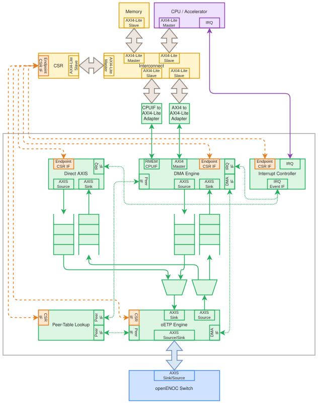

.. SPDX-FileCopyrightText: 2026 Enio Kaljic
.. SPDX-License-Identifier: CC-BY-SA-4.0

.. _rtl-endpoint-interface:

Endpoint interface -- openenoc_endpoint_interface
=================================================

.. index::
   single: openenoc_endpoint_interface

Integrates endpoint transport, memory access, direct software streams, peer
lookup, and interrupts.

**Source:**
:download:`openenoc_endpoint_interface.sv <../../../hw/rtl/core/openenoc_endpoint_interface.sv>`.

Parameters
----------

.. list-table:: Parameters
   :class: rtl-reference-table
   :header-rows: 1
   :widths: 24 18 30 28

   * - Name
     - Default value
     - Allowed values
     - Description
   * - ``FIFO_DEPTH``
     - ``16384``
     - Bytes >= MAX_RAW_FRAME_SIZE
     - Capacity of each direct/DMA transport FIFO; supports one maximum raw frame.
   * - ``FIFO_RAM_PIPELINE``
     - ``1``
     - Integer >= 0
     - RAM pipeline stages in the transport FIFO adapters.
   * - ``IRQ_FIFO_DEPTH``
     - ``16``
     - Integer >= 1
     - Number of interrupt claims; power-of-two depth is not required.
   * - ``MAX_RAW_FRAME_SIZE``
     - ``8192``
     - 36..8192 bytes
     - Synthesized frame ceiling excluding FCS; reserves 32 bytes for the largest
       peer-frame overhead.
   * - ``FRAGMENT_SLOTS``
     - ``16``
     - Integer >= 1
     - Number of local fragment bookkeeping contexts; not wire credits.

Signals
-------

Interface ports contain channels in both directions. The table identifies
the selected modport or stream role; member directions follow that interface.

.. list-table:: Public signals and interfaces
   :class: rtl-reference-table
   :header-rows: 1
   :widths: 20 32 17 31

   * - Name
     - Type
     - Direction / role
     - Description
   * - ``clk``
     - ``logic``
     - input
     - Clock for this component or interface domain.
   * - ``rst``
     - ``logic``
     - input
     - Active-high reset of transaction and control state.
   * - ``endpoint_if``
     - ``openenoc_endpoint_if.core``
     - bidirectional (core)
     - Endpoint configuration, commands, status, and external scalar-memory access.
   * - ``eth_if``
     - ``openenoc_eth_if``
     - bidirectional; endpoint is side A
     - Ethernet frame transport; this endpoint is side A.
   * - ``m_axi_wr``
     - ``taxi_axi_if.wr_mst``
     - bidirectional (wr_mst)
     - Outgoing AXI4 memory write address/data/response channels.
   * - ``m_axi_rd``
     - ``taxi_axi_if.rd_mst``
     - bidirectional (rd_mst)
     - Outgoing AXI4 memory read address/response channels.
   * - ``m_rmem_cpuif``
     - ``openenoc_cpuif_if.mst``
     - bidirectional (mst)
     - Local scalar-memory master supplied by the DMA engine.
   * - ``irq``
     - ``logic``
     - output
     - Level interrupt notification to software.

Architecture and operation
--------------------------

   Internal structure of the openENOC Endpoint Interface

This single-clock integration module connects the generated ``endpoint_if``
to the bidirectional ``eth_if``, AXI memory masters ``m_axi_wr/m_axi_rd``,
local-memory CPUIF master ``m_rmem_cpuif``, and ``irq``. Each submodule owns
its corresponding hardware-driven CSR fields.

The CSR block and AXI4-Lite adapters above the outlined endpoint are external
integration context. This module connects to the generated CSR interface and
the native local-memory CPUIF; it has no AXI4-Lite slave port.
``endpoint_if.csr_to_core`` carries configuration and software commands,
while ``endpoint_if.core_to_csr`` carries hardware status and command clears.

The :ref:`rtl-dma-engine` owns memory access and transfer contexts;
:ref:`rtl-oetp-engine` owns Ethernet protocol processing;
:ref:`rtl-endpoint-direct-axis` bridges the direct CSR stream; and
:ref:`rtl-endpoint-peer-lookup` supplies both engines with peer snapshots.
The :ref:`rtl-endpoint-irq-controller` collects the resulting notifications.

Two peer lookup clients serve DMA and oETP. Two transfer interfaces distinguish
initiator and responder commands. TX/RX FIFOs, stream adapters, a TX mux, and
an RX demux connect DMA and direct traffic to oETP. Internal FIFOs use streaming
operation without frame-drop policies. Endpoint route/sequence/role metadata
is kept inside the endpoint and cleared at the Ethernet boundary.

Seven IRQ producer ports carry three DMA events, two direct-stream events,
initiating RMEM errors, and received-request errors. The last port shares the
bulk/RMEM source encodings; port count and logical event count are distinct.
``rst`` clears the submodules and FIFOs in this clock domain.

The TX mux uses round-robin arbitration at frame boundaries. DMA peer commands
are sequential; protocol TX gives ready responses priority and RMEM initiation
precedes the next bulk fragment. DMA owns memory operations and bulk/RMEM
error status and notifications. Direct-stream notifications
belong to the direct CSR stream block, while IRQ claim/status fields belong
to the IRQ controller. The initiating RMEM error producer captures its source
enable before any delayed IRQ admission.

``FIFO_DEPTH`` specifies bytes for each transport FIFO, and
``FIFO_RAM_PIPELINE`` sets its RAM pipeline stages. These FIFOs use
``FRAME_FIFO = 0``, ``DROP_BAD_FRAME = 0``, ``DROP_WHEN_FULL = 0``,
``DROP_OVERSIZE_FRAME = 0``, and ``MARK_WHEN_FULL = 0``. They propagate
backpressure and permit streaming before a complete frame is buffered.
All AXI and AXI-Stream data paths are fixed at 32 bits, including the direct
CSR streams, DMA streams, and Ethernet streams. Internal
``TUSER[0]`` denotes the final fragment and ``TUSER[1]`` distinguishes initiator
and responder payloads, as specified in :ref:`rtl-dma-transfer-if`.

The AXI read and write ports and ``eth_if`` must use 32-bit data widths;
elaboration checks reject other widths. AXI and local RMEM CPUIF byte addresses
are fixed at 32 bits, with elaboration checks on the connected interfaces.
The local RMEM CPUIF transfers 32-bit words.

Functional scenarios
--------------------

The examples assume valid peer windows and enabled operation classes.
``A0/A1`` denote addresses, ``D0/D1`` scalar data, ``M0`` a
per-bit write mask, ``I0`` a peer index, and ``S0/S1`` local
fragment sequences. Labels are local to each diagram.

CSR trace labels use register field paths relative to ``endpoint_if``,
with the generated ``.value`` and ``.next`` wrappers omitted.
``.hwclr`` denotes the hardware acknowledgement of a software command.
For ``rmem``, the CSR side drives ``csr_to_core.rmem`` and the
core returns ``core_to_csr.rmem``.

``clk`` is the common endpoint clock. Numbered intervals end at the
rising edge that samples their values. Diagrams containing ``|`` omit
variable lookup, memory, FIFO, or network waiting time and show transaction
ordering without absolute cycle numbers. Their duration depends on the
connected logic and the remote peer.

Direct CSR frame transmit and receive
~~~~~~~~~~~~~~~~~~~~~~~~~~~~~~~~~~~~~

Software supplies a 64-byte frame through ``axis_if.source`` and reads
a simultaneously received 65-byte frame through ``axis_if.sink``.
The direct path uses the TX/RX FIFOs and the shared oETP connection;
its payload bytes are preserved. In this example, no raw RX DMA descriptor
is armed, and the receive-mode filter accepts the incoming frame.

The Ethernet view uses ``DATA_W = 32`` and ``KEEP_W = 4``.
This endpoint is side A: ``DA0`` through ``DA15`` travel toward
the switch, while ``DB0`` through ``DB16`` arrive from it.
Frame lengths exclude preamble, SFD, and FCS.

The TX FIFO already contains the frame at the start of the example, and
``DA0`` waits for downstream readiness. TX stalls in cycles 5 and 6,
retaining ``DA3``, full KEEP, and ``tlast = 0``. The internal raw-frame
forwarding sequence also introduces TX idle intervals and applies RX
backpressure while classifying and forwarding the incoming frame.
The incoming source holds each stalled beat and keeps VALID asserted.

The gap omits TX transfers ``DA6`` through ``DA12`` and RX transfers
``DB6`` through ``DB12``. TX finishes on ``DA15`` with full KEEP and
TLAST. RX finishes on ``DB16`` with ``tkeep = 0x1`` and ``tlast = 1``.
All earlier RX beats and all TX beats use ``tkeep = 0xF``.
Endpoint routing metadata stays inside the module.

A direct RX notification is generated when the first received word becomes
visible to software, so it may precede the rest of the frame. Direct TX
completion is measured at the final handoff to the oETP input, after the
FIFO/mux pipeline; it does not acknowledge receipt at the remote endpoint.
The CSR word handshakes are described in :ref:`rtl-endpoint-direct-axis`.

.. wavedrom::
    :name: endpoint-interface-direct-timing
    :caption: Direct 64-byte transmit and 65-byte receive at the endpoint Ethernet boundary
    :alt: Direct TX stalls while RX completes its frame with a partial final beat.
    :align: center

    {
        "signal": [
            {"name": "clk", "wave": "p.........|..........."},
            ["eth_if",
                ["a2b_axis_if",
                    ["A",
                        {"name": "tvalid", "wave": "1...01....|.01010....."},
                        {
                            "name": "tdata",
                            "wave": "=.==x=..==|=x=x=x.....",
                            "data": ["DA0", "DA1", "DA2", "DA3", "DA4", "DA5", "DA13", "DA14", "DA15"]
                        },
                        {
                            "name": "tkeep",
                            "wave": "=...x=....|.x=x=x.....",
                            "data": ["0xF", "0xF", "0xF", "0xF"]
                        },
                        {"name": "tlast", "wave": "0...x0....|.x0x1x....."}
                    ],
                    ["B", {"name": "tready", "wave": "01...0.1..|..........."}]
                ],
                ["b2a_axis_if",
                    ["B",
                        {"name": "tvalid", "wave": "01........|........0.."},
                        {
                            "name": "tdata",
                            "wave": "x=======..|=.=.=.=.x..",
                            "data": [
                                "DB0",
                                "DB1",
                                "DB2",
                                "DB3",
                                "DB4",
                                "DB5",
                                "DB6",
                                "DB13",
                                "DB14",
                                "DB15",
                                "DB16"
                            ]
                        },
                        {"name": "tkeep", "wave": "x=........|......=.x..", "data": ["0xF", "0x1"]},
                        {"name": "tlast", "wave": "x0........|......1.x.."}
                    ],
                    ["A", {"name": "tready", "wave": "1......0..|.101010101."}]
                ]
            ]
        ],
        "head": {"tick": 0},
        "config": {"hscale": 1}
    }

Raw DMA and sequential peer fragments
~~~~~~~~~~~~~~~~~~~~~~~~~~~~~~~~~~~~~

For raw TX, software provides a local buffer address and frame length in
``non_oetp_dma.tx``, then sets its request field. DMA reads that
buffer through ``m_axi_rd``; the frame passes through the DMA TX FIFO
and shared TX mux. A raw RX descriptor armed in ``non_oetp_dma.rx``
instead directs one eligible received frame through the DMA RX FIFO to
``m_axi_wr``. An accepted raw frame without an armed descriptor uses
the direct CSR sink. Filtering precedes descriptor ownership.

For peer DMA, configure a 65-byte block with a 64-byte fragment limit.
The initiator path below issues two bulk writes to peer ``I0``:
64 bytes at ``A0`` with sequence ``S0``, followed by one byte at
``A1 = A0 + 64`` with sequence ``S1``. The operation is
``DMA_OP_WRITE``, and the kind is ``TRANSFER_KIND_DMA``.

Assume the corresponding local memory work finishes before each protocol
completion. The second command remains unissued until the first fragment
has completed locally and remotely. Only the second command and completion
carry LAST. Completion of the final fragment sets the peer's successful
done state and, when enabled, produces one block-completion notification.
The block keeps its accepted peer configuration and fragment-size snapshot.

Software starts the block through ``peers.entry[I0].dma.request``;
``request.hwclr`` acknowledges its acceptance and ``idle`` falls.
The peer becomes idle and reports ``done`` only after the final fragment's
matching completion.

.. wavedrom::
    :name: endpoint-interface-fragments-timing
    :caption: Sequential peer fragments joined with their matching protocol completions
    :alt: A 65-byte block issues a 64-byte fragment before the final one-byte fragment.
    :align: center

    {
        "signal": [
            {"name": "clk", "wave": "p....|...|...|.|...|......"},
            [
                "endpoint_if",
                ["CSR",
                    {
                        "name": "peers.entry[I0].dma.request",
                        "wave": "10...|...|...|.|...|......"
                    }
                ],
                [
                    "Core",
                    {
                        "name": "peers.entry[I0].dma.request.hwclr",
                        "wave": "010..|...|...|.|...|......"
                    },
                    {"name": "peers.entry[I0].dma.idle", "wave": "10...|...|...|.|...|....1."},
                    {"name": "peers.entry[I0].dma.done", "wave": "0....|...|...|.|...|....1."}
                ]
            ],
            [
                "Internal",
                [
                    "initiator_if",
                    [
                        "Requester",
                        {"name": "req_valid", "wave": "0...1|..0|...|1|..0|......"},
                        {
                            "name": "req_addr",
                            "wave": "x...=|..x|...|=|..x|......",
                            "data": ["A0", "A1"]
                        },
                        {
                            "name": "req_len",
                            "wave": "x...=|..x|...|=|..x|......",
                            "data": ["64", "1"]
                        },
                        {
                            "name": "req_peer_idx",
                            "wave": "x...=|..x|...|=|..x|......",
                            "data": ["I0", "I0"]
                        },
                        {
                            "name": "req_sequence",
                            "wave": "x...=|..x|...|=|..x|......",
                            "data": ["S0", "S1"]
                        },
                        {"name": "req_last", "wave": "x...0|..x|...|1|..x|......"},
                        {"name": "cpl_ready", "wave": "1....|...|...|.|...|......"}
                    ],
                    [
                        "Executor",
                        {"name": "req_ready", "wave": "0....|.10|...|.|.10|......"},
                        {"name": "cpl_valid", "wave": "0....|...|.10|.|...|.10..."},
                        {
                            "name": "cpl_sequence",
                            "wave": "x....|...|.=x|.|...|.=x...",
                            "data": ["S0", "S1"]
                        },
                        {
                            "name": "cpl_transferred_len",
                            "wave": "x....|...|.=x|.|...|.=x...",
                            "data": ["64", "1"]
                        },
                        {"name": "cpl_last", "wave": "x....|...|.0x|.|...|.1x..."},
                        {"name": "cpl_error", "wave": "x....|...|.0x|.|...|.0x..."}
                    ]
                ]
            ]
        ],
        "config": {"hscale": 1}
    }

Locally initiated RMEM read
~~~~~~~~~~~~~~~~~~~~~~~~~~~

A pulse on ``endpoint_if.csr_to_core.rmem.req`` starts a local
scalar access to a configured remote window. The endpoint captures
``rmem.addr = A0`` and ``rmem.req_is_wr = 0`` at the rising edge that
accepts ``rmem.req``. These request fields are needed only during that
request cycle; the following ``x`` regions mark irrelevant values.
Peer lookup translates the captured virtual address ``A0`` to remote
address ``A1``. The endpoint sends
``RMEM_READ_REQ`` with ``A1`` and wire Request ID ``RID0`` through
``eth_if.a2b_axis_if``. The matching ``RMEM_READ_RSP`` arrives through
``eth_if.b2a_axis_if`` with the same Request ID and scalar data ``D0``.
The wait between the request and response includes variable network
transit and remote servicing time.
After accepting and validating the complete response, the endpoint returns
``D0`` with a one-cycle ``rmem.rd_ack`` pulse. This external window uses
ACK-only completion.

Both RMEM examples use ``DATA_W = 32`` and ``KEEP_W = 4``. The endpoint
is side A: ``DA`` words are transmitted and ``DB`` words are received.
Each illustrated frame includes its Ethernet header and the complete oETP
PDU, without external-MAC padding. Lengths exclude preamble, SFD, and FCS.
Every beat is full, with ``tkeep = 0xF``; ``tlast`` marks its final word.

The read request and response are each 24 bytes:

.. list-table:: RMEM read frames
   :class: documentation-table
   :header-rows: 1
   :widths: 10 45 45

   * - Word index
     - Transmitted request
     - Received response
   * - 0..2
     - ``DA0..DA2``: destination/source MAC octets
     - ``DB0..DB2``: destination/source MAC octets
   * - 3
     - ``DA3``: EtherType, Magic, ``RMEM_READ_REQ``
     - ``DB3``: EtherType, Magic, ``RMEM_READ_RSP``
   * - 4
     - ``DA4 = RID0``
     - ``DB4 = RID0``
   * - 5
     - ``DA5 = A1``
     - ``DB5 = D0``

A pending initiating RMEM access is selected before the next unsent bulk
fragment, while an already advertised or active fragment finishes first.

.. wavedrom::
    :name: endpoint-interface-rmem-read-timing
    :caption: Local RMEM read sends an Ethernet request and completes from its response
    :alt: A local read produces RMEM_READ_REQ; RMEM_READ_RSP returns the data acknowledged locally.
    :align: center

    {
        "signal": [
            {"name": "clk", "wave": "p..|........|.......|..."},
            ["endpoint_if",
                ["CSR",
                    {"name": "rmem.req", "wave": "010|........|.......|..."},
                    {"name": "rmem.req_is_wr", "wave": "x0x|........|.......|..."},
                    {"name": "rmem.addr", "wave": "x=x|........|.......|...", "data": ["A0"]}
                ],
                ["Core",
                    {"name": "rmem.rd_ack", "wave": "0..|........|.......|.10"},
                    {"name": "rmem.rd_data", "wave": "x..|........|.......|.=x", "data": ["D0"]}
                ]
            ],
            {},
            ["eth_if",
                ["a2b_axis_if",
                    ["A",
                        {"name": "tvalid", "wave": "0..|.1.....0|.......|..."},
                        {
                            "name": "tdata",
                            "wave": "x..|.======x|.......|...",
                            "data": ["DA0", "DA1", "DA2", "DA3", "DA4", "DA5"]
                        },
                        {"name": "tkeep", "wave": "x..|.=.....x|.......|...", "data": ["0xF"]},
                        {"name": "tlast", "wave": "x..|.0....1x|.......|..."}
                    ],
                    ["B", {"name": "tready", "wave": "1..|........|.......|..."}]
                ],
                ["b2a_axis_if",
                    ["B",
                        {"name": "tvalid", "wave": "0..|........|1.....0|..."},
                        {
                            "name": "tdata",
                            "wave": "x..|........|======x|...",
                            "data": ["DB0", "DB1", "DB2", "DB3", "DB4", "DB5"]
                        },
                        {"name": "tkeep", "wave": "x..|........|=.....x|...", "data": ["0xF"]},
                        {"name": "tlast", "wave": "x..|........|0....1x|..."}
                    ],
                    ["A", {"name": "tready", "wave": "1..|........|......0|1.."}]
                ]
            ],
            {}
        ],
        "config": {"hscale": 1}
    }

Incoming RMEM write through local CPUIF
~~~~~~~~~~~~~~~~~~~~~~~~~~~~~~~~~~~~~~~

The endpoint receives a 32-byte unicast ``RMEM_WRITE_REQ`` through
``eth_if.b2a_axis_if``. After frame validation and peer lookup, it issues
a one-cycle request through ``m_rmem_cpuif`` with the received final local
address ``A0``, write data ``D0``, and mask ``M0``. For example,
``M0 = 0x0000000F`` enables bits 3:0.

A successful local write ACK allows the endpoint to transmit a 20-byte
``RMEM_WRITE_RSP`` through ``eth_if.a2b_axis_if`` with the request's
original ``RID0``. The response is sent after local completion.
Successful zero-mask writes complete without issuing a local CPUIF request.

.. list-table:: RMEM write frames
   :class: documentation-table
   :header-rows: 1
   :widths: 10 45 45

   * - Word index
     - Received request
     - Transmitted response
   * - 0..2
     - ``DB0..DB2``: destination/source MAC octets
     - ``DA0..DA2``: destination/source MAC octets
   * - 3
     - ``DB3``: EtherType, Magic, ``RMEM_WRITE_REQ``
     - ``DA3``: EtherType, Magic, ``RMEM_WRITE_RSP``
   * - 4
     - ``DB4 = RID0``
     - ``DA4 = RID0``
   * - 5
     - ``DB5 = A0``
     - --
   * - 6
     - ``DB6 = M0``
     - --
   * - 7
     - ``DB7 = D0``
     - --

.. wavedrom::
    :name: endpoint-interface-rmem-write-timing
    :caption: Received RMEM write completes locally before the Ethernet response
    :alt: RMEM_WRITE_REQ triggers a local CPUIF write; its successful ACK permits RMEM_WRITE_RSP.
    :align: center

    {
        "signal": [
            {"name": "clk", "wave": "p..........|....|......."},
            ["eth_if",
                ["b2a_axis_if",
                    ["B",
                        {"name": "tvalid", "wave": "01........0|....|......."},
                        {
                            "name": "tdata",
                            "wave": "x=======.=x|....|.......",
                            "data": ["DB0", "DB1", "DB2", "DB3", "DB4", "DB5", "DB6", "DB7"]
                        },
                        {"name": "tkeep", "wave": "x=........x|....|.......", "data": ["0xF"]},
                        {"name": "tlast", "wave": "x0.......1x|....|......."}
                    ],
                    ["A", {"name": "tready", "wave": "1......01..|....|......."}]
                ],
                ["a2b_axis_if",
                    ["A",
                        {"name": "tvalid", "wave": "0..........|....|.1....0"},
                        {
                            "name": "tdata",
                            "wave": "x..........|....|.=====x",
                            "data": ["DA0", "DA1", "DA2", "DA3", "DA4"]
                        },
                        {"name": "tkeep", "wave": "x..........|....|.=....x", "data": ["0xF"]},
                        {"name": "tlast", "wave": "x..........|....|.0...1x"}
                    ],
                    ["B", {"name": "tready", "wave": "1..........|....|......."}]
                ]
            ],
            {},
            ["m_rmem_cpuif",
                ["Master",
                    {"name": "req", "wave": "0..........|.10.|......."},
                    {"name": "req_is_wr", "wave": "x..........|.1.x|......."},
                    {"name": "addr", "wave": "x..........|.=.x|.......", "data": ["A0"]},
                    {"name": "wr_data", "wave": "x..........|.=.x|.......", "data": ["D0"]},
                    {"name": "wr_biten", "wave": "x..........|.=.x|.......", "data": ["M0"]}
                ],
                ["Slave",
                    {"name": "wr_ack", "wave": "0..........|..10|......."},
                    {"name": "wr_err", "wave": "x..........|..0x|......."}
                ]
            ],
            {}
        ],
        "config": {"hscale": 1}
    }

Multicast, failures, and timeout recovery
~~~~~~~~~~~~~~~~~~~~~~~~~~~~~~~~~~~~~~~~~

An accepted multicast write is serviced locally, with response suppression
handled by oETP. Servicing failures still update the receiving peer's error
state and retain an enabled notification. A malformed final trailer may
be detected after memory writes have occurred; those writes are retained.
Local AXI causes 4..7 take precedence over a consequent framing error.

The CSR trace below follows ``peers.entry[I0].dma``. A unicast block
times out with ``TIMEOUT``, returns to idle, and leaves done clear.
The error remains recorded until software requests ``clear_error``.
That command clears the peer error record independently of IRQ completion.
A later request then succeeds and sets done. Starting or successfully
completing another block does not itself clear an older error.

Timeout cancels unsent fragments. A late reply cannot revive the aborted
block; a new operation uses a new wire Request ID. For an initiating RMEM
timeout, the window still acknowledges the access and returns all-ones
read data for a read, while recording the failure and retaining a separate
RMEM notification.

.. wavedrom::
    :name: endpoint-interface-recovery-timing
    :caption: Peer timeout recorded until explicit clear and a later successful restart
    :alt: A timeout records TIMEOUT; explicit clear precedes a successful new block.
    :align: center

    {
        "signal": [
            {"name": "clk", "wave": "p.|..|......|..|..."},
            ["endpoint_if",
                ["CSR",
                    {"name": "peers.entry[I0].dma.request", "wave": "01|.0|.....1|.0|..."},
                    {"name": "peers.entry[I0].dma.clear_error", "wave": "0.|..|...10.|..|..."}
                ],
                ["Core",
                    {"name": "peers.entry[I0].dma.request.hwclr", "wave": "0.|10|......|10|..."},
                    {"name": "peers.entry[I0].dma.clear_error.hwclr", "wave": "0.|..|....10|..|..."},
                    {"name": "peers.entry[I0].dma.idle", "wave": "1.|0.|.1....|0.|.1."},
                    {"name": "peers.entry[I0].dma.done", "wave": "0.|..|......|..|.1."},
                    {"name": "peers.entry[I0].dma.error", "wave": "0.|..|.1..0.|..|..."},
                    {
                        "name": "peers.entry[I0].dma.error_code",
                        "wave": "=.|..|.=..=.|..|...",
                        "data": ["NONE", "TIMEOUT", "NONE"]
                    }
                ]
            ]
        ],
        "config": {"hscale": 1}
    }

Backpressure and full IRQ queues
~~~~~~~~~~~~~~~~~~~~~~~~~~~~~~~~

The FIFO adapters preserve byte order and valid-byte counts across the
32-bit CSR, DMA, and Ethernet streams. A 64-byte raw frame has 16 full beats,
while a 65-byte raw frame has 16 full beats followed by a final beat with
``tkeep = 0x1`` and ``tlast = 1``. Only the final beat may have a partial KEEP mask.
FIFO backpressure preserves each pending beat and its metadata.

The IRQ example starts with ``IRQ_FIFO_DEPTH = 2`` and two queued
direct RX notifications, source ``EVENT_NON_OETP_DIRECT_RX_AVAILABLE``, peer index zero,
with distinct sequences ``Q0`` and ``Q1``. The physical IRQ is initially
masked. A third direct frame is already pending, but its first CSR word
cannot become visible until event capacity is reserved.

Software unmasks IRQ in cycle 1; ``irq`` asserts in cycle 2 without
changing the queued claims. Completing ``Q0`` in cycle 3 allows
the controller to reserve that same capacity for the pending notification.
The first CSR word becomes visible in cycle 5, and the new claim
``Q2`` is queued in cycle 7. Credit remains full while its occupancy
moves from a queued claim to a reservation and back to a queued claim.

Software completes ``Q1`` in cycle 9 and ``Q2`` in cycle 12.
The queue then empties and IRQ deasserts in cycle 13. Overflow stays clear.
Completing these notifications does not consume the received frame; the
first visible CSR word remains pending until software reads it.

Initiating RMEM failures and received-request errors retain their local
completion independently of a full notification queue. The initiating
RMEM source-enable decision is captured when the failure is recorded, so
a delayed IRQ admission cannot reinterpret that decision.

.. wavedrom::
    :name: endpoint-interface-irq-pressure-timing
    :caption: Queued IRQ claims and a reserved direct RX notification under full capacity
    :alt: Completing queued claims admits a pending RX notification without overflow.
    :align: center

    {
        "signal": [
            {"name": "clk", "wave": "p.............."},
            ["endpoint_if",
                ["CSR",
                    {"name": "irq.control.global_enable", "wave": "01............."},
                    {"name": "irq.complete.valid", "wave": "0..10....10.10."},
                    {
                        "name": "irq.complete.seq",
                        "wave": "x..=x....=x.=x.",
                        "data": ["Q0", "Q1", "Q2"]
                    },
                    {
                        "name": "irq.complete.source",
                        "wave": "=..............",
                        "data": ["EVENT_NON_OETP_DIRECT_RX_AVAILABLE"]
                    },
                    {
                        "name": "irq.complete.peer_idx",
                        "wave": "x..=x....=x.=x.",
                        "data": ["0", "0", "0"]
                    }
                ],
                ["Core",
                    {"name": "irq.claim.valid", "wave": "1............0."},
                    {
                        "name": "irq.claim.seq",
                        "wave": "=...=.....=..=.",
                        "data": ["Q0", "Q1", "Q2", "0"]
                    },
                    {
                        "name": "irq.claim.source",
                        "wave": "=............=.",
                        "data": ["EVENT_NON_OETP_DIRECT_RX_AVAILABLE", "EVENT_\nPEER_\nDMA_\nCOMPLETE"]
                    },
                    {"name": "irq.claim.peer_idx", "wave": "=..............", "data": ["0"]},
                    {
                        "name": "irq.status.fifo_level",
                        "wave": "=...=..=..=..=.",
                        "data": ["2", "1", "2", "1", "0"]
                    },
                    {
                        "name": "irq.status.reserved_count",
                        "wave": "=...=..=.......",
                        "data": ["0", "1", "0"]
                    },
                    {"name": "irq.status.credit_full", "wave": "1.........0...."},
                    {"name": "irq.status.overflow", "wave": "0.............."},
                    {"name": "axis_if.sink.status.tvalid", "wave": "0....1........."}
                ]
            ],
            {"name": "irq", "wave": "0.1..........0."}
        ],
        "head": {"tick": 0},
        "config": {"hscale": 1}
    }

.. _verification-openenoc-endpoint-interface:

Verification
------------

The test suite is in ``dv/core/openenoc_endpoint_interface/``.

Testbench
~~~~~~~~~

This cocotb suite verifies the integrated endpoint interface without a CPU or generated CSR
register block. It exercises the actual DMA and oETP engines, peer lookup, IRQ controller,
and stream FIFOs together. External fixtures provide a cocotb AXI RAM model, Ethernet stream
models, an acknowledged local CPUIF service, and memory-error injection. All cases use fixed
32-bit AXI and Ethernet data paths. The fixture has two peers, 128-byte transport
FIFOs, two IRQ credits, four fragment slots, and a 64-byte raw-frame ceiling.

Twelve cases exercise direct/raw streams, both bulk DMA modes, sequential multi-fragment
transfers, incoming request servicing, multicast, RMEM initiation and execution, local/remote
errors, timeout abort, and retained IRQ notifications with a full queue.

Coverage
~~~~~~~~

The suite covers:

- direct RX availability before frame completion and direct TX completion after the transport
  FIFO;

- Ethernet/CSR backpressure and complete IRQ admission/commit accounting;

- direct TX readiness following downstream capacity through CSR acknowledgements and frame
  boundaries, IRQ-qualified readiness, and enabled/disabled TX-event admission with a full queue;

- IRQ-qualified TX readiness closed by TLAST and reopened only by a new admission,
  independently of IRQ queue completion or newly available credit;

- raw DMA TX/RX, descriptor claims, and receive MAC filtering;

- sequential fragmented reads/writes, little-endian metadata, rounded MFS, and partial tails;

- fragment timeout, unsent-fragment cancellation, late responses, software restart, and remote
  errors;

- incoming memory requests, range checks, multicast writes, response suppression, and local
  events;

- bad EndOfData after memory TLAST, terminal-status joins, partial writes, and absence of
  rollback;

- initiating RMEM translation, BitEnable, failed-read ACK/data, timeout, and independent error
  notification;

- received RMEM access, delayed ACK, local errors, and zero-BitEnable writes;

- RMEM priority between bulk fragments and original AXI-cause preservation;

- full IRQ queue, independent CPUIF/ERROR_RSP completion, per-peer notification
  retention/coalescing, and enable changes;

- a new one-cycle CPUIF request on the preceding ACK cycle and recovery after failures.
