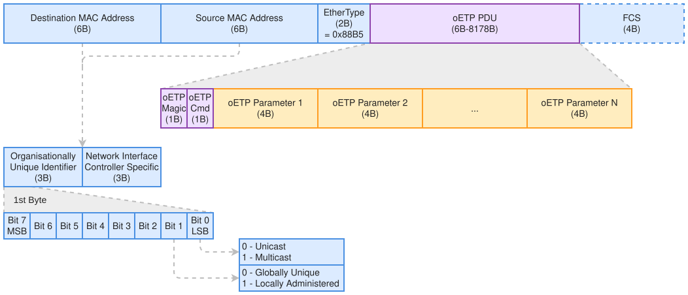

.. SPDX-FileCopyrightText: 2026 Enio Kaljic
.. SPDX-License-Identifier: CC-BY-SA-4.0

.. _rtl-oetp-engine:

oETP Engine -- openenoc_endpoint_oetp_engine
============================================

.. index::
   single: openenoc_endpoint_oetp_engine

Parses and assembles Ethernet transport transactions, matches responses, and
supervises remote-operation completion.

**Source:** :download:`openenoc_endpoint_oetp_engine.sv <../../../hw/rtl/core/openenoc_endpoint_oetp_engine.sv>`.

Parameters
----------

.. list-table:: Parameters
   :class: rtl-reference-table
   :header-rows: 1
   :widths: 24 18 20 38

   * - Name
     - Default value
     - Allowed values
     - Description
   * - ``MAX_RAW_FRAME_SIZE``
     - ``8192``
     - 36..8192 bytes
     - Synthesized frame ceiling excluding FCS; reserves 32 bytes for the largest
       peer-frame overhead.

The 36-byte lower bound leaves room for the 32-byte DMA_WRITE_REQ overhead
and at least one four-byte Data parameter. The overhead consists of the
14-byte Ethernet header, one-byte Magic, one-byte Cmd, three four-byte
parameters (Request ID, Address, and Length), and four-byte EndOfData.
At ``MAX_RAW_FRAME_SIZE = 36``, the synthesized DMA fragment ceiling is
four bytes; values from 32 through 35 would leave a zero-byte fragment
ceiling after rounding down to whole Data parameters. Individual commands
can still produce shorter logical frames.

.. note::

   For a connection through an external Ethernet MAC, configure
   ``MAX_RAW_FRAME_SIZE`` to at least 60 bytes. The MAC pads short frames
   to 64 bytes including the four-byte FCS, leaving 60 bytes visible to
   the engine on receive. The RX frame-ceiling check includes Ethernet
   padding, so a ceiling from 36 through 59 rejects these padded frames.
   Those settings support unpadded on-chip traffic only.

Signals
-------

Interface ports contain channels in both directions. The table identifies
the selected modport or stream role; member directions follow that interface.

.. list-table:: Public signals and interfaces
   :class: rtl-reference-table
   :header-rows: 1
   :widths: 20 32 17 31

   * - Name
     - Type
     - Direction / role
     - Description
   * - ``clk``
     - ``logic``
     - input
     - Clock for this component or interface domain.
   * - ``rst``
     - ``logic``
     - input
     - Active-high reset of transaction and control state.
   * - ``endpoint_if``
     - ``openenoc_endpoint_if.core``
     - bidirectional (core)
     - MAC addresses, raw receive policy, peer MAC configuration, and response timeouts.
   * - ``s_axis_local``
     - ``taxi_axis_if.snk``
     - sink
     - Raw/direct frames or memory payloads from the local paths.
   * - ``m_axis_local``
     - ``taxi_axis_if.src``
     - source
     - Received raw/direct frames or memory payloads to the local paths.
   * - ``s_axis_eth``
     - ``taxi_axis_if.snk``
     - sink
     - Received Ethernet frames, excluding preamble and FCS.
   * - ``m_axis_eth``
     - ``taxi_axis_if.src``
     - source
     - Transmitted Ethernet frames, excluding preamble and FCS.
   * - ``peer_lookup_if``
     - ``openenoc_peer_lookup_if.mst``
     - bidirectional (mst)
     - Peer-table query client and coherent response snapshot.
   * - ``initiator_if``
     - | ``openenoc_dma_transfer_if.``
       | ``executor``
     - bidirectional (executor)
     - Commands and status for locally initiated remote transactions.
   * - ``responder_if``
     - | ``openenoc_dma_transfer_if.``
       | ``requester``
     - bidirectional (requester)
     - Commands and status for servicing received remote transactions.

Architecture and operation
--------------------------

RTL boundary
~~~~~~~~~~~~

The block uses ``clk/rst`` and the generated ``endpoint_if`` configuration.
``s_axis_local/m_axis_local`` connect the shared local stream paths, while
``s_axis_eth/m_axis_eth`` connect Ethernet transport. ``peer_lookup_if`` is
the shared peer-table client. ``initiator_if`` executes locally initiated
commands and ``responder_if`` requests memory servicing for received commands;
both use :ref:`rtl-dma-transfer-if`. There is no memory-master or CPUIF port.
Memory access, scalar RMEM execution, CSR error ownership, and IRQ producers
belong to :ref:`rtl-dma-engine`.

Implementation status and scope
~~~~~~~~~~~~~~~~~~~~~~~~~~~~~~~

The ``openenoc_endpoint_oetp_engine`` block owns Ethernet/oETP parsing and
assembly, Request ID allocation and response matching, multicast response
suppression, and response timeouts. It exchanges commands, data, and completions
with the DMA engine, which owns all memory access. The RTL implements all nine
commands, source/Request ID matching, both response timers, streaming bulk data,
EndOfData verification, multicast writes, and configured raw-frame routing.
Scalar RMEM initiation and execution are implemented in the DMA engine.

This reference specifies frame encoding, command layouts, size limits,
sequencing, and the engine's internal interface contract. System Architecture
provides the communication-model overview; the implementation rules are
defined here and in :ref:`rtl-dma-engine`.
Confirmed decisions are Magic = ``0x0E``, an 8192-byte Ethernet frame limit
excluding FCS, the name Request ID, and BitEnable for RMEM writes only.
Multicast RMEM and DMA writes are also supported without request responses.
Version 1 uses sequential request-response transactions without protocol
credits or automatic retransmission. Multicast delivery is best effort.
All four-byte parameters use little-endian encoding. Request IDs reset only
with the engine/endpoint hard reset and wrap naturally at 32 bits. The single
initiating context prevents overlap between requests with the same ID.
A zero BitEnable is a
successful no-op. RMEM timeout completes with acknowledgement and a CSR error
record; failed reads return all ones. Multicast receivers use a common ``conf.multicast_address``
alongside their individual ``conf.mac_address``.
The command codes and parameter layouts below are assigned, including a
32-bit EndOfData trailer on DMA_WRITE_REQ and DMA_READ_RSP. Wire causes 1..7
and local/remote CSR encoding are assigned. Memory/protocol
ownership and the internal stream contract below are confirmed.
The implemented state machines and verification scope are described below.
VLAN tags, automatic retries, duplicate suppression, and soft reset are outside
this version.

The assigned commands cover transparent 32-bit Remote Memory (RMEM) accesses
and bulk DMA reads and writes, matching the existing endpoint interfaces.

Established encapsulation
~~~~~~~~~~~~~~~~~~~~~~~~~

   oETP PDU encapsulation

Offsets are measured from the first destination MAC octet. The figure
describes an untagged frame; VLAN support would change these offsets and
needs an explicit decision.

.. index::
   single: PDU
   single: Magic
   single: EtherType
   single: FCS

.. list-table:: Frame fields
   :class: documentation-table
   :header-rows: 1
   :widths: 20 30 15 35

   * - Offset
     - Field
     - Size
     - Description
   * - 0
     - Destination MAC
     - 6 bytes
     - Destination endpoint or Ethernet group.
   * - 6
     - Source MAC
     - 6 bytes
     - Sending endpoint.
   * - 12
     - EtherType
     - 2 bytes
     - ``0x88B5``; octets ``88 B5``.
   * - 14
     - Magic
     - 1 byte
     - Protocol discriminator: ``0x0E``.
   * - 15
     - Cmd
     - 1 byte
     - Command selector; assigned values are listed below.
   * - 16 + 4(i - 1)
     - Parameter i
     - 4 bytes
     - Command-specific word, for i = 1 through N.
   * - After the PDU
     - Ethernet padding, if required
     - Variable
     - Outside the logical PDU.
   * - After padding
     - FCS
     - 4 bytes
     - Added/checked by the external MAC; absent on on-chip links.

The first parameter starts at frame offset 16. Parameters have 32-bit alignment
relative to the untagged frame start, although the oETP header is only two bytes.
The PDU begins with Magic ``0x0E``, then Cmd, followed by the command's four-byte
parameters in the order specified below.
AXIS byte-lane placement does not change wire octet order. ``0x88B5`` is a local
experimental EtherType, rather than an exclusive oETP allocation; see
`RFC 9542, Section 3 <https://www.rfc-editor.org/rfc/rfc9542.html#section-3>`_.

Lengths, MTU, and padding
^^^^^^^^^^^^^^^^^^^^^^^^^

.. index::
   single: MTU

The Ethernet frame limit counts from Destination MAC through the last payload
or padding byte. It excludes FCS, preamble, and SFD. The external MAC can
therefore transmit up to 8196 bytes including FCS. The logical PDU has length::

   L_FRAME_MAX = 8192                  # without FCS
   M = L_FRAME_MAX - 14 = 8178         # Ethernet payload budget
   L_PDU = 2 + 4*N
   L_PDU_max(M) = 2 + 4*floor((M - 2)/4)

The PDU envelope is consequently **6..8178 bytes**, or N = 1..2044. This
replaces the original diagram's 8998-byte ceiling. Each command's layout
further constrains its valid lengths. Links carrying maximum frames must
support this configured frame size; a smaller path MTU reduces the limit.
For an Ethernet payload MTU of 1500 bytes, the largest PDU is 1498 bytes.

The 8192-byte limit is an openENOC integration/design limit. The current
endpoint DMA uses that value; TAXI descriptor length widths are parameterized,
rather than universally hard-coded to 8192 bytes.

An external untagged Ethernet MAC pads short payloads to at least 46 bytes,
producing a minimum 64-byte frame including FCS. Padding is not an oETP
parameter; see the `AMD Ethernet MAC padding description
<https://docs.amd.com/r/en-US/pg135-axi-ethernetlite/Pad>`_. On-chip frames can
carry an unpadded PDU; an off-chip receiver may receive Ethernet padding.
The oETP engine emits the logical PDU without Ethernet minimum-frame padding.
The external MAC alone adds that padding when the frame leaves the chip.

Fixed commands determine their logical length from
Cmd. A DMA write request uses its Length parameter; a DMA read reply obtains
the expected data length from the outstanding context selected by Request ID.
Accept either the exact logical length or, for a PDU shorter than 46 bytes,
the frame padded to 46 payload bytes. Reject truncation and other trailing
lengths. Ignore Ethernet padding values on receive; their generation belongs
to the external MAC, not the oETP engine. Four-byte data-parameter padding
remains zero on transmit and is ignored on receive. TLAST
alone cannot identify the end of a short logical PDU received from a MAC.

DMA_WRITE_REQ and DMA_READ_RSP therefore end with the assigned 32-bit
EndOfData value ``0xE0D0E0D0``, serialized as ``D0 E0 D0 E0``. It follows the
rounded-up Data parameter array, before Ethernet padding. Relative to the
PDU start its offset is ``14 + 4*ceil(Length/4)`` for DMA_WRITE_REQ and
``6 + 4*ceil(ExpectedLength/4)`` for DMA_READ_RSP. Add 14 for frame offsets.
These are fixed expected positions, not a delimiter search: arbitrary memory
data may contain this value without ending the transfer. The trailer is never
forwarded over the memory-data AXIS path or written to memory.

Emit EndOfData only after exactly Length bytes and a successful local DMA
read completion. Omit it on failure, even if all data bytes have already been
emitted. Zero-filled Ethernet padding cannot replace any missing nonzero
trailer octet. A missing, incomplete, or incorrect EndOfData fails the
received DMA operation with remote CSR code 10. This is a completion marker,
not a checksum or a guarantee of buffer atomicity. RMEM commands,
DMA_READ_REQ, DMA_WRITE_RSP, and ERROR_RSP have no EndOfData parameter.

The external TX MAC must generate zero-filled padding. The bundled TAXI GMII
transmitter writes zero in its padding state. The external RX MAC uses
store-and-forward with ``RX_DROP_BAD_FRAME`` enabled, so invalid-FCS frames
never enter oETP. A valid Ethernet frame may still carry a deliberately
shortened oETP transfer and must pass the protocol checks above.

MAC addressing
^^^^^^^^^^^^^^

.. index::
   single: MAC address

In conventional bit numbering, bit 0 of the first MAC octet selects individual
or group addressing, and bit 1 selects universal or local administration.
oETP does not mandate a particular MAC address allocation scheme. Documentation
examples use ``02:0E:0C`` and ``03:0E:0C`` as local unicast and local group
prefixes, not claims to an assigned vendor OUI. See `RFC 9542,
Section 2.1.1 <https://www.rfc-editor.org/rfc/rfc9542.html#section-2.1.1>`_.

Read requests use unicast destinations. RMEM_WRITE_REQ and DMA_WRITE_REQ
support both unicast and multicast/group destinations. Reply behavior is
selected by the destination MAC's I/G bit, rather than a new Cmd or Control
field::

   is_group = (DestinationMACOctet0 & 0x01) != 0
   expect_write_reply = not is_group

For a group-addressed write, the initiator does not wait for a reply and the
responder sends neither a success response nor ERROR_RSP. The group bit also
covers the Ethernet broadcast address: response suppression applies to it
too. For an incoming oETP frame, the destination I/G bit selects the configured
address to compare. Individual destinations must equal ``conf.mac_address``;
group destinations must equal ``conf.multicast_address``. There is no implicit
acceptance of other groups or broadcast traffic. A zero multicast address, its
reset value, cannot match a group destination and disables oETP group reception.
Broadcast is accepted only when ``multicast_address`` is configured to all ones.

The master uses an individual/unicast local MAC and configures the group MAC
as its outgoing peer destination. All N slave endpoints configure the same
group MAC in ``conf.multicast_address``, while retaining their own unique
unicast ``conf.mac_address``. Each slave configures the master's unicast
MAC in its own peer table. For bulk replication, the master entry uses mode 3
(mirror local to remote), and the corresponding slave entry uses mode 2
(permit incoming DMA writes). RMEM replication uses mode 1 at both ends.
This realizes one-master-to-N-slave best-effort memory replication.

An Ethernet source address has its group bit clear; see
`IEEE 802.3 address-field definition, Section 3.2.3
<https://www.ieee802.org/3/as/public/0503/3d0_1_CMP.pdf>`_. A configured group
MAC consequently serves as a receive destination, not an outgoing source
address. Outgoing oETP frames use the unicast ``conf.mac_address`` as Source
MAC. Separating the two registers lets a slave also participate in ordinary
unicast operations without reconfiguring its group membership.

The receiver resolves the unicast source MAC to its own peer table for access
policy and address validation; the group destination is not a substitute for
the source-peer lookup. Local peer indices are not transmitted: the endpoints
can assign different indices to each other. Group-addressed read requests
are rejected locally without transmission; receivers discard any such request
without a response. The raw non-oETP receive mode does not define oETP group
membership.

Engine responsibilities and internal transport
~~~~~~~~~~~~~~~~~~~~~~~~~~~~~~~~~~~~~~~~~~~~~~

The DMA engine owns all memory access: the CSR-facing RMEM CPUIF slave, the
local CPUIF master used by received RMEM operations, and local AXI bulk DMA.
It owns initiating address translation, memory-window validation, fragmentation,
local completion, the shared peer error status, and the distinct DMA/RMEM IRQ
producers. A valid zero-BitEnable RMEM write is handled there as a no-op.

The oETP engine owns Ethernet/oETP parsing and assembly, header and data-word
padding handling, receive-side Ethernet padding removal, MAC/source-peer
identification, Request ID allocation and matching,
multicast response suppression, and response timeouts. It has no memory-master
or CPUIF port. Timeout is returned as an error completion; the DMA engine
terminates the local RMEM access or aborts the remainder of the DMA block.

``openenoc_dma_transfer_if`` is instantiated in both initiating and responding
directions. ``req_kind`` / ``cpl_kind`` distinguish bulk DMA (0) from RMEM (1),
independently of the existing READ/WRITE ``req_op`` / ``cpl_op``. RMEM has a
four-byte length and uses ``req_biten`` and ``req_wdata`` for writes and
``cpl_rdata`` for reads, all 32 bits wide. These scalar fields are unused for
bulk DMA. A four-byte bulk operation remains DMA; Length alone cannot select
RMEM. Local peer, sequence, and last metadata remain on the common interface.
Internal metadata does not add wire fields beyond the assigned command layouts.

The companion AXIS carries the following bytes in either direction:

.. list-table:: Internal DMA/oETP data contract
   :class: documentation-table
   :header-rows: 1
   :widths: 25 45 30

   * - Transfer class
     - AXIS contents
     - Address/control information
   * - Non-oETP DMA (``ROUTE_NON_OETP_DMA``)
     - Complete Ethernet frame: Destination MAC, Source MAC, EtherType, payload,
       and any Ethernet padding. No preamble, SFD, or FCS.
     - Raw DMA descriptor controls the memory buffer. Headers are preserved.
   * - oETP bulk DMA (``ROUTE_PEER``)
     - Exactly Length bytes from the memory-side range
       ``[Address, Address + Length - 1]``, in increasing address order.
       No Ethernet/oETP headers, EndOfData, or either form of padding.
     - Address, Length, and operation travel on the command interface and saved
       DMA context; they are not prefixed to the AXIS data.
   * - RMEM
     - No AXIS payload.
     - The single data word and BitEnable travel on command/completion fields.

.. index::
   single: TDEST
   single: TID
   single: TUSER

Internal ``TDEST`` remains ``{route[1:0], peer_idx}``, and ``TID`` carries the
local fragment sequence. ``TUSER[0]`` carries LAST (the final fragment of the
block), while ``TUSER[1]`` identifies the local command context: 0 for initiator,
1 for responder. Both bits remain stable on every beat until accepted TLAST,
including during backpressure. The role resolves equal peer/sequence values
on the independent initiating and responding command paths:

.. list-table:: Bulk AXIS transfer roles
   :class: documentation-table
   :header-rows: 1
   :widths: 18 64 18

   * - Direction
     - Wire operation associated with the memory bytes
     - ``TUSER[1]``
   * - DMA to oETP
     - Locally initiated DMA_WRITE_REQ
     - 0 (initiator)
   * - DMA to oETP
     - DMA_READ_RSP servicing a received DMA_READ_REQ
     - 1 (responder)
   * - oETP to DMA
     - DMA_READ_RSP matching a locally initiated DMA_READ_REQ
     - 0 (initiator)
   * - oETP to DMA
     - Received DMA_WRITE_REQ
     - 1 (responder)

A peer still has one configured DMA mode. Mode 2 permits a locally initiated
read and a received write; mode 3 permits a locally initiated write and a
received read. These complementary operations can share a peer and sequence,
so the role cannot be inferred from those values or from the peer's mode.
Raw non-oETP and direct CSR streams use role 0. RMEM has no AXIS payload.
The role is internal metadata; it adds no CSR field or Ethernet/oETP wire bit.

The agreed streaming contract includes terminal fragment outcomes, separate
from data TVALID/TLAST. A producer's first TVALID does not certify that its entire
AXI read succeeded. The DMA engine must make the final source-read status
available to the oETP engine before EndOfData emission. The responder read's
completion provides that status; an initiating write uses the implemented
``tx_status`` channel on the common transfer interface. Payload remains
streamed while that status is pending.

On RX, a peer write can finish its memory-data AXIS before the subsequent
EndOfData/complete-frame check. Carry that terminal protocol outcome back to
the DMA status owner with the accepted responder peer and local sequence
context. Join it with local memory completion before reporting final success or an error
event. A protocol failure reports CSR code 10 even when the memory write
completed with the expected byte count. The ``rx_status`` channel carries this
late outcome, while ``req_rx_status`` tells DMA to wait for it before completing
the received write. Incoming read-response failure travels on the
initiator completion channel. Do not overload the existing TUSER[0] final-block
flag with a payload error or include EndOfData in the memory stream.

Terminal status uses a ready/valid handshake independently of payload progress;
the producer holds the status and its context stable until accepted. Status
must identify the command path, peer, and sequence and remain available even
when payload TLAST was accepted earlier. A successful transfer waits for both
its required terminal protocol outcome and local memory completion. These
status paths are implemented in :ref:`rtl-dma-transfer-if`.

On failure or timeout, stop scheduling the block's remaining fragments and
finish any started wire frame without EndOfData. Drain the remainder of an
accepted receive frame through TLAST without submitting additional memory
bytes. Already accepted AXI transactions and AXIS activity must finish or be
safely drained before releasing their context. Bytes already written remain
modified; abort does not roll them back. Do not accept a replacement operation
into that context until old payload and status activity can no longer be
mistaken for the replacement. Hard reset clears the endpoint's contexts and
FIFOs as specified below.

For bulk writes, the initiating stream contains the local source bytes while
the command carries the translated remote destination address. The receiver
writes those bytes into its addressed local range. For reads, the responding
stream contains the responder's source bytes and the initiator writes them
using its saved local destination. Address translation never changes the byte
stream or adds an address word to it.

TKEEP marks actual valid bytes, including a partial final beat. TLAST ends one
complete raw frame or one memory fragment. Sequence/TID, route/peer TDEST,
LAST/TUSER[0], and role/TUSER[1] retain their internal meanings. Four-byte PDU
padding is added on transmit and removed on receive by oETP. Ethernet minimum-frame padding is
added only by an external MAC and ignored by the oETP receiver. Neither form
of padding may become bulk DMA memory writes. Non-oETP Ethernet padding remains
part of its raw frame.

Every started AXIS frame or memory fragment is assumed to end with an accepted
TLAST, including a shortened transfer caused by an operation error. A stream
that omits TLAST violates this transport contract; v1 has no separate
missing-TLAST watchdog and does not infer a new frame boundary from subsequent
Ethernet header bytes. If another frame continues the same unterminated stream,
excess length or a missing/incorrect EndOfData at its expected position can
identify the malformed DMA PDU. The receiver then drains through the eventual
TLAST; it cannot reconstruct the lost boundary.

The RTL implements this partition. The DMA engine captures initiating CPUIF
requests, translates the virtual RMEM address once, and executes received
scalar requests through its local CPUIF master. The protocol engine does not
access either memory interface.

Parameter encoding
~~~~~~~~~~~~~~~~~~

.. index::
   single: Little-endian byte order

Every four-byte oETP parameter uses little-endian byte order:
``0x11223344`` is encoded as ``44 33 22 11``. This includes Request ID,
Address, Length, BitEnable, RMEM Data, and Error Code. Ethernet MAC octet order
and EtherType encoding remain unchanged; EtherType is still ``88 B5``.
Addresses and lengths are unsigned 32-bit byte quantities.

Bulk data parameters contain an ordered byte stream: the byte at the lowest
source address is transmitted first, followed by successive source bytes.
The receiver writes them at successive destination addresses without reversing
each four-byte group. B data bytes occupy ceil(B/4) parameters. Unused bytes
in the final parameter are zero on transmit, ignored on receive, and never
written to memory. This word padding differs from Ethernet minimum-frame
padding, which follows the entire PDU.

.. index::
   single: BitEnable
   single: EndOfData

Wire parameters are:

* **Request ID:** a 32-bit identifier allocated by the initiating oETP engine.
  Each RMEM operation or DMA fragment receives an ID; any unicast reply echoes
  it. Group writes retain Request ID in the PDU without creating a remote-reply
  wait. The allocation counter and collision rule are defined below.
* **Address:** the final byte address in the responder's address space. The
  initiator translates once; the responder validates the permitted range
  without adding its local base again.
* **Length:** meaningful bulk bytes, excluding both forms of padding and EndOfData.
* **EndOfData:** the fixed 32-bit successful-completion marker after bulk Data
  in DMA_WRITE_REQ and DMA_READ_RSP only.
* **BitEnable:** a 32-bit RMEM write mask. Bit i enables Data bit i, for
  i = 0 through 31. All 32 mask bits are meaningful and map directly to local
  CPUIF wr_biten. BitEnable is not carried in RMEM reads or bulk DMA commands.
* **Error Code:** a parameter of the dedicated ERROR_RSP command only;
  successful responses have no Status field. Assigned wire causes are 1..7;
  the initiator maps them to remote CSR codes 9..15.

Request ID allocation and hard reset
^^^^^^^^^^^^^^^^^^^^^^^^^^^^^^^^^^^^

.. index::
   single: Request ID
   single: Hard reset

The engine maintains one unsigned 32-bit allocation counter. Allocating any
locally initiated RMEM operation or DMA fragment, including a multicast write,
uses the current counter value and increments it modulo 2^32. A completion,
timeout, transfer abort, or CSR reconfiguration never resets the counter.
Only assertion of the engine/endpoint ``rst`` signal resets it to zero and
invalidates outstanding contexts. Hard reset clears every FIFO in the endpoint
reset domain and removes partial frames and pending events, restoring the
engine's power-on state. Version 1 has no software reset command.

The single initiating context remains occupied until its completion is
accepted. An outstanding request therefore prevents allocating the 2^32
subsequent IDs that would be needed to collide with that live context.
Counter wrap does not require a second outstanding-context mechanism in this
implementation.

An ID can recur after counter wrap or hard reset. The matcher cannot identify
an old external reply once the same ID has been assigned to an otherwise
matching new request. Hard reset drains all FIFOs under its control; it does
not identify old frames subsequently delivered from outside that domain.
Version 1 adds no session/epoch parameter or duplicate-request suppression.

Sequence and Control stay local
^^^^^^^^^^^^^^^^^^^^^^^^^^^^^^^

Sequence and Control are absent from the wire PDU. Request ID selects
an outstanding context containing the peer, operation, address, length, local
DMA Sequence, and local LAST flag. The engine restores Sequence and LAST on
internal AXIS TID/TUSER and DMA completion channels. The current DMA checks
those values, so removing wire fields does not mean dropping local metadata.

For a transfer covering a complete configured peer region, the fragment at
its end can be recognized with widened address arithmetic::

   Address + Length == RegionBase + RegionSize

This requires the correct address space, stable configuration, and matching
transfer/window boundaries. It is not generally the end of a transfer of a
subrange, or when the responder permits a larger window than the initiator
transfers. The initiator already has the authoritative transfer context and
LAST flag; it need not reconstruct them from the responder's configuration.

The responder handles each received DMA request independently and sends one
reply per Request ID for unicast requests; group writes have no reply. It does
not need a wire block-end flag. Internal responder
Sequence/LAST values are assigned or derived locally and kept consistent with
that request's data and completion; they are not returned over Ethernet.
The initiator's sequential scheduler determines completion of the entire block.

Command layouts
~~~~~~~~~~~~~~~

.. index::
   single: RMEM_READ_REQ
   single: RMEM_READ_RSP
   single: RMEM_WRITE_REQ
   single: RMEM_WRITE_RSP
   single: DMA_READ_REQ
   single: DMA_READ_RSP
   single: DMA_WRITE_REQ
   single: DMA_WRITE_RSP
   single: ERROR_RSP

The following command codes are assigned. Parameter lists define order; every
listed parameter occupies four bytes. No additional fixed header is introduced
by these layouts.

.. list-table:: Assigned command codes and parameter layouts
   :class: documentation-table
   :header-rows: 1
   :widths: 24 12 32 32

   * - Command
     - Cmd
     - Parameters, in order
     - Purpose
   * - RMEM_READ_REQ
     - ``0x10``
     - | Request ID
       | Address
     - Read one aligned 32-bit word.
   * - RMEM_READ_RSP
     - ``0x11``
     - | Request ID
       | Data
     - Return the full 32-bit word on success.
   * - RMEM_WRITE_REQ
     - ``0x20``
     - | Request ID
       | Address
       | BitEnable
       | Data
     - Write selected bits of one aligned word; group destinations have no reply.
   * - RMEM_WRITE_RSP
     - ``0x21``
     - Request ID
     - Complete a unicast write after local write acknowledgement.
   * - DMA_READ_REQ
     - ``0x30``
     - | Request ID
       | Address
       | Length
     - Request one remote memory fragment.
   * - DMA_READ_RSP
     - ``0x31``
     - | Request ID
       | Data[ceil(ExpectedLength/4)]
       | EndOfData
     - Return the requested fragment on success.
   * - DMA_WRITE_REQ
     - ``0x40``
     - | Request ID
       | Address
       | Length
       | Data[ceil(Length/4)]
       | EndOfData
     - Write one fragment; group destinations have no reply.
   * - DMA_WRITE_RSP
     - ``0x41``
     - Request ID
     - Acknowledge a unicast fragment after local DMA write completion.
   * - ERROR_RSP
     - ``0xFF``
     - | Request ID
       | Error Code
     - Complete a recognized unicast request with an error instead of success.

For the four memory operation pairs, the high nibble identifies the operation
and the low nibble distinguishes request (0) from successful response (1).
The successful response code is therefore the assigned request code OR
``0x01``. ERROR_RSP = ``0xFF`` is a separate common error response; its
Request ID identifies the failed request and its Error Code identifies the
cause. Error Code values 1..7 use the causes in the local/remote error table
below; local TIMEOUT = 8 is not a wire Error Code.

All other Cmd values are reserved. Decode exact assigned codes before applying
the request/response pairing rule; an arbitrary value with bit 0 set is not
automatically a valid response. Multicast writes still use ``0x20`` or
``0x40`` and generate neither ``0x21``/``0x41`` nor ``0xFF`` responses.

RMEM READ_REQ/READ_RSP/WRITE_REQ/WRITE_RSP PDU lengths are 10, 10, 18, and
6 bytes. ERROR_RSP is 10 bytes. BitEnable = ``0xFFFFFFFF`` writes the complete
word; ``0x00000005`` enables only Data bits 0 and 2 and maps to CPUIF
wr_biten = ``0x00000005``. No expansion into byte groups is needed.
BitEnable = ``0x00000000`` is a successful no-op: after the usual frame,
peer-policy, alignment, and range validation, do not issue a target CPUIF
write. A unicast request still receives RMEM_WRITE_RSP; a group request
receives no response. Invalid requests are not made valid by a zero mask.

RMEM reads carry no BitEnable, always read a complete aligned word, and return
the complete Data word. Bulk DMA uses Address and Length to describe the exact
byte range, including an unaligned first address or a partial final word.

DMA write requests have three metadata parameters, Data, and EndOfData, with
PDU length ``18 + 4*ceil(B/4)``. Their maximum data length is **8160 bytes**
within the 8178-byte PDU budget. DMA read replies have one metadata parameter,
Data, and EndOfData, with length ``10 + 4*ceil(B/4)``; their format could fit
8168 bytes. The common DMA fragment limit is **8160 bytes** so both directions
use the same bound. On a 1500-byte payload MTU, this limit becomes 1480 bytes.

``MAX_RAW_FRAME_SIZE`` is the synthesis-time raw Ethernet frame ceiling,
excluding FCS, supplied by the endpoint RDL parameter. It defaults to 8192
bytes and remains fixed in the implemented hardware. The corresponding common
peer DMA memory-fragment ceiling is
``4 * floor((MAX_RAW_FRAME_SIZE - 32) / 4)``. The 32 bytes account for the
14-byte Ethernet header, 14 bytes of DMA_WRITE_REQ metadata, and four-byte
EndOfData; the remaining wire Data array is rounded to four-byte parameters.

``conf.dma_max_fragment_size.bytes`` follows ``conf.dma_timeout`` and
selects the maximum meaningful memory bytes in each locally initiated peer
DMA fragment. It is a global 32-bit read/write setting that resets to the
synthesized fragment ceiling: 8160 bytes for an 8192-byte raw frame limit.
Hardware rounds the CSR value down to a multiple of four before checking the
effective MFS range: four through the synthesized ceiling, in steps of four.
For example, 31 selects 28 bytes, 7 selects four, and 8161 through 8163 select
8160 in the default build. The CSR retains the unrounded written value. A value
of zero through three, or a rounded value above the ceiling, rejects a new
block with local invalid-parameter code 1 before memory or protocol work.
The last fragment is the smaller of the effective MFS and the exact remaining
block length; it may contain one through three meaningful bytes. Only protocol
word padding fills its wire Data parameter, never additional memory bytes.
The DMA engine snapshots the effective MFS when it accepts the whole
software-started block, so subsequent CSR writes affect only later blocks.

Received DMA requests use the synthesized fragment ceiling independently of
the receiver's local fragmentation setting. A received read is answered with
the exact requested Length and is not split into additional replies. RMEM,
direct CSR streams, and non-oETP DMA are unaffected by this setting. Raw DMA
continues to carry one complete frame up to ``MAX_RAW_FRAME_SIZE``. The full
endpoint passes the RDL-generated parameter to its RTL interface, keeping the
CSR reset, advertised raw ceiling, and implemented capacity consistent.

An unaligned raw TX read near the 8192-byte ceiling requires an additional
AXI input word beyond TAXI's cycle-counter capacity. The DMA engine uses two
local read descriptors for that case, suppressing the intermediate TLAST and
retaining any read error. It still emits one continuous raw AXIS frame and
reports one whole-frame completion. Peer fragments remain below this boundary.

Bulk lengths must be positive. Validate Address + Length with a widened
calculation, checking overflow and the entire permitted window. Bulk DMA
supports unaligned ranges; RMEM remains word aligned.

Transactions and access policy
~~~~~~~~~~~~~~~~~~~~~~~~~~~~~~

In the sequential request-response model, a read consists of a
request and a data reply; a unicast write consists of a data-bearing request
and a result reply. A multicast write consists only of the data-bearing
request. The DMA engine executes RMEM through local CPUIF and bulk operations
through its AXI DMA paths; oETP transports their commands, data, and completions.

A reply must match an outstanding context's source MAC, Request ID, and
expected response command. It cannot create a memory operation itself.
Discard unmatched/late replies. ExpectedLength for a DMA_READ_RSP comes from
the saved request, not a reply parameter. Its data must contain exactly that
many bytes plus the defined word/Ethernet padding. An unmatched read reply
is drained and discarded without interpreting or writing its data.
A recognized response from the expected peer, with the active Request ID and
expected response command but an invalid length, terminates the request with
an error when the mismatch is detected, without waiting for the configured
response timeout. A streamed DMA_READ_RSP may already have modified part of
local memory; failure does not restore those bytes. An incomplete DMA_READ_RSP
or a missing/incorrect EndOfData records remote code 10 directly. The same error-completion
rule applies to a malformed ERROR_RSP that can
reliably be associated with that request. An ERROR_RSP is never answered with
another ERROR_RSP.

A success response implies that the entire requested operation succeeded;
there is no success Status or transferred-length parameter. A write reply
containing only Request ID means the target interface
acknowledged the write, not merely that the Ethernet frame arrived.

A unicast block completes only after every issued fragment's local work and
remote reply succeed, one fragment at a time. For reads, supply data and
completion to the local DMA path while
respecting its handshakes. Restore local Sequence, LAST, and completion length
from the Request ID context; do not substitute Request ID for initiator TID.

TX streams without a store-and-forward barrier between DMA and oETP. The first
AXIS TVALID belonging to a fragment starts Ethernet/oETP frame preparation;
the engine does not wait for the whole fragment or its read completion.
Only the EndOfData trailer waits for successful local read completion.

A read failure before frame transmission starts produces local error status;
for a received unicast DMA_READ_REQ it produces ERROR_RSP with the local cause.
Once DMA_WRITE_REQ or DMA_READ_RSP transmission has begun, a local read error
stops payload emission and ends that frame early without EndOfData. Do not append
an early marker or substitute a second ERROR_RSP for an already started response.
Already accepted local AXI/AXIS activity must still be drained or cancelled
safely before resources are reused. The source records its local AXI cause;
the receiver records remote incomplete-transfer code 10 and may have already
modified memory. A failed initiating write does not wait indefinitely for a
reply to its shortened frame; late replies are discarded with the failed ID.

An incomplete unicast DMA_WRITE_REQ receives ERROR_RSP wire cause 2 while its
receiver records CSR code 10. Group writes retain local diagnostics and no
reply. An incomplete DMA_READ_RSP fails its outstanding request with code 10
and never elicits ERROR_RSP. A received operation failing on its local target
interface retains the existing local error record and ERROR_RSP rules.

Multicast write completion
^^^^^^^^^^^^^^^^^^^^^^^^^^

.. index::
   single: Multicast writes

The sender snapshots the destination MAC and group-write flag for each accepted
operation. Reconfiguration cannot change whether that operation expects a
reply. Request IDs and the existing command parameter layouts are retained;
no explicit no-response flag or multicast command is added.

For multicast RMEM writes, acknowledge the local initiating CPUIF request
after the entire outgoing frame has been accepted by the Ethernet-facing
stream. Do not start an RMEM remote-response timeout for this operation.
For multicast DMA writes, each fragment completes after its local memory read
succeeds and its complete Ethernet frame has been accepted by that stream,
including the accepted TLAST beat. Keep its context until both conditions
hold, then return a locally generated initiator_if completion with the saved
peer, Sequence, LAST, and Length. Local failures still report local errors.
Block completion waits for all issued fragments to finish locally; it is not
triggered solely by the final-address fragment.

The existing DMA engine waits for both local work and initiator_if completion.
The locally generated completion satisfies the latter for a group write; it
must not depend on a nonexistent remote acknowledgement. Completion describes
local emission into the fabric. Reception and memory updates at group members
remain unconfirmed, including whether the group had any accepting members.

The receiver snapshots the group classification from the received destination
MAC. It performs the same framing, source-peer permission, mask, and complete
address-range checks as for a unicast write, then executes any accepted write
through CPUIF or responder DMA. Even after that local operation completes, it
sends no RMEM_WRITE_RSP, DMA_WRITE_RSP, or ERROR_RSP for the group request.
Rejected group writes and local memory failures remain local outcomes. Incoming
responses cannot complete a multicast write context awaiting only local work.

Every receiver sees the same final Address and Length (or aligned RMEM Address
and BitEnable); there is no per-member wire address translation. Each receiver
validates that address against its own configured window. Group membership is
configured by the shared ``conf.multicast_address``; source access policy is
configured separately in each receiver's peer table.

Peer access checks
^^^^^^^^^^^^^^^^^^

The existing CSR peer policy constrains responder requests:

.. list-table:: Peer access policy
   :class: documentation-table
   :header-rows: 1
   :widths: 12 34 54

   * - Mode
     - Permitted incoming requests
     - Locally initiated behavior
   * - 0
     - None
     - Disabled.
   * - 1
     - RMEM read and write
     - Transparent RMEM access.
   * - 2
     - Bulk DMA write
     - Mirror remote to local using DMA reads.
   * - 3
     - Bulk DMA read
     - Mirror local to remote using DMA writes.

DMA mirrors require complementary peer modes. Validate responder addresses
against the local window associated with the source peer. Snapshot configuration
needed for an accepted operation until that operation completes.

Before local memory access, check the decoded command layout, destination,
source peer policy, alignment, and the entire address range. Bulk payload
transfer starts without waiting for the complete Ethernet frame. Count and
check framing and payload length while receiving data. A late length/framing
error or a bus failure can leave a partial DMA write; failure does not imply
rollback or block atomicity.

Other EtherTypes, or ``0x88B5`` with different
Magic, follow the raw non-oETP receive policy. A matching oETP Magic with
malformed content is rejected as oETP, never passed to a raw DMA descriptor.
Unknown sources never cause memory access and are discarded without a reply.
Recognized unicast requests from known peers with a trustworthy Request ID
receive ERROR_RSP when command, length, or access validation fails, including
an operation prohibited by that peer's mode. A group write never receives an
error reply.
Unparseable frames are discarded. ERROR_RSP is a response, never a new request,
and must not provoke another error response. Error Code distinguishes causes
such as access/range rejection, malformed length, and local bus failure; its
numeric assignments are listed below. Without a
transferred-length parameter, an error makes no claim about how many bytes
were modified before failure.

Streaming receive and partial transfers
^^^^^^^^^^^^^^^^^^^^^^^^^^^^^^^^^^^^^^^

The endpoint's DMA receive FIFO, ``u_dma_rx_fifo``, already uses
``FRAME_FIFO = 0``. Its default capacity is 16384 bytes, but that buffering
absorbs bus timing and backpressure; it does not require a complete fragment
before exposing payload to the DMA engine. The protocol design retains this
streaming model and introduces no full-frame validation barrier.

Small internal data buffers may register pipeline boundaries, align byte lanes,
and synchronize payload with control and terminal status. They preserve AXIS
fields while stalled and do not require a whole frame or fragment before
forwarding data.

* Capture and check command metadata before starting the memory operation.
  For a DMA_READ_RSP, first match the source peer, Request ID, and expected
  response command, and use the saved request's expected length.
* Forward only meaningful memory bytes as they arrive. Strip protocol headers,
  data-word padding, and received Ethernet padding. TKEEP marks actual bytes;
  TLAST ends the internal memory fragment. Preserve local sequence, route,
  peer, and last metadata.
* Track the input frame and payload byte counts through Ethernet TLAST. Never
  forward bytes beyond Length to memory. A short payload or invalid trailing
  length fails the operation and the receiver drains any remaining frame data.
  At the expected end of the rounded Data array, check the complete EndOfData
  word. Never scan memory data for this pattern. Zero Ethernet padding can be
  consumed as apparent missing data before this check, but cannot pass it;
  such a failure records remote code 10 and may leave partial or zero-filled writes.
* Emit a successful unicast write response only after the receive-frame length
  and EndOfData checks and local memory operation have both completed successfully. An
  eligible failed unicast write produces ERROR_RSP; a group write produces
  neither a success nor an error response.

The same streaming policy applies to DMA_WRITE_REQ and DMA_READ_RSP. A failure
can therefore leave part of the responder's destination or the initiator's
local destination modified. ERROR_RSP reports failure without an exact count
of modified bytes. Hardware provides no rollback, cross-fragment atomicity,
or buffer synchronization. Software manages buffer ownership, consistency,
and recovery above oETP. RX processing and TX responses remain serviceable
while an outgoing request awaits its reply.

A frame that reaches TLAST with insufficient payload or without a valid
EndOfData produces remote stream error 10. This also applies when padding
makes the received payload appear sufficiently long.
If the frame or reply never arrives, failure detection instead depends on an
enabled initiator response timeout; a zero timeout still permits indefinite
waiting. Timeout does not imply that the destination buffer is unchanged.

Error origin and CSR status
~~~~~~~~~~~~~~~~~~~~~~~~~~~

``peers.entry[n].dma.error`` and ``error_code`` are shared by transparent RMEM
(peer mode 1) and bulk DMA (peer modes 2/3). They report the most recent failure,
including failures while servicing received requests, initiator-local DMA
failures, and errors returned through the oETP completion interface.
The current DMA engine records local and completion-path errors separately
and gives a fragment's local memory error precedence when both are present.
A receive-short indication on the internal AXIS path is a consequence of a
remote truncated transfer when the protocol completion identifies code 10;
it must not replace that canonical code with local stream error 2.

Local CSR codes 4/5 denote AXI read SLVERR/DECERR; codes 6/7 denote AXI write
SLVERR/DECERR. Local and remote are relative to the endpoint recording the
failure. From the initiator's perspective, DMA_WRITE reads local source memory
and writes remote target memory; DMA_READ reads remote source memory and
writes local destination memory. The responder's source read or target write
is its own local memory operation. Raw non-oETP DMA has only local AXI
memory accesses. CSR values 4/5 and 6/7 report local AXI failures; the remote
equivalents are 12/13 and 14/15.

CSR values 1..7 report locally detected failures. Code 8 reports local response
timeout, and values 9..15 report the remote equivalents of causes 1..7 received
in a valid ERROR_RSP. Remote stream code 10 also identifies directly detected
incomplete incoming DMA_WRITE_REQ/DMA_READ_RSP or missing/incorrect EndOfData;
it does not require an ERROR_RSP to arrive first. This encoding fits the existing four-bit
field and is defined by the RDL and internal transfer interface.

.. index::
   single: SLVERR
   single: DECERR

.. list-table:: Local and remote CSR error codes
   :class: documentation-table
   :header-rows: 1
   :widths: 40 30 30

   * - Cause
     - Local mnemonic (code)
     - Remote mnemonic (code)
   * - No recorded error
     - ``NONE`` (0)
     - ``NONE`` (0)
   * - Invalid request, configuration, or parameters
     - ``LOCAL_INVALID`` (1)
     - ``REMOTE_INVALID`` (9)
   * - Stream/PDU length or TLAST error
     - ``LOCAL_AXIS`` (2)
     - ``REMOTE_AXIS`` (10)
   * - Supported size or buffer capacity exceeded
     - ``LOCAL_OVERFLOW`` (3)
     - ``REMOTE_OVERFLOW`` (11)
   * - AXI read SLVERR
     - ``LOCAL_AXI_RD_SLVERR`` (4)
     - ``REMOTE_AXI_RD_SLVERR`` (12)
   * - AXI read DECERR
     - ``LOCAL_AXI_RD_DECERR`` (5)
     - ``REMOTE_AXI_RD_DECERR`` (13)
   * - AXI write SLVERR
     - ``LOCAL_AXI_WR_SLVERR`` (6)
     - ``REMOTE_AXI_WR_SLVERR`` (14)
   * - AXI write DECERR
     - ``LOCAL_AXI_WR_DECERR`` (7)
     - ``REMOTE_AXI_WR_DECERR`` (15)
   * - Response timeout or Request ID wrap collision
     - ``TIMEOUT`` (8)
     - Not reported by ERROR_RSP.

These mnemonics are defined by :ref:`rtl-dma-transfer-error-codes`;
the ``ERROR_`` prefix of the interface constants is omitted.

The corresponding wire Error Code values are 1..7, describing the
responder's failure while servicing the request. The initiator validates the
full 32-bit value and maps it to ``CSR code = 8 + wire code``. Wire values
outside 1..7 are invalid response parameters and terminate the matching
request with local invalid-parameter error code 1. They are never truncated
or interpreted as a locally detected timeout. Internal stream faults and
other local framing checks use code 2; an incomplete received DMA data frame
uses code 10 directly, as does a valid ERROR_RSP reporting cause 2.
Non-oETP DMA has only local causes. Zero continues to mean no recorded error.

The oETP engine returns the final CSR code on initiator completions, including
locally detected errors and timeout. ``csr_error_from_wire`` in
``openenoc_dma_transfer_if`` validates and maps a full 32-bit wire cause.
The DMA engine preserves that code for RMEM and bulk errors. Responder
completions report the local servicing cause 1..7 for ERROR_RSP serialization.
For a resolved source peer, the DMA responder also records that cause in its
own peer CSR before exposing the failed completion to the oETP engine. The
exception is an incomplete received bulk write: its peer CSR records remote
code 10 while its responder completion carries wire cause 2. Late protocol
outcomes such as missing EndOfData must reach the DMA status owner through
the internal transfer contract, even if the streamed memory write has completed.
The protocol engine serializes ERROR_RSP for unicast and suppresses it for multicast;
the local record and enabled notification apply in both cases. A received
failure never changes ``dma.request``, ``idle``, or ``done`` for an independently
initiated transfer. Successful received requests preserve sticky errors.
The wire decoder calls the helper only after response-context validation.

Bulk responder failures use PEER_DMA_COMPLETE, source 0, with the source peer's
``dma.irq_enable`` captured when the failure is recorded. The IRQ controller
samples ``irq.event_enable.peer_dma_complete`` when preparing the registered
admission offer.
Received RMEM failures use RMEM_ERROR, source 5, with
``irq.event_enable.rmem_error`` sampled when preparing the admission offer, independently of the
per-peer bulk enable. Successful incoming requests generate neither event.
Once admitted, the event retains its source and peer index until committed.
An unavailable IRQ FIFO delays the notification, not CSR recording or the
current error completion. The DMA responder retains one pending notification
and defers accepting another incoming request until it is admitted and committed.
IRQ claim handling remains independent of ``dma.clear_error``.

For example, configure A's peer entry for B and B's peer entry for A, and enable
PEER_DMA_COMPLETE globally and per peer on both endpoints. When A issues a
unicast DMA_WRITE_REQ and B's local AXI write fails with SLVERR, B records
``dma.error = 1`` and local ``error_code = 6`` in its entry for A, queues its
enabled error event, and returns ERROR_RSP with the original Request ID and
wire Error Code 6. A maps that reply to remote ``error_code = 14`` in its entry
for B and completes its failed transfer with its enabled completion event.
Both IRQ claims identify the peer local to their own endpoint. Neither claim
nor ERROR_RSP reports how many bytes were modified; software must treat the
target buffer as potentially partially updated.

The error flag and code remain latched across subsequent operations, including
successful completion. Write one to ``peers.entry[n].dma.clear_error`` to clear
both; hardware acknowledges the command by clearing that field. A new failure
takes precedence over a simultaneous clear. Clearing does not abort active
work, change the bulk DMA done/idle state, or complete an IRQ claim. Software
can clear an earlier failure before starting an operation whose result it wants
to assess independently. Error recording does not depend on IRQ enable.

An ERROR_RSP received from a peer reports failure while that peer serviced
the request. Wire AXI causes 4..7 map to CSR values 12..15 and preserve their
bus-operation meaning. Local response timeout code 8 is generated by the initiator when
no peer response arrives, rather than by a received ERROR_RSP.

Transfer sequencing and timeouts
~~~~~~~~~~~~~~~~~~~~~~~~~~~~~~~~

.. index::
   single: Response timeout

Version 1 has at most one active locally initiated unicast request per endpoint.
The next request is transmitted only after the current request completes.
For a software-started DMA block, issue one fragment, wait for its response
and local completion, then issue the next fragment. Any fragment error aborts
the rest of the block. Internal descriptor preparation does not permit multiple
unicast requests to be in flight on the wire. Pre-prepared fragments of a
failed block must be cancelled before they can be transmitted.

Incoming requests are serviced independently while the endpoint waits for its
own response. Response transmission must be possible during that wait; otherwise
two endpoints issuing requests to one another could wait indefinitely. Locally
initiated RMEM and peer DMA operations share the single outgoing request slot.

If no responder context is available when a new incoming request is classified,
discard that request and drain its frame through TLAST without issuing memory
work or a response. Do not stall the RX parser waiting for a responder context,
since a response to this endpoint's own request may follow the discarded frame.
This also applies while the DMA responder retains a pending IRQ notification.
Replies matching the active initiating context remain serviceable independently
of responder availability. A discarded unicast request is observed by its
initiator through an enabled response timeout; with a zero timeout it can wait
indefinitely. A discarded group write retains best-effort delivery semantics.

Give pending RMEM priority over the next bulk DMA fragment at a free request
slot. Do not preempt an active Ethernet frame or unicast request. Responses
to incoming operations have transmit priority. Arbitration among peer DMA
and raw non-oETP traffic must be fair so a continuous producer cannot starve
another traffic class indefinitely.

There are no wire credit messages, credit counters, or advertised receive
reservations in v1. Local buffers and AXIS backpressure remain implementation
resources. Off-chip frame loss or receiver overload can result in a missing
unicast response; the configured timeout governs that wait. Multicast writes
are emitted one fragment at a time and are best effort, with no per-member
capacity accounting or reception/completion guarantee.

The two 32-bit response-timeout CSRs count endpoint clock cycles:

* ``conf.rmem_timeout.cycles`` applies to unicast RMEM operations.
* ``conf.dma_timeout.cycles`` applies separately to each unicast peer
  DMA fragment and is common to all peers. There is no whole-block DMA timer.

Both reset to zero. Zero disables that timer and permits an indefinite response
wait; a nonzero value bounds the wait for the matching response. The value is
sampled when the operation or fragment is accepted. Counting starts after the
complete request frame is accepted by the Ethernet-facing transmit stream.
CSR changes apply to later operations/fragments, not an already active timer.
Multicast writes do not wait for responses and do not run these timers.

Receiving the response header or matching its Request ID does not stop the
timer. A successful response stops it only after the complete matching frame
has been received and validated, including EndOfData where present and the
accepted Ethernet TLAST. A recognized malformed response or valid ERROR_RSP
instead terminates the wait with its corresponding error. RX backpressure is
included in the timed interval. After a valid response has completed, any
remaining local memory completion is outside this response timeout. If a valid
response finishes on the same clock edge as timer expiry, the response takes
priority; a valid ERROR_RSP retains its reported cause rather than becoming a
timeout.

On DMA fragment timeout, return the fragment's error completion with code
**8 (TIMEOUT)**, cease issuing further fragments of that block, and cancel its
unsent descriptors and pending commands. Retire the failed transfer once local
activity is quiescent, reporting ``idle = 1``, ``done = 0``, ``error = 1``, and
``error_code = 8``. An enabled peer completion IRQ follows the existing error
completion path. Do not wait for a response from a timed-out fragment, and do
not retry it or advance to the next fragment. This error is reported locally;
it does not generate a wire ERROR_RSP to a peer that has not responded.

Late responses to the timed-out Request ID are discarded and must not write
local memory or complete a subsequently started transfer. Already accepted
local stream/memory activity must be safely drained or cancelled before its
resources are reused. A timeout cannot undo an already performed remote write.
Software manages timeout handling and any deliberate restart of a transfer;
hardware never retransmits automatically. A retry can repeat a remote write
whose response was lost. This version provides no cross-fragment atomicity
or memory fence.

The CSR definitions and generated HAL expose this policy. The protocol engine
implements response timing, and DMA cancels unsent fragments after the failed
fragment's local activity is quiescent.

RMEM failure completion and notification
^^^^^^^^^^^^^^^^^^^^^^^^^^^^^^^^^^^^^^^^

An RMEM timeout terminates the initiating bus access with the following signals
asserted together for its terminal response:

* Read: ``cpuif_rd_data = 0xFFFFFFFF`` and ``cpuif_rd_ack = 1``.
* Write: ``cpuif_wr_ack = 1``.

These are the CPUIF acknowledgement signals; the native interface members are
``rd_ack`` and ``wr_ack``. The external-RMEM PeakRDL boundary carries ACK and
read data, and remains unchanged without ERR signals. The all-ones read data
alone is not an error indication because it can also be valid memory data.
Invalidate the outstanding Request ID on timeout, so a late response cannot
complete that access again. Counter-wrap invalidation uses this same outcome.

Every resolved-peer locally initiated RMEM failure, including TIMEOUT and an
accepted ERROR_RSP, sets that peer's shared ``dma.error`` and ``dma.error_code``.
Local timeout and Request ID collision record code 8. The wire Error Code is
still a 32-bit parameter, but its numeric codes must have an explicit mapping
to the shared four-bit CSR field; do not silently truncate an arbitrary cause.
A later RMEM or bulk DMA failure replaces that peer's recorded code. There is
no separate RMEM status register or read/write metadata register.

``irq.event_enable.rmem_error`` at bit 5 enables the common RMEM_ERROR
notification, IRQ source 5. The claim identifies the affected peer. For a
locally initiated failure, sample this enable when the failure is recorded;
received-request failures use IRQ admission as described above. Record the
CSR status before exposing the event. RMEM keeps its existing separate IRQ path; bulk DMA still uses
PEER_DMA_COMPLETE and its own enable policy. Clear the shared CSR record with
that peer's ``dma.clear_error``; completing either IRQ claim does not clear it.
Software can poll the flag or handle the IRQ to select recovery.

The failure must also terminate the blocked RMEM bus access; an IRQ alone
cannot release a CPU waiting for that access and might prevent it from entering
the handler. IRQ delivery must not be a prerequisite for releasing the access.
For a received RMEM ERROR_RSP, finish the access through the same ACK-only
boundary and record its mapped Error Code in the peer CSR; a failed read returns
all ones.
Successful or successfully emitted multicast writes generate no RMEM_ERROR.
A failed local multicast emission can still produce a local error record/event;
response suppression does not suppress initiator-local diagnostics. Hardware
does not retry automatically. The existing IRQ sequence token remains separate
from Request ID.

The DMA block owns the shared error registers and receives RMEM error completions
on the transfer interface. Its separate RMEM IRQ producer retains a pending
notification for each peer while the IRQ FIFO is full; repeated pre-admission
failures of that peer coalesce while updating its CSR code. CPUIF ACK and
subsequent requests proceed independently. Local CPUIF execution errors use cause 4 for read failure and
cause 6 for write failure because CPUIF supplies one error bit rather than an
AXI response encoding.

Implemented control and datapath
~~~~~~~~~~~~~~~~~~~~~~~~~~~~~~~~

The initiator, responder, lookup, RX, and TX controllers each own a separate
clocked process. State and context registers receive direct nonblocking
assignments. Command handshakes are registered in their owning controller and
state transitions consume the actual VALID/READY handshake. Registered command
stages add latency without allowing a second acceptance of the same offer.
TX and RX can progress independently; one initiating context and one responding
context can coexist.

Every outward handshake, metadata, and status signal comes from a register.
Each of the four external AXIS boundaries uses a two-entry AXI-Stream register
slice (skid buffer), with registered READY and payload signals. These register
slices retain a beat already in flight when backpressure changes and sustain
consecutive beat transfers.
Inactive stream strobes are derived from registered keep masks. These small
buffers add pipeline latency without storing an entire frame. The response
timer still starts at the actual Ethernet-facing TLAST handshake.

.. list-table:: Control machines
   :class: documentation-table
   :header-rows: 1
   :widths: 15 38 47

   * - Machine
     - Normal path
     - Completion and exceptional paths
   * - Initiator
     - IDLE, LOOKUP, LOOKUP_WAIT, ACCEPT, TX, WAIT
     - COMPLETE holds command completion until accepted. ABORT flushes any
       held RX memory word with TLAST before reporting timeout.
   * - Responder
     - IDLE, EXECUTE
     - Holds source peer, command, Request ID, local sequence, multicast flag,
       and memory result until the reply ends or multicast service completes.
   * - RX
     - IDLE, HEADER, CLASSIFY, META, MATCH or LOOKUP/LOOKUP_WAIT,
       ADMIT, REQUEST, DATA, EOD, TAIL, VALIDATE, FINAL
     - DROP drains rejected traffic. ABORT closes partial memory output.
       RAW_CLAIM, RAW_REPLAY, RAW_STREAM, RAW_FINISH retain and route raw frames.
   * - TX
     - IDLE, PRIME, HEADER, DATA, STATUS, FLUSH, EOD, WAIT_END
     - ERROR_FLUSH and DRAIN close an already started failed frame without
       EndOfData. PRE_DRAIN discards buffered source data when failure is known
       before frame preparation. RAW streams a complete raw frame.
   * - Lookup
     - IDLE, INITIATOR_REQ, INITIATOR_RSP or RX_REQ, RX_RSP
     - Arbitrates the initiating and receiving protocol lookup clients;
       the external endpoint lookup also arbitrates against the DMA client.

An initiating command remains unaccepted until its peer lookup is complete.
This prevents local DMA from starting a rejected memory-source descriptor.
On acceptance the engine allocates Request ID and snapshots its MAC addresses,
multicast decision, and timer. The wire timer starts at the Ethernet-facing
TLAST handshake after the TX register slice and TX backpressure.

A known, addressed request is admitted only when the responder is available.
A busy responder drains the new request through TLAST without a reply. It does
not occupy the matcher for the independently pending initiating response.
A malformed recognized command never falls through to the raw receive path.
Source lookup precedes memory servicing; DMA validates the complete local
address range and configured peer mode before issuing a memory descriptor.

All four streams use fixed 32-bit data paths and enabled four-bit KEEP masks.
Transfer and peer-lookup addresses are also fixed at 32 bits. Elaboration
checks reject connected interfaces with other data, KEEP, or address widths.
The register slices connect directly to the internal streams. Ethernet MAC
bytes and EtherType are assembled explicitly; 32-bit protocol parameters use
little-endian words. The RX metadata buffer has eight words with keep/last
information. Each bulk direction has one held word and one output word;
there is no full-fragment validation buffer. The final source word is retained
until memory-read status is known, so a failed source cannot emit EndOfData.
The current staged bulk path transfers a 32-bit word every two cycles without
stalls.

The principal paths are::

    local AXIS -> RX register slice -> held/output words
               -> Ethernet header -> rounded Data -> conditional EndOfData
               -> TX register slice -> Ethernet AXIS

    Ethernet AXIS -> RX register slice -> header/parser
                  -> source lookup -> exact Length bytes
                  -> TX register slice -> DMA memory
                  -> fixed-position EndOfData + TLAST checks -> terminal status

Raw frames bypass oETP encapsulation while retaining the parsed prefix.
The raw receive policy selects drop, filtered, multicast, or promiscuous
admission. An armed raw DMA descriptor is claimed once before the first local
payload beat; otherwise the frame goes to the direct CSR path.

Received request replies have TX priority when their scalar response or payload
is ready. Raw traffic and eligible initiating traffic alternate at frame
boundaries. A shared FIFO head is consumed only by the matching role, peer,
and local sequence; response priority cannot reorder that FIFO.
The endpoint TX mux also uses round-robin arbitration between DMA and direct
traffic. A pending RMEM command is selected ahead of the next unsent bulk
fragment after the current fragment's memory and protocol activity retires.

The global Request ID counter advances only on command acceptance and resets
only with hard reset. It wraps naturally at 32 bits. With one initiating
context, an outstanding-ID collision cannot occur: no later request can obtain
an ID until that context is complete.

Functional scenarios
--------------------

Command encodings and byte layouts are defined above. These examples show
how the engine connects those wire formats to the public command, payload,
and completion ports. Memory execution and IRQ handling are covered by
:ref:`rtl-dma-engine`; ready/valid channel rules are covered by
:ref:`rtl-dma-transfer-if`.

The endpoints are A (local) and B (remote). ``DA0``, ``DA1``, ...
label Ethernet words sent from A to B; ``DB0``, ``DB1``, ...
label words received from B. ``A0/A1`` are byte addresses,
``D0/D1`` are scalar or memory-data words, and ``M0/M1`` are
per-bit write masks. ``I0`` is a local peer index;
``S0/S1`` are local sequences, and ``RID0/RID1`` are wire Request IDs.
Labels are local to each example.

Frames are counted from Destination MAC through their final byte, excluding
preamble, SFD, and FCS. The oETP examples use exact logical frames without
external-MAC padding. Their four-byte parameters make every shown Ethernet
beat full (``tkeep = 0xF``). The raw example instead uses a 66-byte frame,
whose last beat has ``tkeep = 0x3``. Only local bulk-payload streams
use partial KEEP for the meaningful bytes of a rounded Data parameter.
Ethernet ports carry no active ID, destination, or user metadata.

Transfers occur at the ending rising edge of an interval when VALID and READY
are both high. Gaps omit periods without stream transfers and do not specify
a fixed latency. ``x`` marks irrelevant
values, including READY outside the illustrated input offers.
CSR field paths are relative to ``endpoint_if.csr_to_core``,
with generated ``.value`` wrappers omitted.

RMEM read maps a wire Request ID back to the local context
~~~~~~~~~~~~~~~~~~~~~~~~~~~~~~~~~~~~~~~~~~~~~~~~~~~~~~~~~~

The requester holds a valid scalar read for peer ``I0``, local sequence
``S0``, address ``A0``, and length four. The peer lookup has completed
before the shown READY offer. Acceptance allocates wire Request ID
``RID0``; ``req_kind = TRANSFER_KIND_RMEM``,
``req_op = DMA_OP_READ``, and ``req_last = 1``.

Both the request and successful response are 24-byte logical frames:

.. list-table:: RMEM read words
   :class: documentation-table
   :header-rows: 1
   :widths: 10 45 45

   * - Word index
     - Outgoing request
     - Incoming response
   * - 0..2
     - ``DA0..DA2``: destination/source MAC octets
     - ``DB0..DB2``: destination/source MAC octets
   * - 3
     - ``DA3``: EtherType, Magic, ``RMEM_READ_REQ``
     - ``DB3``: EtherType, Magic, ``RMEM_READ_RSP``
   * - 4
     - ``DA4 = RID0``
     - ``DB4 = RID0``
   * - 5
     - ``DA5 = A0``
     - ``DB5 = D0``

The incoming source MAC, Request ID, response command, and complete frame
length must match the outstanding context. The response has no peer-index
or local-sequence field:
the engine restores ``I0/S0`` and returns ``cpl_rdata = D0`` with
four transferred bytes. The completion remains stable while the requester
delays acceptance. Scalar read data travels in the completion field.

.. wavedrom::
    :name: endpoint-oetp-rmem-read-timing
    :caption: RMEM read response restores the local context and holds scalar data
    :alt: A 24-byte request and response share RID0; the local completion retains S0 and D0.
    :align: center

    {
        "signal": [
            {"name": "clk", "wave": "p..........|.......|....."},
            [
                "FSM",
                {
                    "name": "initiator_state_reg",
                    "wave": "=.=........|=......|=..=.",
                    "data": [
                        "INITIATOR_\nACCEPT",
                        "INITIATOR_TX",
                        "INITIATOR_WAIT",
                        "INITIATOR_\nCOMPLETE",
                        "INITIATOR_\nIDLE"
                    ],
                    "style": "font-size: 12px;"
                },
                {
                    "name": "tx_state_reg",
                    "wave": "=..=.....=.|=......|=....",
                    "data": ["TX_IDLE", "TX_HEADER", "TX_\nWAIT_\nEND", "TX_IDLE", "TX_IDLE"]
                },
                {
                    "name": "rx_state_reg",
                    "wave": "=..........|=.=..==|=....",
                    "data": ["RX_IDLE", "RX_IDLE", "RX_HEADER", "RX_\nCLASSIFY", "RX_\nMETA", "RX_IDLE"],
                    "style": "font-size: 8px;"
                }
            ],
            ["initiator_if",
                ["Requester",
                    {"name": "req_valid", "wave": "1.0........|.......|....."},
                    {"name": "req_addr", "wave": "=.x........|.......|.....", "data": ["A0"]},
                    {
                        "name": "req_sequence",
                        "wave": "=.x........|.......|.....",
                        "data": ["S0"]
                    },
                    {"name": "cpl_ready", "wave": "0..........|.......|..1.."}
                ],
                ["Executor",
                    {"name": "req_ready", "wave": "010........|.......|....."},
                    {"name": "cpl_valid", "wave": "0..........|.......|1..0."},
                    {
                        "name": "cpl_sequence",
                        "wave": "x..........|.......|=..x.",
                        "data": ["S0"]
                    },
                    {"name": "cpl_rdata", "wave": "x..........|.......|=..x.", "data": ["D0"]},
                    {
                        "name": "cpl_transferred_len",
                        "wave": "x..........|.......|=..x.",
                        "data": ["4"]
                    },
                    {"name": "cpl_error", "wave": "x..........|.......|0..x."}
                ]
            ],
            {},
            ["m_axis_eth",
                ["Source",
                    {"name": "tvalid", "wave": "0...1.....0|.......|....."},
                    {
                        "name": "tdata",
                        "wave": "x...======x|.......|.....",
                        "data": ["DA0", "DA1", "DA2", "DA3", "DA4", "DA5"]
                    },
                    {"name": "tkeep", "wave": "x...=.....x|.......|.....", "data": ["0xF"]},
                    {"name": "tlast", "wave": "x...0....1x|.......|....."}
                ],
                ["Sink",
                    {"name": "tready", "wave": "1..........|.......|....."}
                ]
            ],
            {},
            ["s_axis_eth",
                ["Source",
                    {"name": "tvalid", "wave": "0..........|1.....0|....."},
                    {
                        "name": "tdata",
                        "wave": "x..........|======x|.....",
                        "data": ["DB0", "DB1", "DB2", "DB3", "DB4", "DB5"]
                    },
                    {"name": "tkeep", "wave": "x..........|=.....x|.....", "data": ["0xF"]},
                    {"name": "tlast", "wave": "x..........|0....1x|....."}
                ],
                ["Sink",
                    {"name": "tready", "wave": "x..........|1.....x|....."}
                ]
            ]
        ],
        "config": {"hscale": 1}
    }

RMEM write replies for unicast and suppresses replies for multicast
~~~~~~~~~~~~~~~~~~~~~~~~~~~~~~~~~~~~~~~~~~~~~~~~~~~~~~~~~~~~~~~~~~~

Two incoming 32-byte ``RMEM_WRITE_REQ`` frames use the same known
unicast source MAC, which resolves to peer ``I0`` in RMEM mode.
The first frame addresses A's unicast MAC; the second addresses its configured
group MAC. The group decision is retained with each accepted request.

.. list-table:: Scalar write parameters
   :class: documentation-table
   :header-rows: 1
   :widths: 20 40 40

   * - Parameter
     - First, unicast request
     - Second, group request
   * - Request ID
     - ``DB4 = RID0``
     - ``DB4 = RID1``
   * - Address
     - ``DB5 = A0``
     - ``DB5 = A1``
   * - BitEnable
     - ``DB6 = M0``
     - ``DB6 = M1``
   * - Scalar data
     - ``DB7 = D0``
     - ``DB7 = D1``

For example, ``M0 = 0x0000000F`` enables bits 3:0, while
``M1 = 0xFFFFFFFF`` enables the full word. Each request is forwarded
as ``TRANSFER_KIND_RMEM/DMA_OP_WRITE``, length four, with its own local
sequence ``S0`` or ``S1``. The DMA engine executes the access.

Each frame starts with destination/source MAC octets in ``DB0..DB2``
and EtherType, Magic, and ``RMEM_WRITE_REQ`` in ``DB3``.
The first access succeeds. Only after DMA completion does the engine send
the complete 20-byte ``RMEM_WRITE_RSP``: ``DA0..DA2`` carry the MAC
addresses, ``DA3`` carries EtherType, Magic, and the response command,
and the last word ``DA4`` carries the original ``RID0``.
The second access returns ``LOCAL_AXI_WR_SLVERR``. Because that request was
group addressed, the engine sends neither a success response nor
``ERROR_RSP``. Local diagnostics and any IRQ remain DMA responsibilities.

A locally initiated group write similarly completes from successful local
work and the accepted Ethernet TLAST, without a remote response timer.
Group-addressed reads are rejected and are never transmitted.

.. wavedrom::
    :name: endpoint-oetp-rmem-write-unicast-timing
    :caption: A unicast RMEM write receives a complete Ethernet response
    :alt: A full 32-byte request is followed by DMA execution and a full 20-byte response carrying RID0.
    :align: center

    {
        "signal": [
            {"name": "clk", "wave": "p..........|.............."},
            [
                "FSM",
                {
                    "name": "rx_state_reg",
                    "wave": "=..=..==...|==.=..........",
                    "data": [
                        "RX_IDLE",
                        "RX_HEADER",
                        "RX_\nCLASSIFY",
                        "RX_META",
                        "RX_ADMIT",
                        "RX_REQUEST",
                        "RX_IDLE"
                    ],
                    "style": "font-size: 8px;"
                },
                {
                    "name": "responder_state_reg",
                    "wave": "=..........|=..=..........",
                    "data": ["RESPONDER_IDLE", "RESPONDER_IDLE", "RESPONDER_EXECUTE"],
                    "style": "font-size: 12px;"
                },
                {
                    "name": "tx_state_reg",
                    "wave": "=..........|=......=....=.",
                    "data": ["TX_IDLE", "TX_IDLE", "TX_HEADER", "TX_WAIT_END"],
                    "style": "font-size: 10px;"
                }
            ],
            [
                "s_axis_eth",
                [
                    "Source",
                    {"name": "tvalid", "wave": "01........0|.............."},
                    {
                        "name": "tdata",
                        "wave": "x=======.=x|..............",
                        "data": ["DB0", "DB1", "DB2", "DB3", "DB4", "DB5", "DB6", "DB7"]
                    },
                    {"name": "tkeep", "wave": "x=........x|..............", "data": ["0xF"]},
                    {"name": "tlast", "wave": "x0.......1x|.............."}
                ],
                ["Sink", {"name": "tready", "wave": "x1.....01.x|1.x..........."}]
            ],
            {},
            [
                "responder_if",
                [
                    "Requester",
                    {"name": "req_valid", "wave": "0..........|..10.........."},
                    {"name": "req_biten", "wave": "x..........|..=x..........", "data": ["M0"]},
                    {"name": "req_wdata", "wave": "x..........|..=x..........", "data": ["D0"]},
                    {"name": "req_sequence", "wave": "x..........|..=x..........", "data": ["S0"]},
                    {"name": "cpl_ready", "wave": "0..........|....1.0......."}
                ],
                [
                    "Executor",
                    {"name": "req_ready", "wave": "1..........|.............."},
                    {"name": "cpl_valid", "wave": "0..........|.....10......."},
                    {"name": "cpl_error", "wave": "x..........|.....0x......."},
                    {
                        "name": "cpl_error_code",
                        "wave": "x..........|.....=x.......",
                        "data": ["NONE"]
                    }
                ]
            ],
            {},
            [
                "m_axis_eth",
                [
                    "Source",
                    {"name": "tvalid", "wave": "0..........|........1....0"},
                    {
                        "name": "tdata",
                        "wave": "x..........|........=====x",
                        "data": ["DA0", "DA1", "DA2", "DA3", "DA4"]
                    },
                    {"name": "tkeep", "wave": "x..........|........=....x", "data": ["0xF"]},
                    {"name": "tlast", "wave": "x..........|........0...1x"}
                ],
                ["Sink", {"name": "tready", "wave": "1..........|.............."}]
            ]
        ],
        "config": {"hscale": 1}
    }

.. wavedrom::
    :name: endpoint-oetp-rmem-write-group-timing
    :caption: A group-addressed RMEM write suppresses the Ethernet response
    :alt: A complete group request reaches DMA; its local error produces no Ethernet response.
    :align: center

    {
        "signal": [
            {"name": "clk", "wave": "p..........|........."},
            [
                "FSM",
                {
                    "name": "rx_state_reg",
                    "wave": "=..=..==...|==.=.....",
                    "data": [
                        "RX_IDLE",
                        "RX_HEADER",
                        "RX_\nCLASSIFY",
                        "RX_META",
                        "RX_ADMIT",
                        "RX_REQUEST",
                        "RX_IDLE"
                    ],
                    "style": "font-size: 8px;"
                },
                {
                    "name": "responder_state_reg",
                    "wave": "=..........|=..=...=.",
                    "data": ["RESPONDER_IDLE", "RESPONDER_IDLE", "RESPONDER_EXECUTE", "RESPONDER_\nIDLE"],
                    "style": "font-size: 10px;"
                }
            ],
            [
                "s_axis_eth",
                [
                    "Source",
                    {"name": "tvalid", "wave": "01........0|........."},
                    {
                        "name": "tdata",
                        "wave": "x=======.=x|.........",
                        "data": ["DB0", "DB1", "DB2", "DB3", "DB4", "DB5", "DB6", "DB7"]
                    },
                    {"name": "tkeep", "wave": "x=........x|.........", "data": ["0xF"]},
                    {"name": "tlast", "wave": "x0.......1x|........."}
                ],
                ["Sink", {"name": "tready", "wave": "x1.....01.x|1.x......"}]
            ],
            {},
            [
                "responder_if",
                [
                    "Requester",
                    {"name": "req_valid", "wave": "0..........|..10....."},
                    {"name": "req_biten", "wave": "x..........|..=x.....", "data": ["M1"]},
                    {"name": "req_wdata", "wave": "x..........|..=x.....", "data": ["D1"]},
                    {"name": "req_sequence", "wave": "x..........|..=x.....", "data": ["S1"]},
                    {"name": "cpl_ready", "wave": "0..........|....1.0.."}
                ],
                [
                    "Executor",
                    {"name": "req_ready", "wave": "1..........|........."},
                    {"name": "cpl_valid", "wave": "0..........|.....10.."},
                    {"name": "cpl_error", "wave": "x..........|.....1x.."},
                    {
                        "name": "cpl_error_code",
                        "wave": "x..........|.....=x..",
                        "style": "font-size: 10px;",
                        "data": ["LOCAL_\nAXI_\nWR_\nSLVERR"]
                    }
                ]
            ],
            {},
            [
                "m_axis_eth",
                [
                    "Source",
                    {"name": "tvalid", "wave": "0..........|........."},
                    {"name": "tdata", "wave": "x..........|........."},
                    {"name": "tkeep", "wave": "x..........|........."},
                    {"name": "tlast", "wave": "x..........|........."}
                ],
                ["Sink", {"name": "tready", "wave": "1..........|........."}]
            ]
        ],
        "config": {"hscale": 1}
    }

DMA write pads the final Data word and appends EndOfData
~~~~~~~~~~~~~~~~~~~~~~~~~~~~~~~~~~~~~~~~~~~~~~~~~~~~~~~~

An initiating ``TRANSFER_KIND_DMA/DMA_OP_WRITE`` command for
``I0/S0``, address ``A0``, and length five has been accepted.
Its wire Request ID is ``RID0``. The local payload has two beats:
``D0`` with KEEP ``0xF``, then the low byte of ``D1`` with
KEEP ``0x1`` and TLAST. Local metadata selects
``{ROUTE_PEER, I0}``, sequence ``S0``, initiator role 0, and block LAST 1.

This example follows an aligned five-byte DMA source read with no memory
stalls, competing stream traffic, or Ethernet backpressure. The successful
source-read status reaches the engine before the local payload.
The 40-byte logical frame is:

.. list-table:: Five-byte DMA write frame
   :class: documentation-table
   :header-rows: 1
   :widths: 20 80

   * - Ethernet word
     - Contents
   * - ``DA0..DA3``
     - MAC addresses, EtherType, Magic, and ``DMA_WRITE_REQ``
   * - ``DA4``
     - ``RID0``
   * - ``DA5``
     - Remote byte address ``A0``
   * - ``DA6``
     - Length 5
   * - ``DA7``
     - Data word ``D0``
   * - ``DA8``
     - Low byte of ``D1``, followed by three zero padding bytes
   * - ``DA9``
     - EndOfData

Matching ``tx_status_len = 5`` and ``tx_status_error_code = NONE`` have
already been accepted before ``D0/D1`` arrive. The current registered TX
sequencing leaves one idle interval after ``DA6`` and two after ``DA7``;
the final padded word ``DA8`` and EndOfData ``DA9`` then follow consecutively.
The final Data word and EndOfData remain conditional on successful source
status; a later status would delay them until it is accepted.
All Ethernet KEEP bits are set, including on ``DA8``; only the local
payload uses a one-byte final KEEP.

A successful unicast completion still requires the matching
``DMA_WRITE_RSP``, outside this interval. If local source-read status
fails after frame transmission has begun, the engine ends that frame
without EndOfData, retains the local cause, and drains remaining accepted
source activity before releasing its context. Failure known before frame
preparation can prevent the frame from being transmitted at all.

.. wavedrom::
    :name: endpoint-oetp-dma-write-eod-timing
    :caption: Five memory bytes form padded Data and EndOfData after an early DMA status
    :alt: DMA status precedes the local payload; the final byte is padded to a full Ethernet word.
    :align: center

    {
        "signal": [
            {"name": "clk", "wave": "p......................."},
            [
                "FSM",
                {
                    "name": "initiator_state_reg",
                    "wave": "=....................=..",
                    "data": ["INITIATOR_TX", "INITIATOR_WAIT"]
                },
                {
                    "name": "tx_state_reg",
                    "wave": "=....==......=..====.=..",
                    "data": [
                        "TX_IDLE",
                        "TX_\nPRIME",
                        "TX_HEADER",
                        "TX_DATA",
                        "TX_\nSTATUS",
                        "TX_\nFLUSH",
                        "TX_EOD",
                        "TX_WAIT_END",
                        "TX_IDLE"
                    ],
                    "style": "font-size: 10px;"
                }
            ],
            [
                "s_axis_local",
                [
                    "Source",
                    {"name": "tvalid", "wave": "0..1.0.................."},
                    {"name": "tdata", "wave": "x..==x..................", "data": ["D0", "D1"]},
                    {"name": "tkeep", "wave": "x..==x..................", "data": ["0xF", "0x1"]},
                    {"name": "tlast", "wave": "x..01x.................."}
                ],
                ["Sink", {"name": "tready", "wave": "1....01................."}]
            ],
            {},
            [
                "initiator_if",
                [
                    "Requester",
                    {"name": "tx_status_valid", "wave": "010....................."},
                    {"name": "tx_status_len", "wave": "x=x.....................", "data": ["5"]},
                    {
                        "name": "tx_status_error_code",
                        "wave": "x=x.....................",
                        "data": ["NONE"]
                    }
                ],
                [
                    "Executor",
                    {"name": "tx_status_ready", "wave": "1.0....................."},
                    {"name": "req_ready", "wave": "0......................."},
                    {"name": "cpl_valid", "wave": "0......................."}
                ]
            ],
            {},
            [
                "m_axis_eth",
                [
                    "Source",
                    {"name": "tvalid", "wave": "0......1......010.1.0..."},
                    {
                        "name": "tdata",
                        "wave": "x......=======x=x.==x...",
                        "data": ["DA0", "DA1", "DA2", "DA3", "DA4", "DA5", "DA6", "DA7", "DA8", "DA9"]
                    },
                    {
                        "name": "tkeep",
                        "wave": "x......=......x=x.=.x...",
                        "data": ["0xF", "0xF", "0xF"]
                    },
                    {"name": "tlast", "wave": "x......0......x0x.01x..."}
                ],
                ["Sink", {"name": "tready", "wave": "1......................."}]
            ]
        ],
        "config": {"hscale": 1}
    }

DMA read returns an error completion for invalid EndOfData
~~~~~~~~~~~~~~~~~~~~~~~~~~~~~~~~~~~~~~~~~~~~~~~~~~~~~~~~~~

A unicast ``DMA_READ_REQ`` for ``I0/S0``, length five, and wire
Request ID ``RID0`` has already been transmitted. The matching
32-byte ``DMA_READ_RSP`` has this layout:

.. list-table:: Read response with an invalid trailer
   :class: documentation-table
   :header-rows: 1
   :widths: 20 80

   * - Ethernet word
     - Contents
   * - ``DB0..DB3``
     - MAC addresses, EtherType, Magic, and ``DMA_READ_RSP``
   * - ``DB4``
     - Matching ``RID0``
   * - ``DB5``
     - Data word ``D0``
   * - ``DB6``
     - Low data byte of ``D1`` and three word-padding bytes
   * - ``DB7``
     - ``D2``, an incorrect EndOfData value

The parser consumes the MAC header and response parameters before extracting
the Data words. On ``m_axis_local``, the engine restores ``tid = S0``,
``tdest = {ROUTE_PEER, I0}``, initiator role 0, and block LAST 1.
The final local beat has KEEP ``0x1`` and TLAST, so exactly five bytes
reach DMA. Wire word padding and the trailer are not forwarded.

``DB7`` and Ethernet TLAST reveal the bad marker. Payload forwarding does
not wait for trailer validation, so the error does not retract staged data.
The initiator completion reports ``cpl_error_code = REMOTE_AXIS``
and five delivered bytes. It remains valid
until accepted. A failed read response produces no wire reply, and memory
bytes already written by DMA are not rolled back.

For a received ``DMA_WRITE_REQ``, the corresponding late parser failure
instead reaches DMA through ``rx_status``, with the accepted responder
context, wire cause ``LOCAL_AXIS``, and the forwarded length. DMA joins that status with
memory completion before returning an error result. A unicast write can
then receive ``ERROR_RSP``; a group write receives no response.

.. wavedrom::
    :name: endpoint-oetp-dma-read-bad-eod-timing
    :caption: Read data is followed by an error completion for invalid EndOfData
    :alt: An invalid trailer delivers five payload bytes and completes with REMOTE_AXIS.
    :align: center

    {
        "signal": [
            {"name": "clk", "wave": "p......................."},
            [
                "FSM",
                {
                    "name": "initiator_state_reg",
                    "wave": "=..=.............=...=..",
                    "data": ["INITIATOR_TX", "INITIATOR_WAIT", "INITIATOR_COMPLETE", "INITIATOR_IDLE"]
                },
                {
                    "name": "rx_state_reg",
                    "wave": "=....=..====.===.=......",
                    "data": [
                        "RX_IDLE",
                        "RX_HEADER",
                        "RX_\nCLASSIFY",
                        "RX_META",
                        "RX_\nMATCH",
                        "RX_DATA",
                        "RX_EOD",
                        "RX_\nVALIDATE",
                        "RX_FINAL",
                        "RX_IDLE"
                    ],
                    "style": "font-size: 8px;"
                }
            ],
            [
                "s_axis_eth",
                [
                    "Source",
                    {"name": "tvalid", "wave": "0..1.........0.........."},
                    {
                        "name": "tdata",
                        "wave": "x..=======.=.x..........",
                        "data": ["DB0", "DB1", "DB2", "DB3", "DB4", "DB5", "DB6", "DB7"]
                    },
                    {"name": "tkeep", "wave": "x..=.........x..........", "data": ["0xF"]},
                    {"name": "tlast", "wave": "x..0.......1.x.........."}
                ],
                ["Sink", {"name": "tready", "wave": "1.x1.....0101x.........1"}]
            ],
            {},
            [
                "m_axis_local",
                [
                    "Source",
                    {"name": "tvalid", "wave": "0.............1010......"},
                    {"name": "tdata", "wave": "x.............=x=x......", "data": ["D0", "D1"]},
                    {"name": "tkeep", "wave": "x.............=x=x......", "data": ["0xF", "0x1"]},
                    {"name": "tlast", "wave": "x.............0x1x......"},
                    {"name": "tid", "wave": "x.............=x=x......", "data": ["S0", "S0"]}
                ],
                ["Sink", {"name": "tready", "wave": "1......................."}]
            ],
            {},
            [
                "initiator_if",
                ["Requester", {"name": "cpl_ready", "wave": "0...................1..."}, {}, {}],
                [
                    "Executor",
                    {"name": "cpl_valid", "wave": "0.................1..0.."},
                    {"name": "cpl_sequence", "wave": "x.................=..x..", "data": ["S0"]},
                    {
                        "name": "cpl_transferred_len",
                        "wave": "x.................=..x..",
                        "data": ["5"]
                    },
                    {"name": "cpl_error", "wave": "x.................1..x.."},
                    {
                        "name": "cpl_error_code",
                        "wave": "x.................=..x..",
                        "data": ["REMOTE_AXIS"]
                    }
                ]
            ]
        ],
        "config": {"hscale": 1}
    }

Response timeout starts after the Ethernet-facing TLAST handshake
~~~~~~~~~~~~~~~~~~~~~~~~~~~~~~~~~~~~~~~~~~~~~~~~~~~~~~~~~~~~~~~~~

A unicast RMEM read for ``I0/S0`` has already been accepted with
``conf.rmem_timeout.cycles = 4``. The 24-byte request contains MAC
addresses in ``DA0..DA2``, EtherType, Magic, and ``RMEM_READ_REQ``
in ``DA3``, ``RID0`` in ``DA4``, and address ``A0`` in ``DA5``.
The final word stalls in the TX register slice. No response arrives.

READY stays low from cycle 6 through cycle 12, longer than the configured response
interval, but the request does not time out while its final wire beat is
still waiting. Software changes the live timeout CSR to zero in cycle 8;
the active request retains the accepted value of four.

The final word transfers in cycle 13. The timer counts the following four
cycles, 14 through 17, then aborts the request. Registered abort/completion
stages make the failed completion visible in cycle 20 with ``TIMEOUT``
and zero delivered bytes. The completion remains
stable through acceptance in cycle 22.

A later reply for the failed ``RID0`` is drained without completing a
new operation. A new accepted request obtains the next Request ID.
A matching, fully validated response at expiry takes precedence over timeout;
receiving only a response header does not end the timer.

.. wavedrom::
    :name: endpoint-oetp-wire-timeout-timing
    :caption: The sampled response timeout waits for the actual Ethernet TLAST transfer
    :alt: A stalled final request word delays timer start; changing the live CSR does not cancel the timeout.
    :align: center

    {
        "signal": [
            {"name": "clk", "wave": "p........................."},
            ["FSM",
                {
                    "name": "initiator_state_reg",
                    "wave": "=..............=..==...=..",
                    "data": ["INITIATOR_TX",
                        "INITIATOR_WAIT",
                        "INITIATOR_\nABORT",
                        "INITIATOR_COMPLETE",
                        "INITIATOR_IDLE"
                    ],
                    "style": "font-size: 7.2px;"
                },
                {
                    "name": "tx_state_reg",
                    "wave": "=.....=........=..........",
                    "data": ["TX_HEADER", "TX_WAIT_END", "TX_IDLE"]
                }
            ],
            ["endpoint_if",
                ["CSR",
                    {
                        "name": "conf.rmem_timeout.cycles",
                        "wave": "=.......=.................",
                        "data": ["4", "0"]
                    }
                ],
                {},
                {}
            ],
            {},
            ["m_axis_eth",
                ["Source",
                    {"name": "tvalid", "wave": "01............0..........."},
                    {
                        "name": "tdata",
                        "wave": "x======.......x...........",
                        "data": ["DA0", "DA1", "DA2", "DA3", "DA4", "DA5"]
                    },
                    {"name": "tkeep", "wave": "x=............x...........", "data": ["0xF"]},
                    {"name": "tlast", "wave": "x0....1.......x..........."}
                ],
                ["Sink", {"name": "tready", "wave": "1.....0......1............"}]
            ],
            {},
            ["initiator_if",
                ["Requester",
                    {"name": "req_valid", "wave": "0........................."},
                    {"name": "cpl_ready", "wave": "0.....................1..."},
                    {}
                ],
                ["Executor",
                    {"name": "cpl_valid", "wave": "0...................1..0.."},
                    {"name": "cpl_sequence", "wave": "x...................=..x..", "data": ["S0"]},
                    {
                        "name": "cpl_transferred_len",
                        "wave": "x...................=..x..",
                        "data": ["0"]
                    },
                    {"name": "cpl_error", "wave": "x...................1..x.."},
                    {
                        "name": "cpl_error_code",
                        "wave": "x...................=..x..",
                        "data": ["TIMEOUT"]
                    }
                ]
            ]
        ],
        "config": {"hscale": 1},
        "head": {"tick": 0}
    }

Raw RX claims one descriptor and replays the parsed frame prefix
~~~~~~~~~~~~~~~~~~~~~~~~~~~~~~~~~~~~~~~~~~~~~~~~~~~~~~~~~~~~~~~~

Use filtered raw reception and a 66-byte non-oETP frame addressed to the
local MAC. A raw DMA descriptor is available before classification.
``R0 = {ROUTE_NON_OETP_DMA, 0}`` is its local payload route.

Words ``DB0..DB2`` carry destination/source MAC octets; ``DB3`` contains
EtherType and the first two payload bytes. After
``DB3``, the parser recognizes a raw frame and requests descriptor
ownership. The Ethernet RX register slice also prefetches ``DB4/DB5``.
The source then holds ``DB6`` while READY is low and the descriptor
claim waits. Exactly one claim transfers; availability drops once that
descriptor is owned.

The engine replays the buffered ``DB0..DB3`` header into
``m_axis_local`` before continuing with the queued and arriving words.
The final ``DB16`` contains two valid bytes.
Its local output beat remains stable while the consumer stalls.

The complete 66-byte Ethernet frame, including its MAC header, reaches the
claimed DMA buffer with unchanged bytes and final KEEP ``0x3``.
Local ID and user metadata are zero. If no raw DMA descriptor is available
at classification, admitted raw traffic instead uses ``ROUTE_DIRECT``
without a DMA claim. Rejected raw traffic is drained without claiming a
descriptor. Raw TX likewise preserves the complete local frame without
adding oETP fields or EndOfData.

.. wavedrom::
    :name: endpoint-oetp-raw-prefix-replay-timing
    :caption: Raw frame classification claims one descriptor and replays the MAC header
    :alt: Complete MAC-header words enter the engine; one descriptor claim precedes their replay.
    :align: center

    {
        "signal": [
            {"name": "clk", "wave": "p....................."},
            [
                "FSM",
                {
                    "name": "rx_state_reg",
                    "wave": "=..=..==...=...=......",
                    "data": [
                        "RX_IDLE",
                        "RX_HEADER",
                        "RX_\nCLASSIFY",
                        "RX_RAW_CLAIM",
                        "RX_RAW_REPLAY",
                        "RX_RAW_STREAM"
                    ],
                    "style": "font-size: 8px;"
                }
            ],
            ["s_axis_eth",
                ["Source",
                    {"name": "tvalid", "wave": "01...................."},
                    {
                        "name": "tdata",
                        "wave": "x=======.........=.=.=",
                        "data": ["DB0", "DB1", "DB2", "DB3", "DB4", "DB5", "DB6", "DB7", "DB8", "DB9"]
                    },
                    {"name": "tkeep", "wave": "x=....................", "data": ["0xF"]},
                    {"name": "tlast", "wave": "x0...................."}
                ],
                ["Sink",
                    {"name": "tready", "wave": "x1.....0........101010"}
                ]
            ],
            {},
            ["responder_if",
                ["Requester",
                    {"name": "non_oetp_rx_claim_valid", "wave": "0.......1..0.........."},
                    {},
                    {}
                ],
                ["Executor",
                    {"name": "non_oetp_rx_available", "wave": "1..........0.........."},
                    {"name": "non_oetp_rx_claim_ready", "wave": "0.........1..........."}
                ]
            ],
            {},
            ["m_axis_local",
                ["Source",
                    {"name": "tvalid", "wave": "0...........1...010101"},
                    {
                        "name": "tdata",
                        "wave": "x...........====x=x=x=",
                        "data": ["DB0", "DB1", "DB2", "DB3", "DB4", "DB5", "DB6"]
                    },
                    {
                        "name": "tkeep",
                        "wave": "x...........=...x=x=x=",
                        "data": ["0xF", "0xF", "0xF", "0xF"]
                    },
                    {"name": "tlast", "wave": "x...........0...x0x0x0"},
                    {
                        "name": "tdest",
                        "wave": "x...........=...x=x=x=",
                        "data": ["R0", "R0", "R0", "R0"]
                    }
                ],
                ["Sink",
                    {"name": "tready", "wave": "1....................."}
                ]
            ]
        ],
        "config": {"hscale": 1},
        "head": {"tick": 0}
    }

.. wavedrom::
    :name: endpoint-oetp-raw-frame-continuation-timing
    :caption: The remaining raw frame reaches the buffer with a two-byte final beat
    :alt: The same 66-byte frame continues through DB16; final KEEP is 0x3 and the stalled local beat stays stable.
    :align: center

    {
        "signal": [
            {"name": "clk", "wave": "p......................"},
            [
                "FSM",
                {
                    "name": "rx_state_reg",
                    "wave": "=.................=.=..",
                    "data": ["RX_RAW_STREAM", "RX_RAW_\nFINISH", "RX_IDLE"]
                }
            ],
            ["s_axis_eth",
                ["Source",
                    {"name": "tvalid", "wave": "1..............0......."},
                    {
                        "name": "tdata",
                        "wave": "==.=.=.=.=.=.=.x.......",
                        "data": ["DB9", "DB10", "DB11", "DB12", "DB13", "DB14", "DB15", "DB16"]
                    },
                    {"name": "tkeep", "wave": "=............=.x.......", "data": ["0xF", "0x3"]},
                    {"name": "tlast", "wave": "0............1.x......."}
                ],
                ["Sink",
                    {"name": "tready", "wave": "10101010101010101......"}
                ]
            ],
            {},
            ["responder_if",
                ["Requester",
                    {"name": "non_oetp_rx_claim_valid", "wave": "0......................"},
                    {},
                    {}
                ],
                ["Executor",
                    {"name": "non_oetp_rx_available", "wave": "0......................"},
                    {"name": "non_oetp_rx_claim_ready", "wave": "1......................"}
                ]
            ],
            {},
            ["m_axis_local",
                ["Source",
                    {"name": "tvalid", "wave": "01010101010101010101..0"},
                    {
                        "name": "tdata",
                        "wave": "x=x=x=x=x=x=x=x=x=x=..x",
                        "data": ["DB7", "DB8", "DB9", "DB10", "DB11", "DB12", "DB13", "DB14", "DB15", "DB16"]
                    },
                    {
                        "name": "tkeep",
                        "wave": "x=x=x=x=x=x=x=x=x=x=..x",
                        "data": ["0xF", "0xF", "0xF", "0xF", "0xF", "0xF", "0xF", "0xF", "0xF", "0x3"]
                    },
                    {"name": "tlast", "wave": "x0x0x0x0x0x0x0x0x0x1..x"},
                    {
                        "name": "tdest",
                        "wave": "x=x=x=x=x=x=x=x=x=x=..x",
                        "data": ["R0", "R0", "R0", "R0", "R0", "R0", "R0", "R0", "R0", "R0"]
                    }
                ],
                ["Sink",
                    {"name": "tready", "wave": "1..................0.1."}
                ]
            ]
        ],
        "config": {"hscale": 1},
        "head": {"tick": 22}
    }

.. _verification-openenoc-endpoint-oetp-engine:

Verification
------------

The test suite is in ``dv/core/openenoc_endpoint_oetp_engine/``.

Testbench
~~~~~~~~~

This cocotb suite verifies the oETP engine independently of memory, CSR, and IRQ
implementations. The wrapper supplies independent Ethernet/memory AXIS sources and sinks,
memory-service command/completion fixtures, and a registered peer-lookup fixture. All cases use
fixed 32-bit local and Ethernet data paths and 32-bit transfer/lookup addresses.

Fifteen cases cover all commands, scalar fields, full-width error mapping, maximum 8160-byte
data, padding, EndOfData position, multicast, raw filters and claims, timeout start and
snapshots, abort draining, busy responders, simultaneous roles, Request ID wrap,
response-at-expiry precedence, reset, and backpressure.

Counter-wrap and response-at-expiry checks use public VPI registers; normal traffic uses the
module interfaces. A subcycle test pulses handshake inputs during an active write and checks
all control, data, metadata, and READY outputs for stability between rising edges.

Coverage
~~~~~~~~

The suite covers:

- all nine commands, Ethernet octet order, little-endian parameters, scalar data, and BitEnable;

- DMA lengths 1, 3, 4, 5, and 8160 bytes, word rounding, exact memory bytes, and marker placement;

- full-width ERROR_RSP validation and local/remote error mapping;

- streaming before terminal memory status, early/late source failures, and draining before reuse;

- RX truncation, missing/bad trailers, excess data, MAC padding, and errors after memory TLAST;

- unicast/multicast writes, multicast read rejection, local completion, and response suppression;

- raw receive modes, wrong magic, unknown peers/commands, and one-time descriptor claims;

- independent initiator/responder roles, equal metadata, reply priority, and busy-responder
  draining;

- Ethernet-TLAST timeout start, snapshots, disabled timeout, late replies, abort, and expiry
  precedence;

- backpressure, hard reset, Request ID wrap, and registered output stability between clock edges.
