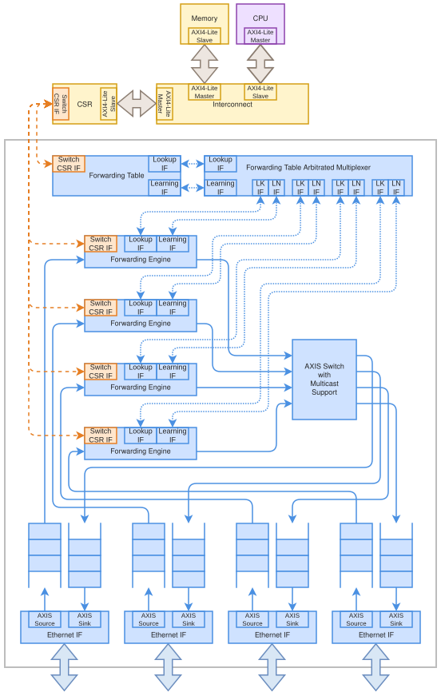

.. SPDX-FileCopyrightText: 2026 Enio Kaljic
.. SPDX-FileCopyrightText: 2026 Kerim Bavcic
.. SPDX-License-Identifier: CC-BY-SA-4.0

.. _rtl-eth-switch-crossbar:

Crossbar switch -- openenoc_eth_switch_crossbar
===============================================

.. index::
   single: openenoc_eth_switch_crossbar

Switches Ethernet traffic through parallel ingress processing and independently
progressing paths.

**Source:** :download:`openenoc_eth_switch_crossbar.sv <../../../hw/rtl/core/openenoc_eth_switch_crossbar.sv>`.

Parameters
----------

.. list-table:: Parameters
   :class: rtl-reference-table
   :header-rows: 1
   :widths: 24 18 30 28

   * - Name
     - Default value
     - Allowed values
     - Description
   * - ``NUM_OF_INTERFACES``
     - ``4``
     - 2..32
     - Number of Ethernet ports and forwarding-bitmap width; match the switch
       interface.
   * - ``TABLE_DEPTH``
     - ``32``
     - Integer >= 1
     - Number of forwarding-table entries.
   * - ``FABRIC_DATA_W``
     - ``32``
     - 8..512 bits, multiple of 8 in forwarding integration
     - Internal switching stream width; link/fabric widths must have an integer
       ratio.
   * - ``PORT_SIDE``
     - ``'1``
     - NUM_OF_INTERFACES-bit mask
     - Port orientation: zero is side A, one is side B.
   * - ``PORT_FIFO_DEPTH``
     - ``64``
     - Bytes; >= 2 widest-side words, power-of-two word count
     - Per-port asynchronous FIFO capacity; divisible by the widest link/fabric
       word size.

Signals
-------

Interface ports contain channels in both directions. The table identifies
the selected modport or stream role; member directions follow that interface.

.. list-table:: Public signals and interfaces
   :class: rtl-reference-table
   :header-rows: 1
   :widths: 30 30 17 23

   * - Name
     - Type
     - Direction / role
     - Description
   * - ``clk``
     - ``logic``
     - input
     - Clock for this component or interface domain.
   * - ``rst``
     - ``logic``
     - input
     - Active-high reset of transaction and control state.
   * - ``switch_if``
     - ``openenoc_switch_if.core``
     - bidirectional (core)
     - Switch configuration, pause status, and forwarding-table CPU access.
   * - | ``eth_if``
       | ``[NUM_OF_INTERFACES-1:0]``
     - ``openenoc_eth_if``
     - bidirectional; PORT_SIDE per port
     - Per-port bidirectional links, each with its own clock/reset domain.

Architecture and operation
--------------------------

   Crossbar Ethernet switch architecture

Each ingress has its own :ref:`rtl-axis-forwarding-engine`. Independent lookup
and learning requests share one table through
:ref:`rtl-forwarding-table-arb-mux`. The AXIS switch fabric routes forwarding
bitmaps to egress adapters, permitting independent paths to progress together.
Each forwarding engine excludes its ingress port and places the resulting
egress-port bitmap in internal ``TUSER``. :ref:`rtl-axis-switch` consumes that
bitmap with ``tuser_bitmap_route = 1`` to replicate multicast frames.

Frames with disjoint destination sets can progress concurrently. Frames that
need the same output share its bandwidth, while lookup and learning requests
remain subject to arbitration at the common forwarding table. A multicast
frame holds every selected output until its final beat has been accepted by
all of them. Backpressure at one selected destination can therefore delay
other traffic needing any of those outputs. Disjoint routes can continue, but
frames queued behind the blocked frame at the same ingress must wait.

Clock adaptation, ``PORT_SIDE``, public interfaces, and configuration parameters
match the shared-bus variant.

Functional scenarios
--------------------

These examples use ``NUM_OF_INTERFACES = 4``, ``TABLE_DEPTH = 8``,
``FABRIC_DATA_W = 64``, and four 64-bit Ethernet links with ``KEEP_W = 8``,
``KEEP_EN = 1``, and ``LAST_EN = 1``. The fabric and all four link clocks
have aligned rising edges and a 10 ns period. Resets have been released,
and managed forwarding entries are already configured; there is no
concurrent CPU table access.

With ``PORT_SIDE = 0b1111``, frames enter through
``eth_if[n].a2b_axis_if`` and leave through ``eth_if[n].b2a_axis_if``.
All example frames contain 66 bytes, including the Ethernet header and
excluding preamble, SFD, and FCS. Each frame uses eight full beats with
KEEP ``0xFF`` and a final two-byte beat with KEEP ``0x03`` and TLAST.

Data labels identify the frame: ``FA`` uses ``DA0`` through ``DA8``,
``FB`` uses ``DB0`` through ``DB8``, ``FC`` uses ``DC0`` through ``DC8``,
and ``FD`` uses ``DD0`` through ``DD8``. Each frame retains its prefix
on every link and multicast copy, with beat numbering restarting at zero.
All scenarios use ``PORT_FIFO_DEPTH = 128`` except the blocked
multicast scenario, which uses ``PORT_FIFO_DEPTH = 32``.

A numbered tick marks a clock interval. A beat transfers at the ending
rising edge when VALID and READY are both high. ``x`` denotes irrelevant
values while VALID is low.

The matching :ref:`rtl-eth-switch-shared-bus` examples use the same
frames, routes, clocks, FIFO capacities, and receiver readiness.

.. _eth-switch-crossbar-disjoint:

Disjoint unicast routes
~~~~~~~~~~~~~~~~~~~~~~~

.. list-table:: Traffic and frame overview
   :class: documentation-table
   :header-rows: 1
   :widths: 12 38 25 25

   * - Frame
     - Data beats
     - Ingress
     - Egress
   * - ``FA``
     - ``DA0`` through ``DA8``
     - Port 0
     - Port 2
   * - ``FB``
     - ``DB0`` through ``DB8``
     - Port 1
     - Port 3
   * - ``FC``
     - ``DC0`` through ``DC8``
     - Port 2
     - Port 0
   * - ``FD``
     - ``DD0`` through ``DD8``
     - Port 3
     - Port 1

All four ingress sources assert VALID at tick 1 and send their complete
frames without input stalls. Every egress receiver stays ready. Port 2
starts ``FA`` at tick 25, port 3 starts ``FB`` at tick 30, port 0 starts
``FC`` at tick 35, and port 1 starts ``FD`` at tick 40. Each output frame
uses nine consecutive transfers, so all four frames have completed by
tick 48, compared with tick 81 on the :ref:`shared-bus fabric
<eth-switch-shared-bus-disjoint>`.

Each ingress has its own forwarding engine. Transfers on distinct outputs
overlap, while the common lookup arbitration staggers their starts.
The four routes therefore complete earlier without requiring all four
outputs to begin transmitting at the same tick.

.. wavedrom::
    :name: eth-switch-crossbar-disjoint-ingress-timing
    :caption: Four frames enter the four-port switch concurrently
    :alt: Four frames enter the four-port switch concurrently.
    :align: center

    {
        "signal": [
            {"name": "clk", "wave": "p..................."},
            ["eth_if[0]",
                ["a2b_axis_if",
                    ["A",
                        {"name": "tvalid", "wave": "01........0........."},
                        {
                            "name": "tdata",
                            "wave": "x=========x.........",
                            "data": ["DA0", "DA1", "DA2", "DA3", "DA4", "DA5", "DA6", "DA7", "DA8"]
                        },
                        {"name": "tkeep", "wave": "x=.......=x.........", "data": ["0xFF", "0x03"]},
                        {"name": "tlast", "wave": "x0.......1x........."}
                    ],
                    ["B", {"name": "tready", "wave": "1..................."}]
                ],
                ["b2a_axis_if",
                    ["B",
                        {"name": "tvalid", "wave": "0..................."},
                        {"name": "tdata", "wave": "x..................."},
                        {"name": "tkeep", "wave": "x..................."},
                        {"name": "tlast", "wave": "x..................."}
                    ],
                    ["A", {"name": "tready", "wave": "1..................."}]
                ]
            ],
            {},
            ["eth_if[1]",
                ["a2b_axis_if",
                    ["A",
                        {"name": "tvalid", "wave": "01........0........."},
                        {
                            "name": "tdata",
                            "wave": "x=========x.........",
                            "data": ["DB0", "DB1", "DB2", "DB3", "DB4", "DB5", "DB6", "DB7", "DB8"]
                        },
                        {"name": "tkeep", "wave": "x=.......=x.........", "data": ["0xFF", "0x03"]},
                        {"name": "tlast", "wave": "x0.......1x........."}
                    ],
                    ["B", {"name": "tready", "wave": "1..................."}]
                ],
                ["b2a_axis_if",
                    ["B",
                        {"name": "tvalid", "wave": "0..................."},
                        {"name": "tdata", "wave": "x..................."},
                        {"name": "tkeep", "wave": "x..................."},
                        {"name": "tlast", "wave": "x..................."}
                    ],
                    ["A", {"name": "tready", "wave": "1..................."}]
                ]
            ],
            {},
            ["eth_if[2]",
                ["a2b_axis_if",
                    ["A",
                        {"name": "tvalid", "wave": "01........0........."},
                        {
                            "name": "tdata",
                            "wave": "x=========x.........",
                            "data": ["DC0", "DC1", "DC2", "DC3", "DC4", "DC5", "DC6", "DC7", "DC8"]
                        },
                        {"name": "tkeep", "wave": "x=.......=x.........", "data": ["0xFF", "0x03"]},
                        {"name": "tlast", "wave": "x0.......1x........."}
                    ],
                    ["B", {"name": "tready", "wave": "1..................."}]
                ],
                ["b2a_axis_if",
                    ["B",
                        {"name": "tvalid", "wave": "0..................."},
                        {"name": "tdata", "wave": "x..................."},
                        {"name": "tkeep", "wave": "x..................."},
                        {"name": "tlast", "wave": "x..................."}
                    ],
                    ["A", {"name": "tready", "wave": "1..................."}]
                ]
            ],
            {},
            ["eth_if[3]",
                ["a2b_axis_if",
                    ["A",
                        {"name": "tvalid", "wave": "01........0........."},
                        {
                            "name": "tdata",
                            "wave": "x=========x.........",
                            "data": ["DD0", "DD1", "DD2", "DD3", "DD4", "DD5", "DD6", "DD7", "DD8"]
                        },
                        {"name": "tkeep", "wave": "x=.......=x.........", "data": ["0xFF", "0x03"]},
                        {"name": "tlast", "wave": "x0.......1x........."}
                    ],
                    ["B", {"name": "tready", "wave": "1..................."}]
                ],
                ["b2a_axis_if",
                    ["B",
                        {"name": "tvalid", "wave": "0..................."},
                        {"name": "tdata", "wave": "x..................."},
                        {"name": "tkeep", "wave": "x..................."},
                        {"name": "tlast", "wave": "x..................."}
                    ],
                    ["A", {"name": "tready", "wave": "1..................."}]
                ]
            ]
        ],
        "config": {"hscale": 1},
        "head": {"tick": 0}
    }

.. wavedrom::
    :name: eth-switch-crossbar-disjoint-timing
    :caption: Four disjoint unicast routes overlap on independent paths
    :alt: Four disjoint unicast routes overlap on independent paths.
    :align: center

    {
        "signal": [
            {"name": "clk", "wave": "p.............................."},
            ["eth_if[0]",
                ["a2b_axis_if",
                    ["A",
                        {"name": "tvalid", "wave": "0.............................."},
                        {"name": "tdata", "wave": "x.............................."},
                        {"name": "tkeep", "wave": "x.............................."},
                        {"name": "tlast", "wave": "x.............................."}
                    ],
                    ["B", {"name": "tready", "wave": "1.............................."}]
                ],
                ["b2a_axis_if",
                    ["B",
                        {"name": "tvalid", "wave": "0..............1........0......"},
                        {
                            "name": "tdata",
                            "wave": "x..............=========x......",
                            "data": ["DC0", "DC1", "DC2", "DC3", "DC4", "DC5", "DC6", "DC7", "DC8"]
                        },
                        {
                            "name": "tkeep",
                            "wave": "x..............=.......=x......",
                            "data": ["0xFF", "0x03"]
                        },
                        {"name": "tlast", "wave": "x..............0.......1x......"}
                    ],
                    ["A", {"name": "tready", "wave": "1.............................."}]
                ]
            ],
            {},
            ["eth_if[1]",
                ["a2b_axis_if",
                    ["A",
                        {"name": "tvalid", "wave": "0.............................."},
                        {"name": "tdata", "wave": "x.............................."},
                        {"name": "tkeep", "wave": "x.............................."},
                        {"name": "tlast", "wave": "x.............................."}
                    ],
                    ["B", {"name": "tready", "wave": "1.............................."}]
                ],
                ["b2a_axis_if",
                    ["B",
                        {"name": "tvalid", "wave": "0...................1........0."},
                        {
                            "name": "tdata",
                            "wave": "x...................=========x.",
                            "data": ["DD0", "DD1", "DD2", "DD3", "DD4", "DD5", "DD6", "DD7", "DD8"]
                        },
                        {
                            "name": "tkeep",
                            "wave": "x...................=.......=x.",
                            "data": ["0xFF", "0x03"]
                        },
                        {"name": "tlast", "wave": "x...................0.......1x."}
                    ],
                    ["A", {"name": "tready", "wave": "1.............................."}]
                ]
            ],
            {},
            ["eth_if[2]",
                ["a2b_axis_if",
                    ["A",
                        {"name": "tvalid", "wave": "0.............................."},
                        {"name": "tdata", "wave": "x.............................."},
                        {"name": "tkeep", "wave": "x.............................."},
                        {"name": "tlast", "wave": "x.............................."}
                    ],
                    ["B", {"name": "tready", "wave": "1.............................."}]
                ],
                ["b2a_axis_if",
                    ["B",
                        {"name": "tvalid", "wave": "0....1........0................"},
                        {
                            "name": "tdata",
                            "wave": "x....=========x................",
                            "data": ["DA0", "DA1", "DA2", "DA3", "DA4", "DA5", "DA6", "DA7", "DA8"]
                        },
                        {
                            "name": "tkeep",
                            "wave": "x....=.......=x................",
                            "data": ["0xFF", "0x03"]
                        },
                        {"name": "tlast", "wave": "x....0.......1x................"}
                    ],
                    ["A", {"name": "tready", "wave": "1.............................."}]
                ]
            ],
            {},
            ["eth_if[3]",
                ["a2b_axis_if",
                    ["A",
                        {"name": "tvalid", "wave": "0.............................."},
                        {"name": "tdata", "wave": "x.............................."},
                        {"name": "tkeep", "wave": "x.............................."},
                        {"name": "tlast", "wave": "x.............................."}
                    ],
                    ["B", {"name": "tready", "wave": "1.............................."}]
                ],
                ["b2a_axis_if",
                    ["B",
                        {"name": "tvalid", "wave": "0.........1........0..........."},
                        {
                            "name": "tdata",
                            "wave": "x.........=========x...........",
                            "data": ["DB0", "DB1", "DB2", "DB3", "DB4", "DB5", "DB6", "DB7", "DB8"]
                        },
                        {
                            "name": "tkeep",
                            "wave": "x.........=.......=x...........",
                            "data": ["0xFF", "0x03"]
                        },
                        {"name": "tlast", "wave": "x.........0.......1x..........."}
                    ],
                    ["A", {"name": "tready", "wave": "1.............................."}]
                ]
            ]
        ],
        "config": {"hscale": 1},
        "head": {"tick": 20}
    }

.. _eth-switch-crossbar-contention:

Contention for one output
~~~~~~~~~~~~~~~~~~~~~~~~~

.. list-table:: Traffic and frame overview
   :class: documentation-table
   :header-rows: 1
   :widths: 12 38 25 25

   * - Frame
     - Data beats
     - Ingress
     - Egress
   * - ``FA``
     - ``DA0`` through ``DA8``
     - Port 0
     - Port 3
   * - ``FB``
     - ``DB0`` through ``DB8``
     - Port 1
     - Port 3

Here ``FA`` and ``FB`` enter ports 0 and 1 at tick 1, with both
destination entries selecting port 3. Its receiver stays ready. The crossbar grants that output to
``FA`` first and keeps it assigned until the final beat enters the
egress FIFO. It can then grant the route for ``FB``. Port 3 delivers
``DA0`` through ``DA8`` followed by ``DB0`` through ``DB8``, without
interleaving the frames. Other ports receive neither frame. Parallel
ingress processing does not increase the bandwidth of a shared output.
The frame order depends on route availability and arbitration state.

.. wavedrom::
    :name: eth-switch-crossbar-contention-ingress-timing
    :caption: Both frames enter the four-port switch
    :alt: Both frames enter the four-port switch.
    :align: center

    {
        "signal": [
            {"name": "clk", "wave": "p..................."},
            ["eth_if[0]",
                ["a2b_axis_if",
                    ["A",
                        {"name": "tvalid", "wave": "01........0........."},
                        {
                            "name": "tdata",
                            "wave": "x=========x.........",
                            "data": ["DA0", "DA1", "DA2", "DA3", "DA4", "DA5", "DA6", "DA7", "DA8"]
                        },
                        {"name": "tkeep", "wave": "x=.......=x.........", "data": ["0xFF", "0x03"]},
                        {"name": "tlast", "wave": "x0.......1x........."}
                    ],
                    ["B", {"name": "tready", "wave": "1..................."}]
                ],
                ["b2a_axis_if",
                    ["B",
                        {"name": "tvalid", "wave": "0..................."},
                        {"name": "tdata", "wave": "x..................."},
                        {"name": "tkeep", "wave": "x..................."},
                        {"name": "tlast", "wave": "x..................."}
                    ],
                    ["A", {"name": "tready", "wave": "1..................."}]
                ]
            ],
            {},
            ["eth_if[1]",
                ["a2b_axis_if",
                    ["A",
                        {"name": "tvalid", "wave": "01........0........."},
                        {
                            "name": "tdata",
                            "wave": "x=========x.........",
                            "data": ["DB0", "DB1", "DB2", "DB3", "DB4", "DB5", "DB6", "DB7", "DB8"]
                        },
                        {"name": "tkeep", "wave": "x=.......=x.........", "data": ["0xFF", "0x03"]},
                        {"name": "tlast", "wave": "x0.......1x........."}
                    ],
                    ["B", {"name": "tready", "wave": "1..................."}]
                ],
                ["b2a_axis_if",
                    ["B",
                        {"name": "tvalid", "wave": "0..................."},
                        {"name": "tdata", "wave": "x..................."},
                        {"name": "tkeep", "wave": "x..................."},
                        {"name": "tlast", "wave": "x..................."}
                    ],
                    ["A", {"name": "tready", "wave": "1..................."}]
                ]
            ],
            {},
            ["eth_if[2]",
                ["a2b_axis_if",
                    ["A",
                        {"name": "tvalid", "wave": "0..................."},
                        {"name": "tdata", "wave": "x..................."},
                        {"name": "tkeep", "wave": "x..................."},
                        {"name": "tlast", "wave": "x..................."}
                    ],
                    ["B", {"name": "tready", "wave": "1..................."}]
                ],
                ["b2a_axis_if",
                    ["B",
                        {"name": "tvalid", "wave": "0..................."},
                        {"name": "tdata", "wave": "x..................."},
                        {"name": "tkeep", "wave": "x..................."},
                        {"name": "tlast", "wave": "x..................."}
                    ],
                    ["A", {"name": "tready", "wave": "1..................."}]
                ]
            ],
            {},
            ["eth_if[3]",
                ["a2b_axis_if",
                    ["A",
                        {"name": "tvalid", "wave": "0..................."},
                        {"name": "tdata", "wave": "x..................."},
                        {"name": "tkeep", "wave": "x..................."},
                        {"name": "tlast", "wave": "x..................."}
                    ],
                    ["B", {"name": "tready", "wave": "1..................."}]
                ],
                ["b2a_axis_if",
                    ["B",
                        {"name": "tvalid", "wave": "0..................."},
                        {"name": "tdata", "wave": "x..................."},
                        {"name": "tkeep", "wave": "x..................."},
                        {"name": "tlast", "wave": "x..................."}
                    ],
                    ["A", {"name": "tready", "wave": "1..................."}]
                ]
            ]
        ],
        "config": {"hscale": 1},
        "head": {"tick": 0}
    }

.. wavedrom::
    :name: eth-switch-crossbar-contention-timing
    :caption: Two complete frames share port 3 without beat interleaving
    :alt: Two complete frames share port 3 without beat interleaving.
    :align: center

    {
        "signal": [
            {"name": "clk", "wave": "p............................."},
            ["eth_if[0]",
                ["a2b_axis_if",
                    ["A",
                        {"name": "tvalid", "wave": "0............................."},
                        {"name": "tdata", "wave": "x............................."},
                        {"name": "tkeep", "wave": "x............................."},
                        {"name": "tlast", "wave": "x............................."}
                    ],
                    ["B", {"name": "tready", "wave": "1............................."}]
                ],
                ["b2a_axis_if",
                    ["B",
                        {"name": "tvalid", "wave": "0............................."},
                        {"name": "tdata", "wave": "x............................."},
                        {"name": "tkeep", "wave": "x............................."},
                        {"name": "tlast", "wave": "x............................."}
                    ],
                    ["A", {"name": "tready", "wave": "1............................."}]
                ]
            ],
            {},
            ["eth_if[1]",
                ["a2b_axis_if",
                    ["A",
                        {"name": "tvalid", "wave": "0............................."},
                        {"name": "tdata", "wave": "x............................."},
                        {"name": "tkeep", "wave": "x............................."},
                        {"name": "tlast", "wave": "x............................."}
                    ],
                    ["B", {"name": "tready", "wave": "1............................."}]
                ],
                ["b2a_axis_if",
                    ["B",
                        {"name": "tvalid", "wave": "0............................."},
                        {"name": "tdata", "wave": "x............................."},
                        {"name": "tkeep", "wave": "x............................."},
                        {"name": "tlast", "wave": "x............................."}
                    ],
                    ["A", {"name": "tready", "wave": "1............................."}]
                ]
            ],
            {},
            ["eth_if[2]",
                ["a2b_axis_if",
                    ["A",
                        {"name": "tvalid", "wave": "0............................."},
                        {"name": "tdata", "wave": "x............................."},
                        {"name": "tkeep", "wave": "x............................."},
                        {"name": "tlast", "wave": "x............................."}
                    ],
                    ["B", {"name": "tready", "wave": "1............................."}]
                ],
                ["b2a_axis_if",
                    ["B",
                        {"name": "tvalid", "wave": "0............................."},
                        {"name": "tdata", "wave": "x............................."},
                        {"name": "tkeep", "wave": "x............................."},
                        {"name": "tlast", "wave": "x............................."}
                    ],
                    ["A", {"name": "tready", "wave": "1............................."}]
                ]
            ],
            {},
            ["eth_if[3]",
                ["a2b_axis_if",
                    ["A",
                        {"name": "tvalid", "wave": "0............................."},
                        {"name": "tdata", "wave": "x............................."},
                        {"name": "tkeep", "wave": "x............................."},
                        {"name": "tlast", "wave": "x............................."}
                    ],
                    ["B", {"name": "tready", "wave": "1............................."}]
                ],
                ["b2a_axis_if",
                    ["B",
                        {"name": "tvalid", "wave": "0....1........0...1........0.."},
                        {
                            "name": "tdata",
                            "wave": "x....=========x...=========x..",
                            "data": [
                                "DA0",
                                "DA1",
                                "DA2",
                                "DA3",
                                "DA4",
                                "DA5",
                                "DA6",
                                "DA7",
                                "DA8",
                                "DB0",
                                "DB1",
                                "DB2",
                                "DB3",
                                "DB4",
                                "DB5",
                                "DB6",
                                "DB7",
                                "DB8"
                            ]
                        },
                        {
                            "name": "tkeep",
                            "wave": "x....=.......=x...=.......=x..",
                            "data": ["0xFF", "0x03", "0xFF", "0x03"]
                        },
                        {"name": "tlast", "wave": "x....0.......1x...0.......1x.."}
                    ],
                    ["A", {"name": "tready", "wave": "1............................."}]
                ]
            ]
        ],
        "config": {"hscale": 1},
        "head": {"tick": 20}
    }

.. _eth-switch-crossbar-broadcast:

Broadcast without stalls
~~~~~~~~~~~~~~~~~~~~~~~~~

.. list-table:: Traffic and frame overview
   :class: documentation-table
   :header-rows: 1
   :widths: 12 38 25 25

   * - Frame
     - Data beats
     - Ingress
     - Egress
   * - ``FA``
     - ``DA0`` through ``DA8``
     - Port 0
     - Ports 1, 2, and 3

The managed forwarding entry for destination ``FF:FF:FF:FF:FF:FF``
selects bitmap ``0b1111``. The forwarding engine excludes ingress
port 0, so the broadcast frame reaches ports 1, 2, and 3. All receivers
remain ready.

``FA`` enters port 0 in ticks 1--9. Its three copies transfer
concurrently in ticks 25--33, with the same ``DA0`` through ``DA8``
on every output. Each copy ends with KEEP ``0x03`` and TLAST;
no copy returns to the ingress port.

.. wavedrom::
    :name: eth-switch-crossbar-broadcast-timing
    :caption: One 66-byte broadcast frame is replicated to every other port
    :alt: One 66-byte broadcast frame is replicated to every other port.
    :align: center

    {
        "signal": [
            {"name": "clk", "wave": "p.................................."},
            ["eth_if[0]",
                ["a2b_axis_if",
                    ["A",
                        {"name": "tvalid", "wave": "01........0........................"},
                        {
                            "name": "tdata",
                            "wave": "x=========x........................",
                            "data": ["DA0", "DA1", "DA2", "DA3", "DA4", "DA5", "DA6", "DA7", "DA8"]
                        },
                        {
                            "name": "tkeep",
                            "wave": "x=.......=x........................",
                            "data": ["0xFF", "0x03"]
                        },
                        {"name": "tlast", "wave": "x0.......1x........................"}
                    ],
                    ["B", {"name": "tready", "wave": "1.................................."}]
                ],
                ["b2a_axis_if",
                    ["B",
                        {"name": "tvalid", "wave": "0.................................."},
                        {"name": "tdata", "wave": "x.................................."},
                        {"name": "tkeep", "wave": "x.................................."},
                        {"name": "tlast", "wave": "x.................................."}
                    ],
                    ["A", {"name": "tready", "wave": "1.................................."}]
                ]
            ],
            {},
            ["eth_if[1]",
                ["a2b_axis_if",
                    ["A",
                        {"name": "tvalid", "wave": "0.................................."},
                        {"name": "tdata", "wave": "x.................................."},
                        {"name": "tkeep", "wave": "x.................................."},
                        {"name": "tlast", "wave": "x.................................."}
                    ],
                    ["B", {"name": "tready", "wave": "1.................................."}]
                ],
                ["b2a_axis_if",
                    ["B",
                        {"name": "tvalid", "wave": "0........................1........0"},
                        {
                            "name": "tdata",
                            "wave": "x........................=========x",
                            "data": ["DA0", "DA1", "DA2", "DA3", "DA4", "DA5", "DA6", "DA7", "DA8"]
                        },
                        {
                            "name": "tkeep",
                            "wave": "x........................=.......=x",
                            "data": ["0xFF", "0x03"]
                        },
                        {"name": "tlast", "wave": "x........................0.......1x"}
                    ],
                    ["A", {"name": "tready", "wave": "1.................................."}]
                ]
            ],
            {},
            ["eth_if[2]",
                ["a2b_axis_if",
                    ["A",
                        {"name": "tvalid", "wave": "0.................................."},
                        {"name": "tdata", "wave": "x.................................."},
                        {"name": "tkeep", "wave": "x.................................."},
                        {"name": "tlast", "wave": "x.................................."}
                    ],
                    ["B", {"name": "tready", "wave": "1.................................."}]
                ],
                ["b2a_axis_if",
                    ["B",
                        {"name": "tvalid", "wave": "0........................1........0"},
                        {
                            "name": "tdata",
                            "wave": "x........................=========x",
                            "data": ["DA0", "DA1", "DA2", "DA3", "DA4", "DA5", "DA6", "DA7", "DA8"]
                        },
                        {
                            "name": "tkeep",
                            "wave": "x........................=.......=x",
                            "data": ["0xFF", "0x03"]
                        },
                        {"name": "tlast", "wave": "x........................0.......1x"}
                    ],
                    ["A", {"name": "tready", "wave": "1.................................."}]
                ]
            ],
            {},
            ["eth_if[3]",
                ["a2b_axis_if",
                    ["A",
                        {"name": "tvalid", "wave": "0.................................."},
                        {"name": "tdata", "wave": "x.................................."},
                        {"name": "tkeep", "wave": "x.................................."},
                        {"name": "tlast", "wave": "x.................................."}
                    ],
                    ["B", {"name": "tready", "wave": "1.................................."}]
                ],
                ["b2a_axis_if",
                    ["B",
                        {"name": "tvalid", "wave": "0........................1........0"},
                        {
                            "name": "tdata",
                            "wave": "x........................=========x",
                            "data": ["DA0", "DA1", "DA2", "DA3", "DA4", "DA5", "DA6", "DA7", "DA8"]
                        },
                        {
                            "name": "tkeep",
                            "wave": "x........................=.......=x",
                            "data": ["0xFF", "0x03"]
                        },
                        {"name": "tlast", "wave": "x........................0.......1x"}
                    ],
                    ["A", {"name": "tready", "wave": "1.................................."}]
                ]
            ]
        ],
        "config": {"hscale": 1},
        "head": {"tick": 0}
    }

.. _eth-switch-crossbar-blocked:

Blocked multicast and a disjoint route
~~~~~~~~~~~~~~~~~~~~~~~~~~~~~~~~~~~~~~

.. list-table:: Traffic and frame overview
   :class: documentation-table
   :header-rows: 1
   :widths: 12 38 25 25

   * - Frame
     - Data beats
     - Ingress
     - Egress
   * - ``FA``
     - ``DA0`` through ``DA8``
     - Port 0
     - Ports 2 and 3
   * - ``FB``
     - ``DB0`` through ``DB8``
     - Port 1
     - Port 0

``FA`` starts at tick 1 and selects ports 2 and 3. ``FB`` starts at
tick 5 and selects port 0. Port 3 holds READY low until tick 45;
ports 0 and 2 remain ready. ``PORT_FIFO_DEPTH = 32`` makes the selected output FIFO fill
before the complete multicast frame can enter it. The small streaming
FIFOs also expose gaps between bursts as data and space availability
cross the clock-domain boundaries.

Port 2 can deliver a prefix of ``FA`` while port 3 holds ``DA0``.
The crossbar tracks which selected outputs have accepted each beat, so
the ready copy can advance before the blocked copy. When the latter
cannot accept more data into its FIFO, multicast progress waits.
The route from ingress 1 to port 0 has no selected output in common
with the multicast. It therefore delivers all of ``FB`` before port 3
asserts READY. Traffic queued behind ``FA`` at ingress 0 would still
have to wait.

.. wavedrom::
    :name: eth-switch-crossbar-blocked-ingress-timing
    :caption: Multicast and disjoint unicast frames enter the four-port switch
    :alt: Multicast and disjoint unicast frames enter the four-port switch.
    :align: center

    {
        "signal": [
            {"name": "clk", "wave": "p..................."},
            ["eth_if[0]",
                ["a2b_axis_if",
                    ["A",
                        {"name": "tvalid", "wave": "01.................."},
                        {
                            "name": "tdata",
                            "wave": "x=====..===.....=...",
                            "data": ["DA0", "DA1", "DA2", "DA3", "DA4", "DA5", "DA6", "DA7", "DA8"]
                        },
                        {"name": "tkeep", "wave": "x=..............=...", "data": ["0xFF", "0x03"]},
                        {"name": "tlast", "wave": "x0..............1..."}
                    ],
                    ["B", {"name": "tready", "wave": "1....0.1..0....10..."}]
                ],
                ["b2a_axis_if",
                    ["B",
                        {"name": "tvalid", "wave": "0..................."},
                        {"name": "tdata", "wave": "x..................."},
                        {"name": "tkeep", "wave": "x..................."},
                        {"name": "tlast", "wave": "x..................."}
                    ],
                    ["A", {"name": "tready", "wave": "1..................."}]
                ]
            ],
            {},
            ["eth_if[1]",
                ["a2b_axis_if",
                    ["A",
                        {"name": "tvalid", "wave": "0....1.............."},
                        {
                            "name": "tdata",
                            "wave": "x....=====..===.....",
                            "data": ["DB0", "DB1", "DB2", "DB3", "DB4", "DB5", "DB6", "DB7"]
                        },
                        {"name": "tkeep", "wave": "x....=..............", "data": ["0xFF"]},
                        {"name": "tlast", "wave": "x....0.............."}
                    ],
                    ["B", {"name": "tready", "wave": "1........0.1..0....1"}]
                ],
                ["b2a_axis_if",
                    ["B",
                        {"name": "tvalid", "wave": "0..................."},
                        {"name": "tdata", "wave": "x..................."},
                        {"name": "tkeep", "wave": "x..................."},
                        {"name": "tlast", "wave": "x..................."}
                    ],
                    ["A", {"name": "tready", "wave": "1..................."}]
                ]
            ],
            {},
            ["eth_if[2]",
                ["a2b_axis_if",
                    ["A",
                        {"name": "tvalid", "wave": "0..................."},
                        {"name": "tdata", "wave": "x..................."},
                        {"name": "tkeep", "wave": "x..................."},
                        {"name": "tlast", "wave": "x..................."}
                    ],
                    ["B", {"name": "tready", "wave": "1..................."}]
                ],
                ["b2a_axis_if",
                    ["B",
                        {"name": "tvalid", "wave": "0..................."},
                        {"name": "tdata", "wave": "x..................."},
                        {"name": "tkeep", "wave": "x..................."},
                        {"name": "tlast", "wave": "x..................."}
                    ],
                    ["A", {"name": "tready", "wave": "1..................."}]
                ]
            ],
            {},
            ["eth_if[3]",
                ["a2b_axis_if",
                    ["A",
                        {"name": "tvalid", "wave": "0..................."},
                        {"name": "tdata", "wave": "x..................."},
                        {"name": "tkeep", "wave": "x..................."},
                        {"name": "tlast", "wave": "x..................."}
                    ],
                    ["B", {"name": "tready", "wave": "1..................."}]
                ],
                ["b2a_axis_if",
                    ["B",
                        {"name": "tvalid", "wave": "0..................."},
                        {"name": "tdata", "wave": "x..................."},
                        {"name": "tkeep", "wave": "x..................."},
                        {"name": "tlast", "wave": "x..................."}
                    ],
                    ["A", {"name": "tready", "wave": "10.................."}]
                ]
            ]
        ],
        "config": {"hscale": 1},
        "head": {"tick": 0}
    }

.. wavedrom::
    :name: eth-switch-crossbar-blocked-timing
    :caption: Blocked multicast allows the disjoint unicast route to finish
    :alt: Blocked multicast allows the disjoint unicast route to finish.
    :align: center

    {
        "signal": [
            {"name": "clk", "wave": "p.............................."},
            ["eth_if[0]",
                ["a2b_axis_if",
                    ["A",
                        {"name": "tvalid", "wave": "1.0............................"},
                        {
                            "name": "tdata",
                            "wave": "=.x............................",
                            "data": ["DA8"]
                        },
                        {
                            "name": "tkeep",
                            "wave": "=.x............................",
                            "data": ["0x03"]
                        },
                        {"name": "tlast", "wave": "1.x............................"}
                    ],
                    ["B", {"name": "tready", "wave": "01............................."}]
                ],
                ["b2a_axis_if",
                    ["B",
                        {"name": "tvalid", "wave": "0.........1...0.1...0.10......."},
                        {
                            "name": "tdata",
                            "wave": "x.........====x.====x.=x.......",
                            "data": ["DB0", "DB1", "DB2", "DB3", "DB4", "DB5", "DB6", "DB7", "DB8"]
                        },
                        {
                            "name": "tkeep",
                            "wave": "x.........=...x.=...x.=x.......",
                            "data": ["0xFF", "0xFF", "0x03"]
                        },
                        {"name": "tlast", "wave": "x.........0...x.0...x.1x......."}
                    ],
                    ["A", {"name": "tready", "wave": "1.............................."}]
                ]
            ],
            {},
            ["eth_if[1]",
                ["a2b_axis_if",
                    ["A",
                        {"name": "tvalid", "wave": "1.....0........................"},
                        {
                            "name": "tdata",
                            "wave": "=.....x........................",
                            "data": ["DB8"]
                        },
                        {
                            "name": "tkeep",
                            "wave": "=.....x........................",
                            "data": ["0x03"]
                        },
                        {"name": "tlast", "wave": "1.....x........................"}
                    ],
                    ["B", {"name": "tready", "wave": "0....1........................."}]
                ],
                ["b2a_axis_if",
                    ["B",
                        {"name": "tvalid", "wave": "0.............................."},
                        {"name": "tdata", "wave": "x.............................."},
                        {"name": "tkeep", "wave": "x.............................."},
                        {"name": "tlast", "wave": "x.............................."}
                    ],
                    ["A", {"name": "tready", "wave": "1.............................."}]
                ]
            ],
            {},
            ["eth_if[2]",
                ["a2b_axis_if",
                    ["A",
                        {"name": "tvalid", "wave": "0.............................."},
                        {"name": "tdata", "wave": "x.............................."},
                        {"name": "tkeep", "wave": "x.............................."},
                        {"name": "tlast", "wave": "x.............................."}
                    ],
                    ["B", {"name": "tready", "wave": "1.............................."}]
                ],
                ["b2a_axis_if",
                    ["B",
                        {"name": "tvalid", "wave": "0....1...0.1..0................"},
                        {
                            "name": "tdata",
                            "wave": "x....====x.===x................",
                            "data": ["DA0", "DA1", "DA2", "DA3", "DA4", "DA5", "DA6"]
                        },
                        {
                            "name": "tkeep",
                            "wave": "x....=...x.=..x................",
                            "data": ["0xFF", "0xFF"]
                        },
                        {"name": "tlast", "wave": "x....0...x.0..x................"}
                    ],
                    ["A", {"name": "tready", "wave": "1.............................."}]
                ]
            ],
            {},
            ["eth_if[3]",
                ["a2b_axis_if",
                    ["A",
                        {"name": "tvalid", "wave": "0.............................."},
                        {"name": "tdata", "wave": "x.............................."},
                        {"name": "tkeep", "wave": "x.............................."},
                        {"name": "tlast", "wave": "x.............................."}
                    ],
                    ["B", {"name": "tready", "wave": "1.............................."}]
                ],
                ["b2a_axis_if",
                    ["B",
                        {"name": "tvalid", "wave": "0....1........................."},
                        {
                            "name": "tdata",
                            "wave": "x....=....................=====",
                            "data": ["DA0", "DA1", "DA2", "DA3", "DA4", "DA5"]
                        },
                        {
                            "name": "tkeep",
                            "wave": "x....=.........................",
                            "data": ["0xFF"]
                        },
                        {"name": "tlast", "wave": "x....0........................."}
                    ],
                    ["A", {"name": "tready", "wave": "0........................1....."}]
                ]
            ]
        ],
        "config": {"hscale": 1},
        "head": {"tick": 20}
    }

After port 3 asserts READY, the remaining multicast beats reach
both destinations. Each copy ends with ``DA8``, KEEP ``0x03``, and
TLAST. ``FB`` has already completed on port 0, which remains idle
through this continuation.

.. wavedrom::
    :name: eth-switch-crossbar-blocked-release-timing
    :caption: The multicast copies finish after the disjoint unicast
    :alt: The multicast copies finish after the disjoint unicast.
    :align: center

    {
        "signal": [
            {"name": "clk", "wave": "p............................"},
            ["eth_if[0]",
                ["a2b_axis_if",
                    ["A",
                        {"name": "tvalid", "wave": "0............................"},
                        {"name": "tdata", "wave": "x............................"},
                        {"name": "tkeep", "wave": "x............................"},
                        {"name": "tlast", "wave": "x............................"}
                    ],
                    ["B", {"name": "tready", "wave": "1............................"}]
                ],
                ["b2a_axis_if",
                    ["B",
                        {"name": "tvalid", "wave": "0............................"},
                        {"name": "tdata", "wave": "x............................"},
                        {"name": "tkeep", "wave": "x............................"},
                        {"name": "tlast", "wave": "x............................"}
                    ],
                    ["A", {"name": "tready", "wave": "1............................"}]
                ]
            ],
            {},
            ["eth_if[1]",
                ["a2b_axis_if",
                    ["A",
                        {"name": "tvalid", "wave": "0............................"},
                        {"name": "tdata", "wave": "x............................"},
                        {"name": "tkeep", "wave": "x............................"},
                        {"name": "tlast", "wave": "x............................"}
                    ],
                    ["B", {"name": "tready", "wave": "1............................"}]
                ],
                ["b2a_axis_if",
                    ["B",
                        {"name": "tvalid", "wave": "0............................"},
                        {"name": "tdata", "wave": "x............................"},
                        {"name": "tkeep", "wave": "x............................"},
                        {"name": "tlast", "wave": "x............................"}
                    ],
                    ["A", {"name": "tready", "wave": "1............................"}]
                ]
            ],
            {},
            ["eth_if[2]",
                ["a2b_axis_if",
                    ["A",
                        {"name": "tvalid", "wave": "0............................"},
                        {"name": "tdata", "wave": "x............................"},
                        {"name": "tkeep", "wave": "x............................"},
                        {"name": "tlast", "wave": "x............................"}
                    ],
                    ["B", {"name": "tready", "wave": "1............................"}]
                ],
                ["b2a_axis_if",
                    ["B",
                        {"name": "tvalid", "wave": "0..1.0......................."},
                        {
                            "name": "tdata",
                            "wave": "x..==x.......................",
                            "data": ["DA7", "DA8"]
                        },
                        {
                            "name": "tkeep",
                            "wave": "x..==x.......................",
                            "data": ["0xFF", "0x03"]
                        },
                        {"name": "tlast", "wave": "x..01x......................."}
                    ],
                    ["A", {"name": "tready", "wave": "1............................"}]
                ]
            ],
            {},
            ["eth_if[3]",
                ["a2b_axis_if",
                    ["A",
                        {"name": "tvalid", "wave": "0............................"},
                        {"name": "tdata", "wave": "x............................"},
                        {"name": "tkeep", "wave": "x............................"},
                        {"name": "tlast", "wave": "x............................"}
                    ],
                    ["B", {"name": "tready", "wave": "1............................"}]
                ],
                ["b2a_axis_if",
                    ["B",
                        {"name": "tvalid", "wave": "0.1..0......................."},
                        {
                            "name": "tdata",
                            "wave": "x.===x.......................",
                            "data": ["DA6", "DA7", "DA8"]
                        },
                        {
                            "name": "tkeep",
                            "wave": "x.=.=x.......................",
                            "data": ["0xFF", "0x03"]
                        },
                        {"name": "tlast", "wave": "x.0.1x......................."}
                    ],
                    ["A", {"name": "tready", "wave": "1............................"}]
                ]
            ]
        ],
        "config": {"hscale": 1},
        "head": {"tick": 51}
    }

.. _eth-switch-crossbar-csr-pause:

CSR-controlled pause and resume
~~~~~~~~~~~~~~~~~~~~~~~~~~~~~~~~

.. list-table:: Traffic and frame overview
   :class: documentation-table
   :header-rows: 1
   :widths: 12 38 25 25

   * - Frame
     - Data beats
     - Ingress
     - Egress
   * - ``FA``
     - ``DA0`` through ``DA8``
     - Port 0
     - Port 1
   * - ``FB``
     - ``DB0`` through ``DB8``
     - Port 1
     - Port 0

``FA`` arrives in ticks 1--9 and forwarding begins. A CSR write
sets ``forwarding_control.pause_request`` at tick 12. The pause
request allows the active frame to finish before stopping at the
next frame boundary. Every receiver remains ready.

``FB`` arrives on the reverse route in ticks 24--32 while port 1
finishes transmitting ``FA`` in ticks 25--33. Input buffering
accepts the second frame, which waits for forwarding while the
pause request remains asserted.

``forwarding_control.pause_done`` becomes high at tick 28, confirming
that forwarding is paused at frame boundaries. Egress FIFOs can
continue draining after this status rises.

.. wavedrom::
    :name: eth-switch-crossbar-csr-pause-drain-timing
    :caption: CSR pause lets FA finish while FB waits for forwarding
    :alt: CSR pause lets FA finish while FB waits for forwarding.
    :align: center

    {
        "signal": [
            {"name": "clk", "wave": "p.................................."},
            ["switch_if",
                ["CSR",
                    {
                        "name": "forwarding_control.pause_request.value",
                        "wave": "0...........1......................"
                    },
                    {}
                ],
                ["Core",
                    {
                        "name": "forwarding_control.pause_done.next",
                        "wave": "0...........................1......"
                    },
                    {}
                ]
            ],
            {},
            ["eth_if[0]",
                ["a2b_axis_if",
                    ["A",
                        {"name": "tvalid", "wave": "01........0........................"},
                        {
                            "name": "tdata",
                            "wave": "x=========x........................",
                            "data": ["DA0", "DA1", "DA2", "DA3", "DA4", "DA5", "DA6", "DA7", "DA8"]
                        },
                        {
                            "name": "tkeep",
                            "wave": "x=.......=x........................",
                            "data": ["0xFF", "0x03"]
                        },
                        {"name": "tlast", "wave": "x0.......1x........................"}
                    ],
                    ["B", {"name": "tready", "wave": "1.................................."}]
                ],
                ["b2a_axis_if",
                    ["B",
                        {"name": "tvalid", "wave": "0.................................."},
                        {"name": "tdata", "wave": "x.................................."},
                        {"name": "tkeep", "wave": "x.................................."},
                        {"name": "tlast", "wave": "x.................................."}
                    ],
                    ["A", {"name": "tready", "wave": "1.................................."}]
                ]
            ],
            {},
            ["eth_if[1]",
                ["a2b_axis_if",
                    ["A",
                        {"name": "tvalid", "wave": "0.......................1........0."},
                        {
                            "name": "tdata",
                            "wave": "x.......................=========x.",
                            "data": ["DB0", "DB1", "DB2", "DB3", "DB4", "DB5", "DB6", "DB7", "DB8"]
                        },
                        {
                            "name": "tkeep",
                            "wave": "x.......................=.......=x.",
                            "data": ["0xFF", "0x03"]
                        },
                        {"name": "tlast", "wave": "x.......................0.......1x."}
                    ],
                    ["B", {"name": "tready", "wave": "1.................................."}]
                ],
                ["b2a_axis_if",
                    ["B",
                        {"name": "tvalid", "wave": "0........................1........0"},
                        {
                            "name": "tdata",
                            "wave": "x........................=========x",
                            "data": ["DA0", "DA1", "DA2", "DA3", "DA4", "DA5", "DA6", "DA7", "DA8"]
                        },
                        {
                            "name": "tkeep",
                            "wave": "x........................=.......=x",
                            "data": ["0xFF", "0x03"]
                        },
                        {"name": "tlast", "wave": "x........................0.......1x"}
                    ],
                    ["A", {"name": "tready", "wave": "1.................................."}]
                ]
            ]
        ],
        "config": {"hscale": 1},
        "head": {"tick": 0}
    }

A CSR write clears ``pause_request`` at tick 40. ``pause_done``
falls, and the queued reverse frame can proceed. Port 0 transfers
``DB0`` through ``DB8`` in ticks 62--70, ending with KEEP
``0x03`` and TLAST. No beat of ``FB`` leaves the switch before
the pause is released.

.. wavedrom::
    :name: eth-switch-crossbar-csr-pause-resume-timing
    :caption: Clearing the CSR pause forwards the queued reverse frame
    :alt: Clearing the CSR pause forwards the queued reverse frame.
    :align: center

    {
        "signal": [
            {"name": "clk", "wave": "p....................................."},
            ["switch_if",
                ["CSR",
                    {
                        "name": "forwarding_control.pause_request.value",
                        "wave": "1....0................................"
                    },
                    {}
                ],
                ["Core",
                    {
                        "name": "forwarding_control.pause_done.next",
                        "wave": "1....0................................"
                    },
                    {}
                ]
            ],
            {},
            ["eth_if[0]",
                ["a2b_axis_if",
                    ["A",
                        {"name": "tvalid", "wave": "0....................................."},
                        {"name": "tdata", "wave": "x....................................."},
                        {"name": "tkeep", "wave": "x....................................."},
                        {"name": "tlast", "wave": "x....................................."}
                    ],
                    ["B", {"name": "tready", "wave": "1....................................."}]
                ],
                ["b2a_axis_if",
                    ["B",
                        {"name": "tvalid", "wave": "0..........................1........0."},
                        {
                            "name": "tdata",
                            "wave": "x..........................=========x.",
                            "data": ["DB0", "DB1", "DB2", "DB3", "DB4", "DB5", "DB6", "DB7", "DB8"]
                        },
                        {
                            "name": "tkeep",
                            "wave": "x..........................=.......=x.",
                            "data": ["0xFF", "0x03"]
                        },
                        {"name": "tlast", "wave": "x..........................0.......1x."}
                    ],
                    ["A", {"name": "tready", "wave": "1....................................."}]
                ]
            ],
            {},
            ["eth_if[1]",
                ["a2b_axis_if",
                    ["A",
                        {"name": "tvalid", "wave": "0....................................."},
                        {"name": "tdata", "wave": "x....................................."},
                        {"name": "tkeep", "wave": "x....................................."},
                        {"name": "tlast", "wave": "x....................................."}
                    ],
                    ["B", {"name": "tready", "wave": "1....................................."}]
                ],
                ["b2a_axis_if",
                    ["B",
                        {"name": "tvalid", "wave": "0....................................."},
                        {"name": "tdata", "wave": "x....................................."},
                        {"name": "tkeep", "wave": "x....................................."},
                        {"name": "tlast", "wave": "x....................................."}
                    ],
                    ["A", {"name": "tready", "wave": "1....................................."}]
                ]
            ]
        ],
        "config": {"hscale": 1},
        "head": {"tick": 35}
    }

.. _verification-openenoc-eth-switch-crossbar:

Verification
------------

The test suite is in ``dv/core/openenoc_eth_switch_crossbar/``.

Testbench
~~~~~~~~~

This integration suite validates the ``openenoc_eth_switch_crossbar`` module. The switch
contains one forwarding engine per ingress port, a shared forwarding table with independent
lookup and learning arbitration, and a bitmap-routed AXI Stream output switch. Independent
noncontending paths can transfer frames concurrently, while each contested output is arbitrated
independently.

The test wrapper instantiates the switch, a parameterized array of ``openenoc_eth_if`` links,
and one ``openenoc_switch_if``. The generated CSR block is intentionally not instantiated.
Flattened testbench signals drive the control fields of ``openenoc_switch_if`` directly from
Cocotb and expose status, forwarding-table, and arbitration observations.

The wrapper acts as the peer opposite each switch port. For a side-B switch port it transmits
through ``a2b_axis_if`` and receives through ``b2a_axis_if``; those directions are reversed for
a side-A switch port. Constant-index bridges expose both cases uniformly as ``port_rx_axis_if``
and ``port_tx_axis_if``.

Datapath Under Test
~~~~~~~~~~~~~~~~~~~

For every ingress port, the suite exercises the complete crossbar datapath:

#. An asynchronous FIFO adapter moves the frame into the fabric clock domain and adapts it to
   ``FABRIC_DATA_W``.

#. The physical ingress index replaces the incoming ``tid`` value.

#. A dedicated ``openenoc_axis_forwarding_engine`` extracts the destination and source MAC
   addresses and issues lookup and learning requests.

#. ``openenoc_forwarding_table_arb_mux`` arbitrates lookup and learning requests independently and
   returns each response to the requesting engine.

#. ``openenoc_forwarding_table`` returns a programmed route or the default forwarding bitmap and
   learns source MAC addresses in unmanaged mode.

#. Each forwarding engine removes its ingress port from the route and writes the resulting egress
   bitmap into ``tuser``.

#. ``openenoc_axis_switch`` replicates frames to selected outputs. Disjoint routes can advance
   concurrently, and contending routes arbitrate per output.

#. Per-port egress FIFO adapters return frames to the external port clock and data width.

Unlike the shared-bus architecture, the crossbar has no global ingress frame ordering. Ordering
is preserved within each ingress stream and at each egress output.

Control Interface Model
~~~~~~~~~~~~~~~~~~~~~~~

The wrapper exposes CSR-equivalent controls for:

- managed or unmanaged operation mode,

- pause request and pause-done status,

- default forwarding bitmap,

- forwarding-table CPU address, write data, bit enables, request, and acknowledge signals.

Each forwarding-table entry occupies 16 bytes:

.. list-table::
   :class: rtl-reference-table
   :header-rows: 1

   * - Word
     - Byte offset
     - Contents
   * - MAC low
     - 0
     - MAC address bits 31:0
   * - MAC high
     - 4
     - MAC address bits 47:32
   * - Interface bitmap
     - 8
     - Egress-port bitmap
   * - Configuration
     - 12
     - Entry-enable bit

Managed-mode tests pause all forwarding engines at frame boundaries before modifying the
forwarding table.

Coverage
~~~~~~~~

**Functional checks:**

- End-to-end frame transfer through ingress adaptation, per-port forwarding, output switching, and
  egress adaptation

- Lookup misses using the CSR default-forwarding bitmap

- Managed forwarding-table programming through the CPU request/acknowledge interface

- Lookup hits and multicast replication

- Autonomous source-MAC learning in unmanaged mode

- Removal of the ingress interface from the egress bitmap

- Replacement of incoming ``tid`` with the physical ingress port index

- Preservation of frame data and ``tdest``

- Continuous ``tvalid`` across back-to-back frame boundaries

- Standard 1500-byte and jumbo 9000-byte Ethernet payloads

- Dropping frames with incomplete 1-5 byte destination addresses

- Dropping frames with incomplete 6-11 byte Ethernet headers

- Detection of frames delivered to unexpected egress ports

- Pause request and pause-done sequencing before managed table updates

- Pause requests asserted while one or more frames are active

- CPU readback through the switch CSR bridge

- Independent lookup and learning arbitration

- Concurrent transfers through noncontending crossbar paths

- Per-output arbitration between contending ingress streams

- Multicast over overlapping routes with asymmetric output backpressure

- Side-A, side-B, and mixed port orientations

**Scenarios:**

- ``test_default_forwarding``: an unknown destination arriving on port 0 uses default bitmap
  ``0b0010`` and exits only through port 1.

- ``test_managed_multicast_hit``: software programs a destination with bitmap ``0b1100``; the
  matching frame is replicated to ports 2 and 3.

- ``test_unmanaged_learning``: a source observed on port 0 is learned and then reached by a frame
  arriving on port 1.

- ``test_ingress_port_suppression``: a table result selecting ports 0 and 1 is reduced to port 1
  when the frame arrived on port 0.

- ``test_ingress_overwrites_source_tid``: a frame carrying an intentionally incorrect source
  ``tid`` enters physical port 2; the ingress bridge replaces it with 2, forwarding suppresses
  port 2, and every output copy carries ``tid = 2``.

- ``test_round_robin_between_active_ingresses``: ports 0 and 1 queue two frames each while
  forwarding is paused. After resume, the monitor checks every lookup and learning grant against
  the pending request set and round-robin pointer. Independent frame streams are not required to
  alternate globally.

- ``test_zero_bitmap_drops_frame``: an unknown destination with a zero default bitmap is consumed
  without appearing on any egress interface.

- ``test_incomplete_destination_address_drops_frame``: frames ending before the complete six-byte
  destination address are dropped even when the default forwarding bitmap selects a valid egress.

- ``test_incomplete_ethernet_header_drops_frame``: frames with a complete destination address but
  an incomplete source address are dropped even when the destination has a valid programmed
  unicast route.

- ``test_header_only_and_unaligned_frames``: Ethernet header-only frames and several
  non-word-aligned lengths verify final-beat ``tkeep`` handling.

- ``test_back_to_back_frame_burst``: twelve consecutive frames of different lengths verify
  boundaries, ordering, sidebands, and sustained operation.

- ``test_no_idle_cycle_between_back_to_back_frames``: four queued frames verify that the source
  presents the next frame in the cycle immediately following each accepted ``tlast``, without a
  source-created idle cycle.

- ``test_standard_and_jumbo_payloads``: frames carrying 1500-byte and 9000-byte payloads with
  EtherType ``0x88B5`` traverse the switch intact. Their internal AXI Stream lengths are 1514 and
  9014 bytes because FCS is not present.

- ``test_all_ingress_ports_simultaneously``: every ingress FIFO is preloaded with three frames.
  The test verifies all lookup and learning requests, correct response routing, concurrent
  arbitration channels, and delivery to each independently configured output.

- ``test_unmanaged_mac_moves_to_new_port``: a learned source moves from port 0 to port 2, and a
  subsequent lookup must use the updated location.

- ``test_multicast_with_output_backpressure``: eight multicast frames traverse two independently
  stalled outputs without loss, duplication, or reordering.

- ``test_managed_table_cpu_readback``: the highest valid table entry is written and all four CSR
  words are read back through the switch interface.

- ``test_pause_completes_current_frame_and_blocks_next``: pause is asserted after a long frame
  starts. That frame drains, the next frame remains blocked, and forwarding resumes only after
  pause is released.

- ``test_parallel_disjoint_paths``: two long frames use disjoint routes and the monitor confirms
  that more than one fabric transfer occurs in the same cycle.

- ``test_contending_ingresses``: three ingress streams target one egress under backpressure.
  Per-source frame order and complete delivery are checked while the output switch arbitrates the
  contention.

- ``test_concurrent_learning_and_cpu_reads``: three ingress engines learn source addresses while
  software repeatedly reads the forwarding table. All learned entries must remain present and
  usable afterward.

- ``test_pause_multiple_active_engines``: two forwarding engines start long frames concurrently.
  Global ``pause_done`` may assert only after every engine reaches a frame boundary, and queued
  frames remain blocked until resume.

- ``test_reset_pending_transactions``: reset is asserted while forwarding-table requests are
  queued. Pending ownership and responses must clear, and a fresh post-reset frame must complete
  normally.

- ``test_overlapping_multicast_routes``: two ingress streams use multicast routes with one
  independent output each and one shared output. Independent copies proceed concurrently while the
  common output arbitrates without loss, duplication, or per-source reordering.

The passive scoreboard checks request strobes, pending requests, round-robin selection, active
transaction ownership, response routing, learning bitmaps, physical ingress identity, and
concurrent fabric transfers.

**TestFactory matrix:**

``run_factory_routing`` follows the same factory pattern used by the other openENOC and Taxi
component tests. It generates the Cartesian product of:

- three routes: unicast, two-port multicast, and all-port multicast with ingress suppression,

- AXI input idle insertion disabled or enabled,

- AXI output backpressure disabled or enabled.

Every generated case sends Ethernet frames with payload lengths 0, 1, 3, 16, 47, and 128 bytes.
It checks payload ordering and integrity, ``tid`` replacement, ``tdest`` preservation, multicast
copies, and absence of traffic on unselected ports.

**Pytest parameter sweep:**

The pytest runner repeats all 24 directed tests and 12 TestFactory cases for the following
``(NUM_OF_INTERFACES, DATA_W, FABRIC_DATA_W, TABLE_DEPTH, PORT_FIFO_DEPTH, PORT_SIDE)`` tuples:

- ``(4, 8, 32, 5, 64, 0b1111)``

- ``(5, 24, 48, 8, 48, 0b10101)``

- ``(4, 32, 32, 8, 64, 0b0000)``

- ``(8, 64, 16, 8, 16, 0b10101010)``

This covers width expansion, equal-width transfer, width contraction, non-power-of-two external
stream widths and table depth, minimum two-word FIFOs, and all-A, all-B, and mixed port
orientations.

Independent port clocks, heterogeneous widths between ports, ``TABLE_DEPTH=1``, and table-full
replacement behavior are not yet covered by this suite.
