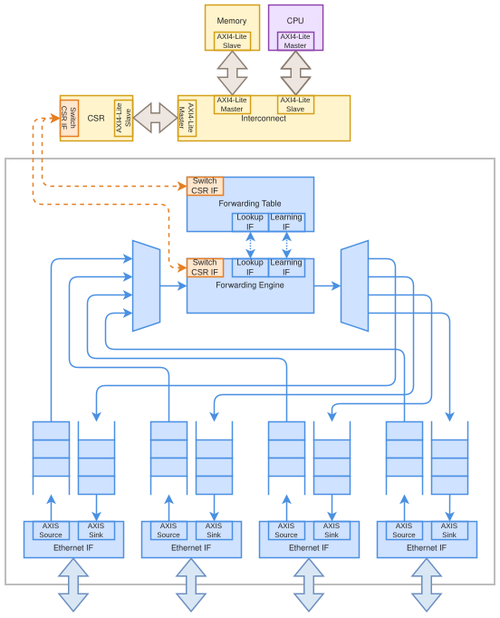

.. SPDX-FileCopyrightText: 2026 Enio Kaljic
.. SPDX-FileCopyrightText: 2026 Kerim Bavcic
.. SPDX-License-Identifier: CC-BY-SA-4.0

.. _rtl-eth-switch-shared-bus:

Shared-bus switch -- openenoc_eth_switch_shared_bus
===================================================

.. index::
   single: openenoc_eth_switch_shared_bus

Switches Ethernet traffic through one shared forwarding pipeline.

**Source:** :download:`openenoc_eth_switch_shared_bus.sv <../../../hw/rtl/core/openenoc_eth_switch_shared_bus.sv>`.

Parameters
----------

.. list-table:: Parameters
   :class: rtl-reference-table
   :header-rows: 1
   :widths: 24 18 30 28

   * - Name
     - Default value
     - Allowed values
     - Description
   * - ``NUM_OF_INTERFACES``
     - ``4``
     - 2..32
     - Number of Ethernet ports and forwarding-bitmap width; match the switch
       interface.
   * - ``TABLE_DEPTH``
     - ``32``
     - Integer >= 1
     - Number of forwarding-table entries.
   * - ``FABRIC_DATA_W``
     - ``32``
     - 8..512 bits, multiple of 8 in forwarding integration
     - Internal switching stream width; link/fabric widths must have an integer
       ratio.
   * - ``PORT_SIDE``
     - ``'1``
     - NUM_OF_INTERFACES-bit mask
     - Port orientation: zero is side A, one is side B.
   * - ``PORT_FIFO_DEPTH``
     - ``64``
     - Bytes; >= 2 widest-side words, power-of-two word count
     - Per-port asynchronous FIFO capacity; divisible by the widest link/fabric
       word size.

Signals
-------

Interface ports contain channels in both directions. The table identifies
the selected modport or stream role; member directions follow that interface.

.. list-table:: Public signals and interfaces
   :class: rtl-reference-table
   :header-rows: 1
   :widths: 30 30 17 23

   * - Name
     - Type
     - Direction / role
     - Description
   * - ``clk``
     - ``logic``
     - input
     - Clock for this component or interface domain.
   * - ``rst``
     - ``logic``
     - input
     - Active-high reset of transaction and control state.
   * - ``switch_if``
     - ``openenoc_switch_if.core``
     - bidirectional (core)
     - Switch configuration, pause status, and forwarding-table CPU access.
   * - | ``eth_if``
       | ``[NUM_OF_INTERFACES-1:0]``
     - ``openenoc_eth_if``
     - bidirectional; PORT_SIDE per port
     - Per-port bidirectional links, each with its own clock/reset domain.

Architecture and operation
--------------------------

   Shared-bus Ethernet switch architecture

Ingress adapters feed a shared stream multiplexer. One
:ref:`rtl-axis-forwarding-engine` performs destination lookup and source
learning through one :ref:`rtl-forwarding-table`. A bitmap-controlled demux
replicates or drops the resulting frame at the egress boundary. Ingress
identity accompanies the stream for learning and ingress-port exclusion.
The ingress multiplexer arbitrates complete frames, so all inputs share one
internal path even when their destinations differ. The forwarding engine puts
the selected egress-port bitmap in internal ``TUSER``; :ref:`rtl-axis-demux`
uses it for unicast delivery or multicast fanout.

Multicast fanout applies all-or-none backpressure to the selected outputs.
Once a selected egress FIFO cannot accept another beat, the shared path stalls.
This can delay unrelated ingress traffic as well as the current frame. A
multicast beat advances only when all selected outputs can accept it.

The fabric uses ``clk/rst`` while each Ethernet port retains its own domain.
Pause control takes effect at a frame boundary through the forwarding engine.
Parameter meanings and port orientation follow :ref:`rtl-eth-switch`.

Functional scenarios
--------------------

These examples use ``NUM_OF_INTERFACES = 4``, ``TABLE_DEPTH = 8``,
``FABRIC_DATA_W = 64``, and four 64-bit Ethernet links with ``KEEP_W = 8``,
``KEEP_EN = 1``, and ``LAST_EN = 1``. The fabric and all four link clocks
have aligned rising edges and a 10 ns period. Resets have been released,
and managed forwarding entries are already configured; there is no
concurrent CPU table access.

With ``PORT_SIDE = 0b1111``, frames enter through
``eth_if[n].a2b_axis_if`` and leave through ``eth_if[n].b2a_axis_if``.
All example frames contain 66 bytes, including the Ethernet header and
excluding preamble, SFD, and FCS. Each frame uses eight full beats with
KEEP ``0xFF`` and a final two-byte beat with KEEP ``0x03`` and TLAST.

Data labels identify the frame: ``FA`` uses ``DA0`` through ``DA8``,
``FB`` uses ``DB0`` through ``DB8``, ``FC`` uses ``DC0`` through ``DC8``,
and ``FD`` uses ``DD0`` through ``DD8``. Each frame retains its prefix
on every link and multicast copy, with beat numbering restarting at zero.
All scenarios use ``PORT_FIFO_DEPTH = 128`` except the blocked
multicast scenario, which uses ``PORT_FIFO_DEPTH = 32``.

A numbered tick marks a clock interval. A beat transfers at the ending
rising edge when VALID and READY are both high. ``x`` denotes irrelevant
values while VALID is low.

The matching :ref:`rtl-eth-switch-crossbar` examples use the same
frames, routes, clocks, FIFO capacities, and receiver readiness.

.. _eth-switch-shared-bus-disjoint:

Disjoint unicast routes
~~~~~~~~~~~~~~~~~~~~~~~

.. list-table:: Traffic and frame overview
   :class: documentation-table
   :header-rows: 1
   :widths: 12 38 25 25

   * - Frame
     - Data beats
     - Ingress
     - Egress
   * - ``FA``
     - ``DA0`` through ``DA8``
     - Port 0
     - Port 2
   * - ``FB``
     - ``DB0`` through ``DB8``
     - Port 1
     - Port 3
   * - ``FC``
     - ``DC0`` through ``DC8``
     - Port 2
     - Port 0
   * - ``FD``
     - ``DD0`` through ``DD8``
     - Port 3
     - Port 1

All four ingress sources assert VALID at tick 1 and send their complete
frames without input stalls. Every egress receiver stays ready. In the
illustrated arbitration state, the shared ingress multiplexer selects
``FD``, then ``FC``, ``FB``, and ``FA``. Their output transfers occupy
ticks 22--30 on port 1, 39--47 on port 0, 56--64 on port 3, and
73--81 on port 2. The shared forwarding pipeline serializes all four
frames even though their destinations are distinct. The initial winner
can change with round-robin history.

.. wavedrom::
    :name: eth-switch-shared-bus-disjoint-ingress-timing
    :caption: Four frames enter the four-port switch concurrently
    :alt: Four frames enter the four-port switch concurrently.
    :align: center

    {
        "signal": [
            {"name": "clk", "wave": "p..................."},
            ["eth_if[0]",
                ["a2b_axis_if",
                    ["A",
                        {"name": "tvalid", "wave": "01........0........."},
                        {
                            "name": "tdata",
                            "wave": "x=========x.........",
                            "data": ["DA0", "DA1", "DA2", "DA3", "DA4", "DA5", "DA6", "DA7", "DA8"]
                        },
                        {"name": "tkeep", "wave": "x=.......=x.........", "data": ["0xFF", "0x03"]},
                        {"name": "tlast", "wave": "x0.......1x........."}
                    ],
                    ["B", {"name": "tready", "wave": "1..................."}]
                ],
                ["b2a_axis_if",
                    ["B",
                        {"name": "tvalid", "wave": "0..................."},
                        {"name": "tdata", "wave": "x..................."},
                        {"name": "tkeep", "wave": "x..................."},
                        {"name": "tlast", "wave": "x..................."}
                    ],
                    ["A", {"name": "tready", "wave": "1..................."}]
                ]
            ],
            {},
            ["eth_if[1]",
                ["a2b_axis_if",
                    ["A",
                        {"name": "tvalid", "wave": "01........0........."},
                        {
                            "name": "tdata",
                            "wave": "x=========x.........",
                            "data": ["DB0", "DB1", "DB2", "DB3", "DB4", "DB5", "DB6", "DB7", "DB8"]
                        },
                        {"name": "tkeep", "wave": "x=.......=x.........", "data": ["0xFF", "0x03"]},
                        {"name": "tlast", "wave": "x0.......1x........."}
                    ],
                    ["B", {"name": "tready", "wave": "1..................."}]
                ],
                ["b2a_axis_if",
                    ["B",
                        {"name": "tvalid", "wave": "0..................."},
                        {"name": "tdata", "wave": "x..................."},
                        {"name": "tkeep", "wave": "x..................."},
                        {"name": "tlast", "wave": "x..................."}
                    ],
                    ["A", {"name": "tready", "wave": "1..................."}]
                ]
            ],
            {},
            ["eth_if[2]",
                ["a2b_axis_if",
                    ["A",
                        {"name": "tvalid", "wave": "01........0........."},
                        {
                            "name": "tdata",
                            "wave": "x=========x.........",
                            "data": ["DC0", "DC1", "DC2", "DC3", "DC4", "DC5", "DC6", "DC7", "DC8"]
                        },
                        {"name": "tkeep", "wave": "x=.......=x.........", "data": ["0xFF", "0x03"]},
                        {"name": "tlast", "wave": "x0.......1x........."}
                    ],
                    ["B", {"name": "tready", "wave": "1..................."}]
                ],
                ["b2a_axis_if",
                    ["B",
                        {"name": "tvalid", "wave": "0..................."},
                        {"name": "tdata", "wave": "x..................."},
                        {"name": "tkeep", "wave": "x..................."},
                        {"name": "tlast", "wave": "x..................."}
                    ],
                    ["A", {"name": "tready", "wave": "1..................."}]
                ]
            ],
            {},
            ["eth_if[3]",
                ["a2b_axis_if",
                    ["A",
                        {"name": "tvalid", "wave": "01........0........."},
                        {
                            "name": "tdata",
                            "wave": "x=========x.........",
                            "data": ["DD0", "DD1", "DD2", "DD3", "DD4", "DD5", "DD6", "DD7", "DD8"]
                        },
                        {"name": "tkeep", "wave": "x=.......=x.........", "data": ["0xFF", "0x03"]},
                        {"name": "tlast", "wave": "x0.......1x........."}
                    ],
                    ["B", {"name": "tready", "wave": "1..................."}]
                ],
                ["b2a_axis_if",
                    ["B",
                        {"name": "tvalid", "wave": "0..................."},
                        {"name": "tdata", "wave": "x..................."},
                        {"name": "tkeep", "wave": "x..................."},
                        {"name": "tlast", "wave": "x..................."}
                    ],
                    ["A", {"name": "tready", "wave": "1..................."}]
                ]
            ]
        ],
        "config": {"hscale": 1},
        "head": {"tick": 0}
    }

.. wavedrom::
    :name: eth-switch-shared-bus-disjoint-timing
    :caption: First two disjoint unicast frames leave through the shared path
    :alt: First two disjoint unicast frames leave through the shared path.
    :align: center

    {
        "signal": [
            {"name": "clk", "wave": "p............................."},
            ["eth_if[0]",
                ["a2b_axis_if",
                    ["A",
                        {"name": "tvalid", "wave": "0............................."},
                        {"name": "tdata", "wave": "x............................."},
                        {"name": "tkeep", "wave": "x............................."},
                        {"name": "tlast", "wave": "x............................."}
                    ],
                    ["B", {"name": "tready", "wave": "1............................."}]
                ],
                ["b2a_axis_if",
                    ["B",
                        {"name": "tvalid", "wave": "0..................1........0."},
                        {
                            "name": "tdata",
                            "wave": "x..................=========x.",
                            "data": ["DC0", "DC1", "DC2", "DC3", "DC4", "DC5", "DC6", "DC7", "DC8"]
                        },
                        {
                            "name": "tkeep",
                            "wave": "x..................=.......=x.",
                            "data": ["0xFF", "0x03"]
                        },
                        {"name": "tlast", "wave": "x..................0.......1x."}
                    ],
                    ["A", {"name": "tready", "wave": "1............................."}]
                ]
            ],
            {},
            ["eth_if[1]",
                ["a2b_axis_if",
                    ["A",
                        {"name": "tvalid", "wave": "0............................."},
                        {"name": "tdata", "wave": "x............................."},
                        {"name": "tkeep", "wave": "x............................."},
                        {"name": "tlast", "wave": "x............................."}
                    ],
                    ["B", {"name": "tready", "wave": "1............................."}]
                ],
                ["b2a_axis_if",
                    ["B",
                        {"name": "tvalid", "wave": "0.1........0.................."},
                        {
                            "name": "tdata",
                            "wave": "x.=========x..................",
                            "data": ["DD0", "DD1", "DD2", "DD3", "DD4", "DD5", "DD6", "DD7", "DD8"]
                        },
                        {
                            "name": "tkeep",
                            "wave": "x.=.......=x..................",
                            "data": ["0xFF", "0x03"]
                        },
                        {"name": "tlast", "wave": "x.0.......1x.................."}
                    ],
                    ["A", {"name": "tready", "wave": "1............................."}]
                ]
            ],
            {},
            ["eth_if[2]",
                ["a2b_axis_if",
                    ["A",
                        {"name": "tvalid", "wave": "0............................."},
                        {"name": "tdata", "wave": "x............................."},
                        {"name": "tkeep", "wave": "x............................."},
                        {"name": "tlast", "wave": "x............................."}
                    ],
                    ["B", {"name": "tready", "wave": "1............................."}]
                ],
                ["b2a_axis_if",
                    ["B",
                        {"name": "tvalid", "wave": "0............................."},
                        {"name": "tdata", "wave": "x............................."},
                        {"name": "tkeep", "wave": "x............................."},
                        {"name": "tlast", "wave": "x............................."}
                    ],
                    ["A", {"name": "tready", "wave": "1............................."}]
                ]
            ],
            {},
            ["eth_if[3]",
                ["a2b_axis_if",
                    ["A",
                        {"name": "tvalid", "wave": "0............................."},
                        {"name": "tdata", "wave": "x............................."},
                        {"name": "tkeep", "wave": "x............................."},
                        {"name": "tlast", "wave": "x............................."}
                    ],
                    ["B", {"name": "tready", "wave": "1............................."}]
                ],
                ["b2a_axis_if",
                    ["B",
                        {"name": "tvalid", "wave": "0............................."},
                        {"name": "tdata", "wave": "x............................."},
                        {"name": "tkeep", "wave": "x............................."},
                        {"name": "tlast", "wave": "x............................."}
                    ],
                    ["A", {"name": "tready", "wave": "1............................."}]
                ]
            ]
        ],
        "config": {"hscale": 1},
        "head": {"tick": 20}
    }

.. wavedrom::
    :name: eth-switch-shared-bus-disjoint-complete-timing
    :caption: Remaining disjoint unicast frames leave through the shared path
    :alt: Remaining disjoint unicast frames leave through the shared path.
    :align: center

    {
        "signal": [
            {"name": "clk", "wave": "p................................"},
            ["eth_if[0]",
                ["a2b_axis_if",
                    ["A",
                        {"name": "tvalid", "wave": "0................................"},
                        {"name": "tdata", "wave": "x................................"},
                        {"name": "tkeep", "wave": "x................................"},
                        {"name": "tlast", "wave": "x................................"}
                    ],
                    ["B", {"name": "tready", "wave": "1................................"}]
                ],
                ["b2a_axis_if",
                    ["B",
                        {"name": "tvalid", "wave": "0................................"},
                        {"name": "tdata", "wave": "x................................"},
                        {"name": "tkeep", "wave": "x................................"},
                        {"name": "tlast", "wave": "x................................"}
                    ],
                    ["A", {"name": "tready", "wave": "1................................"}]
                ]
            ],
            {},
            ["eth_if[1]",
                ["a2b_axis_if",
                    ["A",
                        {"name": "tvalid", "wave": "0................................"},
                        {"name": "tdata", "wave": "x................................"},
                        {"name": "tkeep", "wave": "x................................"},
                        {"name": "tlast", "wave": "x................................"}
                    ],
                    ["B", {"name": "tready", "wave": "1................................"}]
                ],
                ["b2a_axis_if",
                    ["B",
                        {"name": "tvalid", "wave": "0................................"},
                        {"name": "tdata", "wave": "x................................"},
                        {"name": "tkeep", "wave": "x................................"},
                        {"name": "tlast", "wave": "x................................"}
                    ],
                    ["A", {"name": "tready", "wave": "1................................"}]
                ]
            ],
            {},
            ["eth_if[2]",
                ["a2b_axis_if",
                    ["A",
                        {"name": "tvalid", "wave": "0................................"},
                        {"name": "tdata", "wave": "x................................"},
                        {"name": "tkeep", "wave": "x................................"},
                        {"name": "tlast", "wave": "x................................"}
                    ],
                    ["B", {"name": "tready", "wave": "1................................"}]
                ],
                ["b2a_axis_if",
                    ["B",
                        {"name": "tvalid", "wave": "0......................1........0"},
                        {
                            "name": "tdata",
                            "wave": "x......................=========x",
                            "data": ["DA0", "DA1", "DA2", "DA3", "DA4", "DA5", "DA6", "DA7", "DA8"]
                        },
                        {
                            "name": "tkeep",
                            "wave": "x......................=.......=x",
                            "data": ["0xFF", "0x03"]
                        },
                        {"name": "tlast", "wave": "x......................0.......1x"}
                    ],
                    ["A", {"name": "tready", "wave": "1................................"}]
                ]
            ],
            {},
            ["eth_if[3]",
                ["a2b_axis_if",
                    ["A",
                        {"name": "tvalid", "wave": "0................................"},
                        {"name": "tdata", "wave": "x................................"},
                        {"name": "tkeep", "wave": "x................................"},
                        {"name": "tlast", "wave": "x................................"}
                    ],
                    ["B", {"name": "tready", "wave": "1................................"}]
                ],
                ["b2a_axis_if",
                    ["B",
                        {"name": "tvalid", "wave": "0.....1........0................."},
                        {
                            "name": "tdata",
                            "wave": "x.....=========x.................",
                            "data": ["DB0", "DB1", "DB2", "DB3", "DB4", "DB5", "DB6", "DB7", "DB8"]
                        },
                        {
                            "name": "tkeep",
                            "wave": "x.....=.......=x.................",
                            "data": ["0xFF", "0x03"]
                        },
                        {"name": "tlast", "wave": "x.....0.......1x................."}
                    ],
                    ["A", {"name": "tready", "wave": "1................................"}]
                ]
            ]
        ],
        "config": {"hscale": 1},
        "head": {"tick": 50}
    }

.. _eth-switch-shared-bus-contention:

Contention for one output
~~~~~~~~~~~~~~~~~~~~~~~~~

.. list-table:: Traffic and frame overview
   :class: documentation-table
   :header-rows: 1
   :widths: 12 38 25 25

   * - Frame
     - Data beats
     - Ingress
     - Egress
   * - ``FA``
     - ``DA0`` through ``DA8``
     - Port 0
     - Port 3
   * - ``FB``
     - ``DB0`` through ``DB8``
     - Port 1
     - Port 3

Here ``FA`` and ``FB`` enter ports 0 and 1 at tick 1, with both
destination entries selecting port 3. Its receiver stays ready. The shared pipeline forwards ``FB``
and then ``FA``, preserving each complete frame on the output. Other
ports receive neither frame. Compared with
:ref:`eth-switch-crossbar-contention`, the shared ingress path determines
the order before the frames reach the egress FIFO.

.. wavedrom::
    :name: eth-switch-shared-bus-contention-ingress-timing
    :caption: Both frames enter the four-port switch
    :alt: Both frames enter the four-port switch.
    :align: center

    {
        "signal": [
            {"name": "clk", "wave": "p..................."},
            ["eth_if[0]",
                ["a2b_axis_if",
                    ["A",
                        {"name": "tvalid", "wave": "01........0........."},
                        {
                            "name": "tdata",
                            "wave": "x=========x.........",
                            "data": ["DA0", "DA1", "DA2", "DA3", "DA4", "DA5", "DA6", "DA7", "DA8"]
                        },
                        {"name": "tkeep", "wave": "x=.......=x.........", "data": ["0xFF", "0x03"]},
                        {"name": "tlast", "wave": "x0.......1x........."}
                    ],
                    ["B", {"name": "tready", "wave": "1..................."}]
                ],
                ["b2a_axis_if",
                    ["B",
                        {"name": "tvalid", "wave": "0..................."},
                        {"name": "tdata", "wave": "x..................."},
                        {"name": "tkeep", "wave": "x..................."},
                        {"name": "tlast", "wave": "x..................."}
                    ],
                    ["A", {"name": "tready", "wave": "1..................."}]
                ]
            ],
            {},
            ["eth_if[1]",
                ["a2b_axis_if",
                    ["A",
                        {"name": "tvalid", "wave": "01........0........."},
                        {
                            "name": "tdata",
                            "wave": "x=========x.........",
                            "data": ["DB0", "DB1", "DB2", "DB3", "DB4", "DB5", "DB6", "DB7", "DB8"]
                        },
                        {"name": "tkeep", "wave": "x=.......=x.........", "data": ["0xFF", "0x03"]},
                        {"name": "tlast", "wave": "x0.......1x........."}
                    ],
                    ["B", {"name": "tready", "wave": "1..................."}]
                ],
                ["b2a_axis_if",
                    ["B",
                        {"name": "tvalid", "wave": "0..................."},
                        {"name": "tdata", "wave": "x..................."},
                        {"name": "tkeep", "wave": "x..................."},
                        {"name": "tlast", "wave": "x..................."}
                    ],
                    ["A", {"name": "tready", "wave": "1..................."}]
                ]
            ],
            {},
            ["eth_if[2]",
                ["a2b_axis_if",
                    ["A",
                        {"name": "tvalid", "wave": "0..................."},
                        {"name": "tdata", "wave": "x..................."},
                        {"name": "tkeep", "wave": "x..................."},
                        {"name": "tlast", "wave": "x..................."}
                    ],
                    ["B", {"name": "tready", "wave": "1..................."}]
                ],
                ["b2a_axis_if",
                    ["B",
                        {"name": "tvalid", "wave": "0..................."},
                        {"name": "tdata", "wave": "x..................."},
                        {"name": "tkeep", "wave": "x..................."},
                        {"name": "tlast", "wave": "x..................."}
                    ],
                    ["A", {"name": "tready", "wave": "1..................."}]
                ]
            ],
            {},
            ["eth_if[3]",
                ["a2b_axis_if",
                    ["A",
                        {"name": "tvalid", "wave": "0..................."},
                        {"name": "tdata", "wave": "x..................."},
                        {"name": "tkeep", "wave": "x..................."},
                        {"name": "tlast", "wave": "x..................."}
                    ],
                    ["B", {"name": "tready", "wave": "1..................."}]
                ],
                ["b2a_axis_if",
                    ["B",
                        {"name": "tvalid", "wave": "0..................."},
                        {"name": "tdata", "wave": "x..................."},
                        {"name": "tkeep", "wave": "x..................."},
                        {"name": "tlast", "wave": "x..................."}
                    ],
                    ["A", {"name": "tready", "wave": "1..................."}]
                ]
            ]
        ],
        "config": {"hscale": 1},
        "head": {"tick": 0}
    }

.. wavedrom::
    :name: eth-switch-shared-bus-contention-timing
    :caption: Two complete frames share port 3 without beat interleaving
    :alt: Two complete frames share port 3 without beat interleaving.
    :align: center

    {
        "signal": [
            {"name": "clk", "wave": "p............................."},
            ["eth_if[0]",
                ["a2b_axis_if",
                    ["A",
                        {"name": "tvalid", "wave": "0............................."},
                        {"name": "tdata", "wave": "x............................."},
                        {"name": "tkeep", "wave": "x............................."},
                        {"name": "tlast", "wave": "x............................."}
                    ],
                    ["B", {"name": "tready", "wave": "1............................."}]
                ],
                ["b2a_axis_if",
                    ["B",
                        {"name": "tvalid", "wave": "0............................."},
                        {"name": "tdata", "wave": "x............................."},
                        {"name": "tkeep", "wave": "x............................."},
                        {"name": "tlast", "wave": "x............................."}
                    ],
                    ["A", {"name": "tready", "wave": "1............................."}]
                ]
            ],
            {},
            ["eth_if[1]",
                ["a2b_axis_if",
                    ["A",
                        {"name": "tvalid", "wave": "0............................."},
                        {"name": "tdata", "wave": "x............................."},
                        {"name": "tkeep", "wave": "x............................."},
                        {"name": "tlast", "wave": "x............................."}
                    ],
                    ["B", {"name": "tready", "wave": "1............................."}]
                ],
                ["b2a_axis_if",
                    ["B",
                        {"name": "tvalid", "wave": "0............................."},
                        {"name": "tdata", "wave": "x............................."},
                        {"name": "tkeep", "wave": "x............................."},
                        {"name": "tlast", "wave": "x............................."}
                    ],
                    ["A", {"name": "tready", "wave": "1............................."}]
                ]
            ],
            {},
            ["eth_if[2]",
                ["a2b_axis_if",
                    ["A",
                        {"name": "tvalid", "wave": "0............................."},
                        {"name": "tdata", "wave": "x............................."},
                        {"name": "tkeep", "wave": "x............................."},
                        {"name": "tlast", "wave": "x............................."}
                    ],
                    ["B", {"name": "tready", "wave": "1............................."}]
                ],
                ["b2a_axis_if",
                    ["B",
                        {"name": "tvalid", "wave": "0............................."},
                        {"name": "tdata", "wave": "x............................."},
                        {"name": "tkeep", "wave": "x............................."},
                        {"name": "tlast", "wave": "x............................."}
                    ],
                    ["A", {"name": "tready", "wave": "1............................."}]
                ]
            ],
            {},
            ["eth_if[3]",
                ["a2b_axis_if",
                    ["A",
                        {"name": "tvalid", "wave": "0............................."},
                        {"name": "tdata", "wave": "x............................."},
                        {"name": "tkeep", "wave": "x............................."},
                        {"name": "tlast", "wave": "x............................."}
                    ],
                    ["B", {"name": "tready", "wave": "1............................."}]
                ],
                ["b2a_axis_if",
                    ["B",
                        {"name": "tvalid", "wave": "0.1........0.......1........0."},
                        {
                            "name": "tdata",
                            "wave": "x.=========x.......=========x.",
                            "data": [
                                "DB0",
                                "DB1",
                                "DB2",
                                "DB3",
                                "DB4",
                                "DB5",
                                "DB6",
                                "DB7",
                                "DB8",
                                "DA0",
                                "DA1",
                                "DA2",
                                "DA3",
                                "DA4",
                                "DA5",
                                "DA6",
                                "DA7",
                                "DA8"
                            ]
                        },
                        {
                            "name": "tkeep",
                            "wave": "x.=.......=x.......=.......=x.",
                            "data": ["0xFF", "0x03", "0xFF", "0x03"]
                        },
                        {"name": "tlast", "wave": "x.0.......1x.......0.......1x."}
                    ],
                    ["A", {"name": "tready", "wave": "1............................."}]
                ]
            ]
        ],
        "config": {"hscale": 1},
        "head": {"tick": 20}
    }

.. _eth-switch-shared-bus-broadcast:

Broadcast without stalls
~~~~~~~~~~~~~~~~~~~~~~~~~

.. list-table:: Traffic and frame overview
   :class: documentation-table
   :header-rows: 1
   :widths: 12 38 25 25

   * - Frame
     - Data beats
     - Ingress
     - Egress
   * - ``FA``
     - ``DA0`` through ``DA8``
     - Port 0
     - Ports 1, 2, and 3

The managed forwarding entry for destination ``FF:FF:FF:FF:FF:FF``
selects bitmap ``0b1111``. The forwarding engine excludes ingress
port 0, so the broadcast frame reaches ports 1, 2, and 3. All receivers
remain ready.

``FA`` enters port 0 in ticks 1--9. Its three copies transfer
concurrently in ticks 22--30, with the same ``DA0`` through ``DA8``
on every output. Each copy ends with KEEP ``0x03`` and TLAST;
no copy returns to the ingress port.

.. wavedrom::
    :name: eth-switch-shared-bus-broadcast-timing
    :caption: One 66-byte broadcast frame is replicated to every other port
    :alt: One 66-byte broadcast frame is replicated to every other port.
    :align: center

    {
        "signal": [
            {"name": "clk", "wave": "p.................................."},
            ["eth_if[0]",
                ["a2b_axis_if",
                    ["A",
                        {"name": "tvalid", "wave": "01........0........................"},
                        {
                            "name": "tdata",
                            "wave": "x=========x........................",
                            "data": ["DA0", "DA1", "DA2", "DA3", "DA4", "DA5", "DA6", "DA7", "DA8"]
                        },
                        {
                            "name": "tkeep",
                            "wave": "x=.......=x........................",
                            "data": ["0xFF", "0x03"]
                        },
                        {"name": "tlast", "wave": "x0.......1x........................"}
                    ],
                    ["B", {"name": "tready", "wave": "1.................................."}]
                ],
                ["b2a_axis_if",
                    ["B",
                        {"name": "tvalid", "wave": "0.................................."},
                        {"name": "tdata", "wave": "x.................................."},
                        {"name": "tkeep", "wave": "x.................................."},
                        {"name": "tlast", "wave": "x.................................."}
                    ],
                    ["A", {"name": "tready", "wave": "1.................................."}]
                ]
            ],
            {},
            ["eth_if[1]",
                ["a2b_axis_if",
                    ["A",
                        {"name": "tvalid", "wave": "0.................................."},
                        {"name": "tdata", "wave": "x.................................."},
                        {"name": "tkeep", "wave": "x.................................."},
                        {"name": "tlast", "wave": "x.................................."}
                    ],
                    ["B", {"name": "tready", "wave": "1.................................."}]
                ],
                ["b2a_axis_if",
                    ["B",
                        {"name": "tvalid", "wave": "0.....................1........0..."},
                        {
                            "name": "tdata",
                            "wave": "x.....................=========x...",
                            "data": ["DA0", "DA1", "DA2", "DA3", "DA4", "DA5", "DA6", "DA7", "DA8"]
                        },
                        {
                            "name": "tkeep",
                            "wave": "x.....................=.......=x...",
                            "data": ["0xFF", "0x03"]
                        },
                        {"name": "tlast", "wave": "x.....................0.......1x..."}
                    ],
                    ["A", {"name": "tready", "wave": "1.................................."}]
                ]
            ],
            {},
            ["eth_if[2]",
                ["a2b_axis_if",
                    ["A",
                        {"name": "tvalid", "wave": "0.................................."},
                        {"name": "tdata", "wave": "x.................................."},
                        {"name": "tkeep", "wave": "x.................................."},
                        {"name": "tlast", "wave": "x.................................."}
                    ],
                    ["B", {"name": "tready", "wave": "1.................................."}]
                ],
                ["b2a_axis_if",
                    ["B",
                        {"name": "tvalid", "wave": "0.....................1........0..."},
                        {
                            "name": "tdata",
                            "wave": "x.....................=========x...",
                            "data": ["DA0", "DA1", "DA2", "DA3", "DA4", "DA5", "DA6", "DA7", "DA8"]
                        },
                        {
                            "name": "tkeep",
                            "wave": "x.....................=.......=x...",
                            "data": ["0xFF", "0x03"]
                        },
                        {"name": "tlast", "wave": "x.....................0.......1x..."}
                    ],
                    ["A", {"name": "tready", "wave": "1.................................."}]
                ]
            ],
            {},
            ["eth_if[3]",
                ["a2b_axis_if",
                    ["A",
                        {"name": "tvalid", "wave": "0.................................."},
                        {"name": "tdata", "wave": "x.................................."},
                        {"name": "tkeep", "wave": "x.................................."},
                        {"name": "tlast", "wave": "x.................................."}
                    ],
                    ["B", {"name": "tready", "wave": "1.................................."}]
                ],
                ["b2a_axis_if",
                    ["B",
                        {"name": "tvalid", "wave": "0.....................1........0..."},
                        {
                            "name": "tdata",
                            "wave": "x.....................=========x...",
                            "data": ["DA0", "DA1", "DA2", "DA3", "DA4", "DA5", "DA6", "DA7", "DA8"]
                        },
                        {
                            "name": "tkeep",
                            "wave": "x.....................=.......=x...",
                            "data": ["0xFF", "0x03"]
                        },
                        {"name": "tlast", "wave": "x.....................0.......1x..."}
                    ],
                    ["A", {"name": "tready", "wave": "1.................................."}]
                ]
            ]
        ],
        "config": {"hscale": 1},
        "head": {"tick": 0}
    }

.. _eth-switch-shared-bus-blocked:

Blocked multicast and a disjoint route
~~~~~~~~~~~~~~~~~~~~~~~~~~~~~~~~~~~~~~

.. list-table:: Traffic and frame overview
   :class: documentation-table
   :header-rows: 1
   :widths: 12 38 25 25

   * - Frame
     - Data beats
     - Ingress
     - Egress
   * - ``FA``
     - ``DA0`` through ``DA8``
     - Port 0
     - Ports 2 and 3
   * - ``FB``
     - ``DB0`` through ``DB8``
     - Port 1
     - Port 0

``FA`` starts at tick 1 and selects ports 2 and 3. ``FB`` starts at
tick 5 and selects port 0. Port 3 holds READY low until tick 45;
ports 0 and 2 remain ready. ``PORT_FIFO_DEPTH = 32`` makes the selected output FIFO fill
before the complete multicast frame can enter it. The small streaming
FIFOs also expose gaps between bursts as data and space availability
cross the clock-domain boundaries.

The egress FIFOs allow port 2 to deliver a prefix of ``FA`` while
port 3 holds ``DA0``. Once port 3's FIFO fills, all-or-none multicast
backpressure stops the shared forwarding path. ``FB`` cannot pass that
frame, so port 0 remains idle despite being ready. In the
:ref:`eth-switch-crossbar-blocked` example, the same independent route
can progress during this interval.

.. wavedrom::
    :name: eth-switch-shared-bus-blocked-ingress-timing
    :caption: Multicast and disjoint unicast frames enter the four-port switch
    :alt: Multicast and disjoint unicast frames enter the four-port switch.
    :align: center

    {
        "signal": [
            {"name": "clk", "wave": "p..................."},
            ["eth_if[0]",
                ["a2b_axis_if",
                    ["A",
                        {"name": "tvalid", "wave": "01............0....."},
                        {
                            "name": "tdata",
                            "wave": "x=====..====..x.....",
                            "data": ["DA0", "DA1", "DA2", "DA3", "DA4", "DA5", "DA6", "DA7", "DA8"]
                        },
                        {"name": "tkeep", "wave": "x=.........=..x.....", "data": ["0xFF", "0x03"]},
                        {"name": "tlast", "wave": "x0.........1..x....."}
                    ],
                    ["B", {"name": "tready", "wave": "1....0.1...0.1......"}]
                ],
                ["b2a_axis_if",
                    ["B",
                        {"name": "tvalid", "wave": "0..................."},
                        {"name": "tdata", "wave": "x..................."},
                        {"name": "tkeep", "wave": "x..................."},
                        {"name": "tlast", "wave": "x..................."}
                    ],
                    ["A", {"name": "tready", "wave": "1..................."}]
                ]
            ],
            {},
            ["eth_if[1]",
                ["a2b_axis_if",
                    ["A",
                        {"name": "tvalid", "wave": "0....1.............."},
                        {
                            "name": "tdata",
                            "wave": "x....=====..===.....",
                            "data": ["DB0", "DB1", "DB2", "DB3", "DB4", "DB5", "DB6", "DB7"]
                        },
                        {"name": "tkeep", "wave": "x....=..............", "data": ["0xFF"]},
                        {"name": "tlast", "wave": "x....0.............."}
                    ],
                    ["B", {"name": "tready", "wave": "1........0.1..0....."}]
                ],
                ["b2a_axis_if",
                    ["B",
                        {"name": "tvalid", "wave": "0..................."},
                        {"name": "tdata", "wave": "x..................."},
                        {"name": "tkeep", "wave": "x..................."},
                        {"name": "tlast", "wave": "x..................."}
                    ],
                    ["A", {"name": "tready", "wave": "1..................."}]
                ]
            ],
            {},
            ["eth_if[2]",
                ["a2b_axis_if",
                    ["A",
                        {"name": "tvalid", "wave": "0..................."},
                        {"name": "tdata", "wave": "x..................."},
                        {"name": "tkeep", "wave": "x..................."},
                        {"name": "tlast", "wave": "x..................."}
                    ],
                    ["B", {"name": "tready", "wave": "1..................."}]
                ],
                ["b2a_axis_if",
                    ["B",
                        {"name": "tvalid", "wave": "0..................."},
                        {"name": "tdata", "wave": "x..................."},
                        {"name": "tkeep", "wave": "x..................."},
                        {"name": "tlast", "wave": "x..................."}
                    ],
                    ["A", {"name": "tready", "wave": "1..................."}]
                ]
            ],
            {},
            ["eth_if[3]",
                ["a2b_axis_if",
                    ["A",
                        {"name": "tvalid", "wave": "0..................."},
                        {"name": "tdata", "wave": "x..................."},
                        {"name": "tkeep", "wave": "x..................."},
                        {"name": "tlast", "wave": "x..................."}
                    ],
                    ["B", {"name": "tready", "wave": "1..................."}]
                ],
                ["b2a_axis_if",
                    ["B",
                        {"name": "tvalid", "wave": "0..................."},
                        {"name": "tdata", "wave": "x..................."},
                        {"name": "tkeep", "wave": "x..................."},
                        {"name": "tlast", "wave": "x..................."}
                    ],
                    ["A", {"name": "tready", "wave": "10.................."}]
                ]
            ]
        ],
        "config": {"hscale": 1},
        "head": {"tick": 0}
    }

.. wavedrom::
    :name: eth-switch-shared-bus-blocked-timing
    :caption: Blocked multicast delays the disjoint unicast route
    :alt: Blocked multicast delays the disjoint unicast route.
    :align: center

    {
        "signal": [
            {"name": "clk", "wave": "p.............................."},
            ["eth_if[0]",
                ["a2b_axis_if",
                    ["A",
                        {"name": "tvalid", "wave": "0.............................."},
                        {"name": "tdata", "wave": "x.............................."},
                        {"name": "tkeep", "wave": "x.............................."},
                        {"name": "tlast", "wave": "x.............................."}
                    ],
                    ["B", {"name": "tready", "wave": "1.............................."}]
                ],
                ["b2a_axis_if",
                    ["B",
                        {"name": "tvalid", "wave": "0.............................."},
                        {"name": "tdata", "wave": "x.............................."},
                        {"name": "tkeep", "wave": "x.............................."},
                        {"name": "tlast", "wave": "x.............................."}
                    ],
                    ["A", {"name": "tready", "wave": "1.............................."}]
                ]
            ],
            {},
            ["eth_if[1]",
                ["a2b_axis_if",
                    ["A",
                        {"name": "tvalid", "wave": "1......0......................."},
                        {
                            "name": "tdata",
                            "wave": "=.....=x.......................",
                            "data": ["DB7", "DB8"]
                        },
                        {
                            "name": "tkeep",
                            "wave": "=.....=x.......................",
                            "data": ["0xFF", "0x03"]
                        },
                        {"name": "tlast", "wave": "0.....1x......................."}
                    ],
                    ["B", {"name": "tready", "wave": "0....1.0......................."}]
                ],
                ["b2a_axis_if",
                    ["B",
                        {"name": "tvalid", "wave": "0.............................."},
                        {"name": "tdata", "wave": "x.............................."},
                        {"name": "tkeep", "wave": "x.............................."},
                        {"name": "tlast", "wave": "x.............................."}
                    ],
                    ["A", {"name": "tready", "wave": "1.............................."}]
                ]
            ],
            {},
            ["eth_if[2]",
                ["a2b_axis_if",
                    ["A",
                        {"name": "tvalid", "wave": "0.............................."},
                        {"name": "tdata", "wave": "x.............................."},
                        {"name": "tkeep", "wave": "x.............................."},
                        {"name": "tlast", "wave": "x.............................."}
                    ],
                    ["B", {"name": "tready", "wave": "1.............................."}]
                ],
                ["b2a_axis_if",
                    ["B",
                        {"name": "tvalid", "wave": "0.1...0.1.0...................."},
                        {
                            "name": "tdata",
                            "wave": "x.====x.==x....................",
                            "data": ["DA0", "DA1", "DA2", "DA3", "DA4", "DA5"]
                        },
                        {
                            "name": "tkeep",
                            "wave": "x.=...x.=.x....................",
                            "data": ["0xFF", "0xFF"]
                        },
                        {"name": "tlast", "wave": "x.0...x.0.x...................."}
                    ],
                    ["A", {"name": "tready", "wave": "1.............................."}]
                ]
            ],
            {},
            ["eth_if[3]",
                ["a2b_axis_if",
                    ["A",
                        {"name": "tvalid", "wave": "0.............................."},
                        {"name": "tdata", "wave": "x.............................."},
                        {"name": "tkeep", "wave": "x.............................."},
                        {"name": "tlast", "wave": "x.............................."}
                    ],
                    ["B", {"name": "tready", "wave": "1.............................."}]
                ],
                ["b2a_axis_if",
                    ["B",
                        {"name": "tvalid", "wave": "0.1............................"},
                        {
                            "name": "tdata",
                            "wave": "x.=.......................=====",
                            "data": ["DA0", "DA1", "DA2", "DA3", "DA4", "DA5"]
                        },
                        {
                            "name": "tkeep",
                            "wave": "x.=............................",
                            "data": ["0xFF"]
                        },
                        {"name": "tlast", "wave": "x.0............................"}
                    ],
                    ["A", {"name": "tready", "wave": "0........................1....."}]
                ]
            ]
        ],
        "config": {"hscale": 1},
        "head": {"tick": 20}
    }

After port 3 asserts READY, its FIFO drains and the remaining
multicast beats reach both destinations. Only then can the shared
forwarding engine release ``FB`` toward port 0. Both multicast copies
end with ``DA8``, and the later unicast ends with ``DB8``; each final
beat has KEEP ``0x03`` and TLAST.

.. wavedrom::
    :name: eth-switch-shared-bus-blocked-release-timing
    :caption: Multicast completion releases the waiting unicast frame
    :alt: Multicast completion releases the waiting unicast frame.
    :align: center

    {
        "signal": [
            {"name": "clk", "wave": "p............................"},
            ["eth_if[0]",
                ["a2b_axis_if",
                    ["A",
                        {"name": "tvalid", "wave": "0............................"},
                        {"name": "tdata", "wave": "x............................"},
                        {"name": "tkeep", "wave": "x............................"},
                        {"name": "tlast", "wave": "x............................"}
                    ],
                    ["B", {"name": "tready", "wave": "1............................"}]
                ],
                ["b2a_axis_if",
                    ["B",
                        {"name": "tvalid", "wave": "0............1...0.1...0.10.."},
                        {
                            "name": "tdata",
                            "wave": "x............====x.====x.=x..",
                            "data": ["DB0", "DB1", "DB2", "DB3", "DB4", "DB5", "DB6", "DB7", "DB8"]
                        },
                        {
                            "name": "tkeep",
                            "wave": "x............=...x.=...x.=x..",
                            "data": ["0xFF", "0xFF", "0x03"]
                        },
                        {"name": "tlast", "wave": "x............0...x.0...x.1x.."}
                    ],
                    ["A", {"name": "tready", "wave": "1............................"}]
                ]
            ],
            {},
            ["eth_if[1]",
                ["a2b_axis_if",
                    ["A",
                        {"name": "tvalid", "wave": "0............................"},
                        {"name": "tdata", "wave": "x............................"},
                        {"name": "tkeep", "wave": "x............................"},
                        {"name": "tlast", "wave": "x............................"}
                    ],
                    ["B", {"name": "tready", "wave": "0..1........................."}]
                ],
                ["b2a_axis_if",
                    ["B",
                        {"name": "tvalid", "wave": "0............................"},
                        {"name": "tdata", "wave": "x............................"},
                        {"name": "tkeep", "wave": "x............................"},
                        {"name": "tlast", "wave": "x............................"}
                    ],
                    ["A", {"name": "tready", "wave": "1............................"}]
                ]
            ],
            {},
            ["eth_if[2]",
                ["a2b_axis_if",
                    ["A",
                        {"name": "tvalid", "wave": "0............................"},
                        {"name": "tdata", "wave": "x............................"},
                        {"name": "tkeep", "wave": "x............................"},
                        {"name": "tlast", "wave": "x............................"}
                    ],
                    ["B", {"name": "tready", "wave": "1............................"}]
                ],
                ["b2a_axis_if",
                    ["B",
                        {"name": "tvalid", "wave": "0.1..0......................."},
                        {
                            "name": "tdata",
                            "wave": "x.===x.......................",
                            "data": ["DA6", "DA7", "DA8"]
                        },
                        {
                            "name": "tkeep",
                            "wave": "x.=.=x.......................",
                            "data": ["0xFF", "0x03"]
                        },
                        {"name": "tlast", "wave": "x.0.1x......................."}
                    ],
                    ["A", {"name": "tready", "wave": "1............................"}]
                ]
            ],
            {},
            ["eth_if[3]",
                ["a2b_axis_if",
                    ["A",
                        {"name": "tvalid", "wave": "0............................"},
                        {"name": "tdata", "wave": "x............................"},
                        {"name": "tkeep", "wave": "x............................"},
                        {"name": "tlast", "wave": "x............................"}
                    ],
                    ["B", {"name": "tready", "wave": "1............................"}]
                ],
                ["b2a_axis_if",
                    ["B",
                        {"name": "tvalid", "wave": "0.1..0......................."},
                        {
                            "name": "tdata",
                            "wave": "x.===x.......................",
                            "data": ["DA6", "DA7", "DA8"]
                        },
                        {
                            "name": "tkeep",
                            "wave": "x.=.=x.......................",
                            "data": ["0xFF", "0x03"]
                        },
                        {"name": "tlast", "wave": "x.0.1x......................."}
                    ],
                    ["A", {"name": "tready", "wave": "1............................"}]
                ]
            ]
        ],
        "config": {"hscale": 1},
        "head": {"tick": 51}
    }

.. _eth-switch-shared-bus-csr-pause:

CSR-controlled pause and resume
~~~~~~~~~~~~~~~~~~~~~~~~~~~~~~~~

.. list-table:: Traffic and frame overview
   :class: documentation-table
   :header-rows: 1
   :widths: 12 38 25 25

   * - Frame
     - Data beats
     - Ingress
     - Egress
   * - ``FA``
     - ``DA0`` through ``DA8``
     - Port 0
     - Port 1
   * - ``FB``
     - ``DB0`` through ``DB8``
     - Port 1
     - Port 0

``FA`` arrives in ticks 1--9 and forwarding begins. A CSR write
sets ``forwarding_control.pause_request`` at tick 12. The pause
request allows the active frame to finish before stopping at the
next frame boundary. Every receiver remains ready.

``FB`` arrives on the reverse route in ticks 24--32 while port 1
finishes transmitting ``FA`` in ticks 22--30. Input buffering
accepts the second frame, which waits for forwarding while the
pause request remains asserted.

``forwarding_control.pause_done`` becomes high at tick 25, confirming
that forwarding is paused at frame boundaries. Egress FIFOs can
continue draining after this status rises.

.. wavedrom::
    :name: eth-switch-shared-bus-csr-pause-drain-timing
    :caption: CSR pause lets FA finish while FB waits for forwarding
    :alt: CSR pause lets FA finish while FB waits for forwarding.
    :align: center

    {
        "signal": [
            {"name": "clk", "wave": "p.................................."},
            ["switch_if",
                ["CSR",
                    {
                        "name": "forwarding_control.pause_request.value",
                        "wave": "0...........1......................"
                    },
                    {}
                ],
                ["Core",
                    {
                        "name": "forwarding_control.pause_done.next",
                        "wave": "0........................1........."
                    },
                    {}
                ]
            ],
            {},
            ["eth_if[0]",
                ["a2b_axis_if",
                    ["A",
                        {"name": "tvalid", "wave": "01........0........................"},
                        {
                            "name": "tdata",
                            "wave": "x=========x........................",
                            "data": ["DA0", "DA1", "DA2", "DA3", "DA4", "DA5", "DA6", "DA7", "DA8"]
                        },
                        {
                            "name": "tkeep",
                            "wave": "x=.......=x........................",
                            "data": ["0xFF", "0x03"]
                        },
                        {"name": "tlast", "wave": "x0.......1x........................"}
                    ],
                    ["B", {"name": "tready", "wave": "1.................................."}]
                ],
                ["b2a_axis_if",
                    ["B",
                        {"name": "tvalid", "wave": "0.................................."},
                        {"name": "tdata", "wave": "x.................................."},
                        {"name": "tkeep", "wave": "x.................................."},
                        {"name": "tlast", "wave": "x.................................."}
                    ],
                    ["A", {"name": "tready", "wave": "1.................................."}]
                ]
            ],
            {},
            ["eth_if[1]",
                ["a2b_axis_if",
                    ["A",
                        {"name": "tvalid", "wave": "0.......................1........0."},
                        {
                            "name": "tdata",
                            "wave": "x.......................=========x.",
                            "data": ["DB0", "DB1", "DB2", "DB3", "DB4", "DB5", "DB6", "DB7", "DB8"]
                        },
                        {
                            "name": "tkeep",
                            "wave": "x.......................=.......=x.",
                            "data": ["0xFF", "0x03"]
                        },
                        {"name": "tlast", "wave": "x.......................0.......1x."}
                    ],
                    ["B", {"name": "tready", "wave": "1.................................."}]
                ],
                ["b2a_axis_if",
                    ["B",
                        {"name": "tvalid", "wave": "0.....................1........0..."},
                        {
                            "name": "tdata",
                            "wave": "x.....................=========x...",
                            "data": ["DA0", "DA1", "DA2", "DA3", "DA4", "DA5", "DA6", "DA7", "DA8"]
                        },
                        {
                            "name": "tkeep",
                            "wave": "x.....................=.......=x...",
                            "data": ["0xFF", "0x03"]
                        },
                        {"name": "tlast", "wave": "x.....................0.......1x..."}
                    ],
                    ["A", {"name": "tready", "wave": "1.................................."}]
                ]
            ]
        ],
        "config": {"hscale": 1},
        "head": {"tick": 0}
    }

A CSR write clears ``pause_request`` at tick 40. ``pause_done``
falls, and the queued reverse frame can proceed. Port 0 transfers
``DB0`` through ``DB8`` in ticks 54--62, ending with KEEP
``0x03`` and TLAST. No beat of ``FB`` leaves the switch before
the pause is released.

.. wavedrom::
    :name: eth-switch-shared-bus-csr-pause-resume-timing
    :caption: Clearing the CSR pause forwards the queued reverse frame
    :alt: Clearing the CSR pause forwards the queued reverse frame.
    :align: center

    {
        "signal": [
            {"name": "clk", "wave": "p....................................."},
            ["switch_if",
                ["CSR",
                    {
                        "name": "forwarding_control.pause_request.value",
                        "wave": "1....0................................"
                    },
                    {}
                ],
                ["Core",
                    {
                        "name": "forwarding_control.pause_done.next",
                        "wave": "1....0................................"
                    },
                    {}
                ]
            ],
            {},
            ["eth_if[0]",
                ["a2b_axis_if",
                    ["A",
                        {"name": "tvalid", "wave": "0....................................."},
                        {"name": "tdata", "wave": "x....................................."},
                        {"name": "tkeep", "wave": "x....................................."},
                        {"name": "tlast", "wave": "x....................................."}
                    ],
                    ["B", {"name": "tready", "wave": "1....................................."}]
                ],
                ["b2a_axis_if",
                    ["B",
                        {"name": "tvalid", "wave": "0..................1........0........."},
                        {
                            "name": "tdata",
                            "wave": "x..................=========x.........",
                            "data": ["DB0", "DB1", "DB2", "DB3", "DB4", "DB5", "DB6", "DB7", "DB8"]
                        },
                        {
                            "name": "tkeep",
                            "wave": "x..................=.......=x.........",
                            "data": ["0xFF", "0x03"]
                        },
                        {"name": "tlast", "wave": "x..................0.......1x........."}
                    ],
                    ["A", {"name": "tready", "wave": "1....................................."}]
                ]
            ],
            {},
            ["eth_if[1]",
                ["a2b_axis_if",
                    ["A",
                        {"name": "tvalid", "wave": "0....................................."},
                        {"name": "tdata", "wave": "x....................................."},
                        {"name": "tkeep", "wave": "x....................................."},
                        {"name": "tlast", "wave": "x....................................."}
                    ],
                    ["B", {"name": "tready", "wave": "1....................................."}]
                ],
                ["b2a_axis_if",
                    ["B",
                        {"name": "tvalid", "wave": "0....................................."},
                        {"name": "tdata", "wave": "x....................................."},
                        {"name": "tkeep", "wave": "x....................................."},
                        {"name": "tlast", "wave": "x....................................."}
                    ],
                    ["A", {"name": "tready", "wave": "1....................................."}]
                ]
            ]
        ],
        "config": {"hscale": 1},
        "head": {"tick": 35}
    }

.. _verification-openenoc-eth-switch-shared-bus:

Verification
------------

The test suite is in ``dv/core/openenoc_eth_switch_shared_bus/``.

Testbench
~~~~~~~~~

This integration suite validates the ``openenoc_eth_switch_shared_bus`` module. The switch
combines per-port clock-domain and data-width adapters, a frame-aware round-robin AXI Stream
arbiter/multiplexer, the openENOC forwarding engine and forwarding table, and a bitmap-routed
AXI Stream demultiplexer.

The test wrapper instantiates the switch, a parameterized array of ``openenoc_eth_if`` links,
and one ``openenoc_switch_if``. The default Makefile configuration uses four links. The
generated CSR register block is intentionally not instantiated. Flattened testbench signals
drive the control fields of ``openenoc_switch_if`` directly from cocotb and expose the
corresponding status and acknowledge signals.

The wrapper acts as the peer opposite each switch port. For a side-B switch port it transmits
through ``a2b_axis_if`` and receives through ``b2a_axis_if``; those directions are reversed for
a side-A switch port. Constant-index AXI Stream bridges expose both cases uniformly as
``port_rx_axis_if`` and ``port_tx_axis_if``. This also avoids unreliable VPI access to nested
interface arrays with Verilator.

Datapath Under Test
~~~~~~~~~~~~~~~~~~~

For each input frame, the test exercises the complete shared datapath:

#. The ingress asynchronous FIFO adapter moves the frame into the fabric clock domain and adapts it
   to ``FABRIC_DATA_W``.

#. ``taxi_axis_arb_mux`` selects one ingress using frame-aware round-robin arbitration and writes
   the selected port index into ``tid``.

#. ``openenoc_axis_forwarding_engine`` extracts the destination and source MAC addresses, requests
   lookup and learning operations, removes the ingress port from the forwarding result, and writes
   the egress bitmap into ``tuser``.

#. ``openenoc_forwarding_table`` returns either a matching table bitmap or the configured default
   bitmap. In unmanaged mode it also learns source MAC addresses automatically.

#. ``openenoc_axis_demux`` uses the ``tuser`` bitmap to replicate the frame to all selected outputs
   with all-or-none multicast backpressure.

#. The egress asynchronous FIFO adapters return the frames to the individual port clock domains.

Control Interface Model
~~~~~~~~~~~~~~~~~~~~~~~

The wrapper exposes the following CSR-equivalent controls to cocotb:

- managed or unmanaged operation mode,

- pause request and pause-done status,

- default forwarding bitmap,

- forwarding-table CPU address, write data, bit enables, request, and acknowledge signals.

Each forwarding-table entry occupies 16 bytes and contains four 32-bit words:

.. list-table::
   :class: rtl-reference-table
   :header-rows: 1

   * - Word
     - Byte offset
     - Contents
   * - MAC low
     - 0
     - MAC address bits 31:0
   * - MAC high
     - 4
     - MAC address bits 47:32
   * - Interface bitmap
     - 8
     - Egress-port bitmap
   * - Configuration
     - 12
     - Entry-enable bit

The managed-mode tests assert ``pause_request`` and wait for ``pause_done`` before programming
the table. This models the intended software sequence and ensures that modification occurs at a
frame boundary.

Coverage
~~~~~~~~

**Functional checks:**

- End-to-end frame transfer through ingress adaptation, arbitration, forwarding, demultiplexing,
  and egress adaptation

- Lookup misses using the CSR default-forwarding bitmap

- Managed forwarding-table programming through the CPU request/acknowledge interface

- Lookup hits and multicast replication

- Autonomous source-MAC learning in unmanaged mode

- Removal of the ingress interface from the egress bitmap

- Preservation of frame data and ``tdest``

- Continuous ``tvalid`` across back-to-back frame boundaries

- Standard 1500-byte and jumbo 9000-byte Ethernet payloads

- Dropping frames with incomplete 1-5 byte destination addresses

- Dropping frames with incomplete 6-11 byte Ethernet headers

- Detection of frames delivered to unexpected egress ports

- Pause request and pause-done sequencing before managed table updates

- Pause requests asserted while a frame is active

- CPU readback through the switch CSR bridge

- Side-A, side-B, and mixed port orientations

**Scenarios:**

- ``test_default_forwarding``: an unknown destination arriving on port 0 uses default bitmap
  ``0b0010`` and exits only through port 1.

- ``test_managed_multicast_hit``: software programs a destination with bitmap ``0b1100``; the
  matching frame is replicated to ports 2 and 3.

- ``test_unmanaged_learning``: a source observed on port 0 is learned and then reached by a frame
  arriving on port 1.

- ``test_ingress_port_suppression``: a table result selecting ports 0 and 1 is reduced to port 1
  when the frame arrived on port 0.

- ``test_arbiter_overwrites_source_tid``: a frame carrying an intentionally incorrect source
  ``tid`` enters physical port 2; the arbiter replaces it with 2, forwarding suppresses port 2,
  and every output copy carries ``tid = 2``.

- ``test_round_robin_between_active_ingresses``: ports 0 and 1 are filled while forwarding is
  paused; after resume, frame-boundary observations verify that both active inputs are served
  alternately and that each frame retains the arbiter-generated ingress identity.

- ``test_zero_bitmap_drops_frame``: an unknown destination with a zero default bitmap is consumed
  without appearing on any egress interface.

- ``test_incomplete_destination_address_drops_frame``: frames ending before the complete six-byte
  destination address are dropped even when the default forwarding bitmap selects a valid egress.

- ``test_incomplete_ethernet_header_drops_frame``: frames with a complete destination address but
  an incomplete source address are dropped even when the destination has a valid programmed
  unicast route.

- ``test_header_only_and_unaligned_frames``: Ethernet header-only frames and several
  non-word-aligned lengths verify final-beat ``tkeep`` handling.

- ``test_back_to_back_frame_burst``: twelve consecutive frames of different lengths verify
  boundaries, ordering, sidebands, and sustained operation.

- ``test_no_idle_cycle_between_back_to_back_frames``: four queued frames verify that the source
  presents the next frame in the cycle immediately following each accepted ``tlast``, without a
  source-created idle cycle.

- ``test_standard_and_jumbo_payloads``: frames carrying 1500-byte and 9000-byte payloads with
  EtherType ``0x88B5`` traverse the switch intact. Their internal AXI Stream lengths are 1514 and
  9014 bytes because FCS is not present.

- ``test_all_ingress_ports_simultaneously``: all four ingress FIFOs are preloaded with three
  frames; each arbitration round must serve every port once, and all twelve frames must reach
  their independently configured outputs.

- ``test_unmanaged_mac_moves_to_new_port``: a learned source moves from port 0 to port 2, and a
  subsequent lookup must use the updated location.

- ``test_multicast_with_output_backpressure``: eight multicast frames traverse two independently
  stalled outputs without loss, duplication, or reordering.

- ``test_managed_table_cpu_readback``: the highest valid table entry is written and all four CSR
  words are read back through the switch interface.

- ``test_pause_completes_current_frame_and_blocks_next``: pause is asserted after arbitration
  starts a long frame; that frame drains, the next frame remains blocked, and forwarding resumes
  only after pause is released.

**TestFactory matrix:**

``run_factory_routing`` follows the same factory pattern used by the other openENOC and Taxi
component tests. It generates the Cartesian product of:

- three routes: unicast, two-port multicast, and all-port multicast with ingress suppression,

- AXI input idle insertion disabled or enabled,

- AXI output backpressure disabled or enabled.

Every generated case sends Ethernet frames with payload lengths 0, 1, 3, 16, 47, and 128 bytes.
It checks payload ordering and integrity, ``tid`` replacement, ``tdest`` preservation, multicast
copies, and absence of traffic on unselected ports.

**Pytest parameter sweep:**

The pytest runner repeats all 18 directed tests and 12 TestFactory cases for the following
``(NUM_OF_INTERFACES, DATA_W, FABRIC_DATA_W, TABLE_DEPTH, PORT_FIFO_DEPTH, PORT_SIDE)`` tuples:

- ``(4, 8, 32, 5, 64, 0b1111)``

- ``(5, 24, 48, 8, 48, 0b10101)``

- ``(4, 32, 32, 8, 64, 0b0000)``

- ``(8, 64, 16, 8, 16, 0b10101010)``

This covers four, five, and eight interfaces; width expansion, equal-width transfer, and width
contraction; power-of-two and non-power-of-two stream widths; a non-power-of-two
forwarding-table depth; a minimum-size two-word FIFO; and all-A, all-B, and mixed port
orientations.

Independent port clocks, heterogeneous widths between ports, ``TABLE_DEPTH=1``, and table-full
replacement behavior are not yet covered by this suite.
