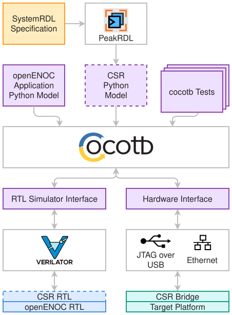
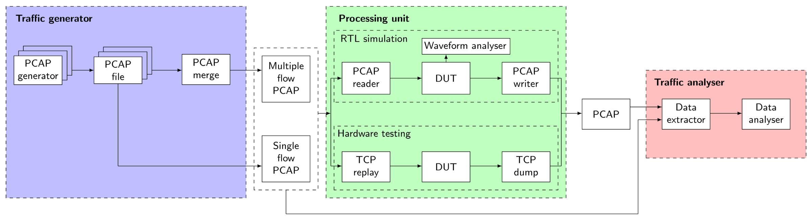

.. SPDX-FileCopyrightText: 2026 Enio Kaljic
.. SPDX-FileCopyrightText: 2026 Amina Tankovic
.. SPDX-FileCopyrightText: 2026 Kerim Bavcic
.. SPDX-License-Identifier: CC-BY-SA-4.0

Verification Infrastructure
===========================

Introduction
------------

The openENOC verification infrastructure provides a unified framework for functional verification of hardware, software, and hardware/software interactions throughout the project lifecycle. The framework is based on open-source tools, primarily Verilator and cocotb, and is designed to support fast, scriptable, and reproducible verification workflows.

Verification activities are developed in parallel with RTL and software development. The infrastructure emphasizes reuse, allowing common verification components, register models, and test scenarios to be applied consistently across simulation and hardware environments. Particular attention is given to supporting parameterized designs, heterogeneous configurations, and multiple clock domains, which are expected to be common characteristics of future openENOC-based systems.

The infrastructure also incorporates concepts previously developed for reproducible verification and benchmarking of networking hardware, particularly the use of PCAP-based traffic replay and capture mechanisms for protocol-aware testing and analysis. These concepts provide a practical foundation for validating Ethernet-based communication subsystems and higher-level networking functionality.

Verification Architecture
-------------------------

.. index::
   single: Component-Level Verification
   single: HAL-Level Verification
   single: Subsystem-Level Verification
   single: System-Level Verification

The verification architecture is organized into several complementary levels, each targeting a different stage of system integration:

* **Component-Level Verification** — Individual RTL modules are verified using dedicated cocotb testbenches. This level focuses on functional correctness, protocol compliance, corner-case handling, and parameterized configurations. Future work will expand this layer with protocol-aware verification environments and coverage-driven testing of datapath components introduced throughout the project.
* **HAL-Level Verification** — Hardware functionality is verified through software-visible interfaces rather than direct signal manipulation whenever practical. This approach aligns verification with the Hardware Abstraction Layer (HAL) used by software components and enables reuse of test scenarios across simulation and hardware platforms. This level also establishes the foundation for hardware/software co-verification by ensuring that software-visible behavior remains consistent across simulation and hardware environments.
* **Subsystem-Level Verification** — Multiple RTL components are verified together as integrated subsystems. Typical examples include communication endpoints, switching elements, control subsystems, and other functional blocks composed of several reusable components. Subsequent project phases will extend subsystem verification to larger packet-processing pipelines and interactions between heterogeneous interfaces and clock domains.
* **System-Level Verification** — Complete reference systems and demonstration platforms are verified using realistic traffic patterns and application-level scenarios. This level validates interactions between hardware, software, and external interfaces. This level ultimately evolves toward software-driven end-to-end verification, where complete applications interact with the simulated and physical openENOC platform.

Current component suites exercise bus adapters, streaming logic, forwarding
tables, switching blocks, and endpoint engines, including DMA and interrupt
control. The full-endpoint suite integrates the CPU, memories, generated CSR
block, and communication logic, and executes C firmware through the Endpoint
HAL.

Verification Framework
----------------------

.. index::
   single: Verilator
   single: cocotb

The verification framework is built around Verilator and cocotb. Verilator serves both as a high-performance RTL simulator and as the primary linting tool within the development workflow, enabling verification activities to begin with static design checks before progressing to functional simulation. Cocotb enables development of verification components and test scenarios in Python, providing a flexible and reusable environment for functional verification.

The framework includes reusable drivers, monitors, scoreboards, and utility libraries that can be shared across verification levels. Tests are designed to be parameterizable, allowing the same verification scenarios to be executed across multiple configurations, including different data widths, interface options, and clocking arrangements.

.. index::
   single: Scoreboards
   single: Local regressions
   single: pytest

Existing directed tests and scoreboards check protocol behavior, arbitration,
backpressure, and error handling. Local regressions run through suite-level
Make and pytest flows, parameter sweeps, and shell entry points. Shared output
paths organize simulator builds, results, waveforms, and captured traffic for
repeatable runs and debugging.

.. index::
   single: Clock domains

Verification components can operate with independent clocks and configurable
timing relationships. Parameterized scenarios vary these relationships to
exercise clock-domain crossings and synchronization mechanisms under different
timing conditions.

Building on this reusable infrastructure, future development will extend
protocol-aware scoreboards, functional coverage collection, layered testbench
architectures, project-wide regression coordination, and continuous integration
workflows.

CSR-Based Verification
~~~~~~~~~~~~~~~~~~~~~~

Control and Status Register (CSR) definitions are described using SystemRDL and serve as the single source of truth for register-level interfaces.

   CSR-Based Verification Framework

PeakRDL-generated Python models are used within the verification environment to provide a consistent abstraction of the register map. This approach enables automated verification of control-plane functionality while ensuring alignment between RTL implementations, software APIs, documentation, and verification artefacts.

By deriving verification models directly from the SystemRDL specification, register-level tests can be developed independently of implementation details, reducing duplication and improving maintainability as the design evolves.

The generated CSR models also provide a common software interface that can be connected either to a simulated RTL environment or to physical hardware through the Hardware Interface abstraction layer. This enables the same verification software, configuration utilities, and diagnostic tools to be reused across simulation and hardware environments, minimizing differences between development and deployment workflows.

As a result, software-driven verification can be performed early in the development process using simulated hardware models and later reused for validation on FPGA-based platforms without significant modifications.

Full-endpoint CSR test backend
^^^^^^^^^^^^^^^^^^^^^^^^^^^^^^

``dv/hal/openenoc_endpoint_full/`` exercises the generated CSR block through
AXI4-Lite. ``testbench.py`` starts a 10 ns clock, applies reset, and constructs
a cocotb ``AxiLiteMaster`` and the generated PeakRDL register model.
``rtl_simulator.py`` implements the model's synchronous read/write callbacks
with cocotb ``resume`` wrappers around asynchronous bus transactions. Cocotb
``bridge`` runs the normal Python register tests from ``tests.py`` without
blocking the simulation event loop.

The RTL wrapper ``test_openenoc_endpoint_full_csr.sv`` injects hardware status
and command acknowledgements. The tests use generated register locations,
including configuration adjacency checks and independent peer/raw-DMA error
clear commands. The CSR block, its package, and the Python model come from
``build/hal/openenoc_endpoint_full/``; regenerate them with ``make -C hal all``.
The simulation build and outputs go to
``build/dv/hal/openenoc_endpoint_full/sim_build/``.

.. index::
   single: FST
   single: GTKWave

This suite uses the cocotb Makefile flow directly. Verilator FST tracing is
enabled on each simulation run, and ``make wave`` in the suite directory opens
the ``dump.fst`` from that build directory with GTKWave. It has no pytest
parameter sweep. The component
suites use their ``run_tests.sh pytest``, ``waves``, and ``clean`` entry points.

All project DV suites store generated artifacts under ``build/dv/``, mirroring
their source group and component names. Make uses ``sim_build/`` and
pytest uses ``sim_build/pytest/<case>/`` inside each component's build directory.
Simulator binaries, generated C++ sources, result XML, FST waveforms, and
captured PCAP files stay there. Python bytecode uses the component's
``__pycache__/`` prefix and temporary files use ``tmp/``. The pytest session
cache is shared at ``build/dv/.pytest_cache/``. These paths apply to direct
Make and pytest calls as well as the shell wrappers.

.. index::
   single: HardwareInterface

``hardware_test.py`` reuses the same register tests and callback API through
``HardwareInterface``. The current backend is a placeholder based on the
generated simulator model, rather than board access. ``make hwtest`` selects
that backend. A board transport can replace its read/write implementation
without changing the register tests.

Traffic-Based Verification
~~~~~~~~~~~~~~~~~~~~~~~~~~

.. index::
   single: PCAP

Since openENOC is built around Ethernet-based communication, the verification framework adopts a PCAP-based traffic methodology inspired by previous work on verification and benchmarking of networking and cryptographic hardware. In this approach, packet traces are used as reproducible test vectors that can be injected into both simulated and physical implementations.

   Traffic-Based Verification Framework

Traffic stimuli are generated from recorded or synthesized Ethernet traces and injected into simulations through dedicated source models. Corresponding sink models capture resulting Ethernet frames and store them as PCAP files for post-processing and analysis. This approach is conceptually aligned with the PCAP reader and PCAP writer methodology, where network traffic is replayed through a device under test and captured again for functional and performance evaluation. 

The use of PCAP files enables reproducible regression testing, reuse of real network traffic captures, protocol-level debugging, and integration with standard analysis tools such as Wireshark. Captured traces can be compared against reference outputs, enabling packet-level scoreboarding and protocol-aware verification. Furthermore, the same methodology can be applied in both RTL simulation and hardware-based testing environments, providing a consistent verification workflow throughout the project lifecycle. 

Hardware-Software Co-Verification
~~~~~~~~~~~~~~~~~~~~~~~~~~~~~~~~~

.. index::
   single: Hardware-software co-verification

Hardware-software co-verification validates hardware and software together as
an interacting system. Software drives the hardware through its normal APIs,
while the verification environment checks both software results and hardware
responses to expose errors at their boundary.

Compiled C firmware executes on the PicoRV32 RTL processor within the Verilator
endpoint simulation, while cocotb controls stimuli and observes hardware
behavior. With runtime assertions enabled (``DEBUG=1``), a failed C ``assert``
records the source-file pointer and line in ``_openenoc_assert_status``,
publishes a failure status, and then traps the CPU, preserving the application's
completed-check mask.

The full-endpoint suite includes continuous-transfer, stalled-transfer, and
fault-injection scenarios that check both successful execution and the assertion
failure path.

The linker keeps this record at the start of DMEM, and testbench signals expose
its fields and the CPU trap to cocotb. Cocotb resolves the filename from the
firmware image and reports the failing software check alongside observed
traffic and bus activity; successful runs require firmware success, the
expected completed-check mask, and the hardware checks. Fault-injection
scenarios corrupt loopback payloads to verify that assertion diagnostics appear
before the trap and remain intact afterward, as described by the assertion
contract in :ref:`runtime-assertions`.

ISS-Based Co-Simulation
~~~~~~~~~~~~~~~~~~~~~~~

.. index::
   single: ISS
   single: Spike

The implemented co-simulation environment in ``dv/iss/`` executes RISC-V
firmware with `Spike, the RISC-V ISA simulator
<https://github.com/riscv-software-src/riscv-isa-sim>`_, while Verilator simulates
the endpoint crossbar, DMEM, generated CSR block, communication logic, and
Ethernet streams. Cocotb drives the hardware, services software data accesses,
and checks firmware results together with bus and traffic behavior. This
complements the existing PicoRV32 RTL firmware tests with an ISS backend.

Spike is embedded through its ``processor_t`` and ``simif_t`` APIs behind a
versioned C ABI, accessed from Python through ``ctypes``. Each endpoint handle
owns one RV32I+Zicsr machine-mode hart and one native worker thread. The worker
publishes one pending 1-, 2-, or 4-byte external data request and waits while
cocotb performs the corresponding AXI4-Lite transaction. Execution resumes
after the final R or B response, so backpressure reaches the executing firmware
while the simulator thread remains free to advance RTL and service other
endpoints. Independent workers run without an instruction-by-instruction host
barrier.

Memory ranges come from the RDL-generated
``build/hal/<endpoint>/sw/memory_map.h`` and are passed per endpoint handle.
``HAL_EP`` selects the default map, currently ``openenoc_endpoint_full``. This
profile provides private 32 KiB ISS IMEM at ``0x00000000``, RTL DMEM at
``0x10000000-0x10007fff``, and RTL CSRs at ``0x20000000-0x20001fff``. Instruction
fetches stay in private ISS IMEM. Native tests qualify distinct maps in one
process; the current RTL test tops and firmware targets use the full endpoint.
Mixed RTL endpoint types require matching test tops, source selections, and
firmware builds.

The ELF loader validates ELF32 little-endian RISC-V executables against the
RV32I soft-float profile, supported memory ranges, load-segment constraints,
and an executable entry point. It copies file-backed load bytes into ISS IMEM
using their physical/load addresses. Firmware startup copies initialized data
to RTL DMEM and clears BSS; the loader leaves those operations to the actual
startup code. ELF symbols provide completion addresses for the tests.

The unchanged ``csr_smoke`` C application runs with a separate ``PLATFORM=iss``
``rv32i_zicsr`` ELF, using standard machine-mode CSRs and ``mret`` in place of
PicoRV32-specific IRQ instructions. IRQ-enabled handles sample the actual RTL
CPU IRQ level into ``mip.MEIP`` and receive bounded instruction credit,
initially 32 steps per sampled RTL clock. After each AXI response, the bridge
publishes the stable IRQ level before releasing the blocked instruction.
This pacing is not a PicoRV32 cycle model; handles without IRQ support retain
unpaced execution.

The verification targets cover the native API, Python binding, ELF loader,
and software interactions with RTL:

* ``rtl-smoke``, ``rtl-lanes-smoke``, and ``rtl-bridge-smoke`` exercise DMEM
  accesses, byte/halfword lanes, signed loads, AXI channel backpressure,
  malformed requests, bus errors, and timeouts.
* ``rtl-firmware-smoke`` checks ``csr_smoke`` interrupt entry and return,
  both CSR claim completion tokens, IRQ assertion and deassertion, and the
  complete 17-beat Ethernet frame, including ``TKEEP`` and ``TLAST``.
  ``rtl-irq-system-smoke`` runs two independent IRQ-enabled instances with
  separate RTL loopbacks.
* ``rtl-startup-smoke`` runs ``iss_startup`` to check initialized data,
  dirty BSS clearing, read-only data, and stack traffic through RTL DMEM.
* ``rtl-system-smoke`` runs two independent ``iss_link`` contexts against
  directly crossed RTL Ethernet streams. It checks request/reply traffic,
  firmware-validated Ethernet headers and payloads, every transferred beat,
  isolated DMEM state, and continued progress while the other endpoint stalls
  or stops. A separate case checks recovery after a mid-frame stop.
* ``rtl-lifecycle-smoke`` qualifies coordinated worker stop and whole-top
  RTL/BFM reset while AW/W, B, or R is blocked. Restarted workers use a new
  epoch, and late responses are rejected. An accepted write remains in DMEM;
  an incomplete write does not.

Malformed and out-of-range requests are rejected before AXI submission. CSR
generation enables ``--err-if-bad-addr`` and ``--err-if-bad-rw``. The bridge
suite checks that an unassigned CSR read and a read-only CSR write return
RTL-generated ``SLVERR`` and report an error to the ISS worker. Separate error
and 10 us timeout tests use a controlled AXI responder. These checks do not
establish CPU trap equivalence or safe replay of an in-flight write after
timeout. Lifecycle recovery coordinates worker stop with bus reset. Recovery
from an interrupted Ethernet frame resets both endpoints and starts a fresh
exchange. The recorded
``accepted_sim_tick`` marks submission to the AXI BFM, while
``completed_sim_tick`` follows the R/B response.

``make -C dv/iss check`` runs native and Python checks, and
``make -C dv/iss check-all`` adds every RTL target and generates the aggregate
success manifest. Per-target JUnit XML and the validated JSON manifest live
under ``build/dv/iss/reports/``. The manifest records repository and pinned
Spike commits, tracked-worktree state, ISS library and platform-specific
firmware hashes, CPU/memory/IRQ profile, tool versions, and test counts.
Missing or failing XML prevents manifest generation, and ``check-all`` removes
the previous manifest before starting. Standalone smoke targets do not update
that aggregate result. ThreadSanitizer qualification uses the separate
``tsan-smoke`` target. Build prerequisites, individual commands, and clean-clone
qualification are documented in ``dv/iss/README.md``; the pinned Spike commit
and CPU profile are recorded in ``dv/iss/compatibility.json``.

Verification Roadmap
--------------------

Further development will extend the existing component, endpoint, and
two-endpoint ISS suites to larger integrated systems with switches and multiple
clock domains. Software-driven Switch HAL verification, broader protocol-aware scoreboards,
and systematic functional coverage collection will build on the current tests
and firmware completed-check reporting.

The Spike bridge, ELF loading, standard machine-mode startup and interrupt
support, and independent endpoint execution are implemented. Further ISS work
will extend software scenarios and heterogeneous RTL endpoint configurations
using per-instance memory maps and matching firmware builds.

.. index::
   single: GDB
   single: OpenOCD

Interactive debugging through GDB, OpenOCD, and development IDEs remains a
future extension of the embedded Spike backend. It will require debugger
transport and coordination of halt, resume, and stepping with cocotb and
pending RTL transactions.

Project-wide regression coordination and automated verification in continuous
integration remain further infrastructure steps. These workflows will reuse
the existing suite entry points and ISS aggregate manifest, execute selected
configuration matrices, and collect results and coverage information to detect
regressions as the hardware and software evolve. ISS qualification includes a
post-commit clean-clone ``check-all`` run with
``tracked_worktree_dirty: false`` in the manifest.

FPGA-based validation will follow by replacing the current simulator-backed
hardware-interface placeholder with a real board transport. Reusing register
tests, firmware, and traffic scenarios on physical hardware will extend
verification to implementation timing, clock-domain interactions, and complete
system integration.

Summary
-------

The openENOC verification infrastructure combines component RTL tests,
generated CSR models, PCAP traffic replay and capture, and full-endpoint
hardware-software co-verification. Verilator and cocotb provide the common
simulation environment, while parameterized regressions and shared artifact
paths support reproducible execution and debugging.

Firmware running on the PicoRV32 RTL processor exercises the Endpoint HAL and
reports assertion failures with source-file and line diagnostics, preserving
completed-check information before trapping the CPU. Cocotb checks these
software results together with hardware behavior, including backpressure and
fault-injection scenarios.

The integrated Spike backend also runs compiled firmware against RTL
peripherals through a threaded AXI4-Lite bridge. Its tests cover ELF startup,
subword accesses, backpressure, standard machine-mode interrupts, independent
two-endpoint execution, and coordinated stop/reset recovery. JUnit results and
an aggregate manifest capture the qualified configuration and source state.

The next stages will expand integrated-system and software coverage, add
interactive debugging of the embedded ISS, and coordinate verification
regressions through continuous integration. A real hardware transport will
later enable reuse of the verification workflows on FPGA platforms.
